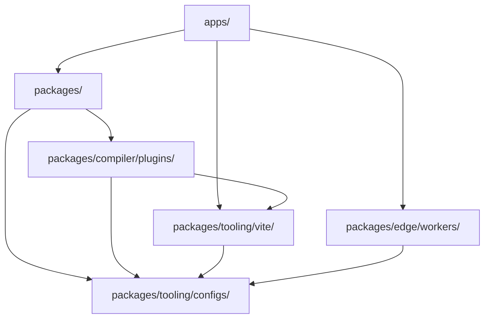

# هندسة منصة المهمة

ترجمة آلية مساعدة من المصدر الإنجليزي الأساسي. تُراجع يدويًا عند الحاجة. تبقى أسماء الحزم والأوامر والمسارات والمعرّفات التقنية دون تغيير.

> docs/architecture.md: [docs/architecture.md](../../architecture.md)
> اللغة: العربية (ar)

تم تصميم Mission Platform لتحقيق أقصى قدر من قابلية إعادة الاستخدام والمرونة عبر الإطارات. تشرح هذه الوثيقة
المبادئ المعمارية، والمحرك المحايد للإطار، وأنظمة البناء التي تعمل على تشغيل النظام الأساسي.

## المخطط المعماري

تتبع المنصة **بنية قابلة للتركيب وقائمة على الحزمة**. وهذا يعني أن التطبيقات ليست متجانسة؛
بدلاً من ذلك، فهي "تتكون" من العديد من الحزم الصغيرة والمستقلة التي تعالج كل منها مشكلة معينة (على سبيل المثال، التوجيه،
التدويل، مكونات واجهة المستخدم).

### القاعدة الذهبية: اتجاه التبعية

يتم فرض تدفق تبعية صارم في اتجاه واحد عبر monorepo لمنع التبعيات الدائرية والحفاظ على الوضوح
الحدود:

1. **التطبيقات (`apps/`)**: تستهلك الحزم والمكونات الإضافية Vite والعاملين. لا يقومون أبدًا بتصدير التعليمات البرمجية إلى أجزاء أخرى من الملف
   com.monorepo.
2. **الحزم (`packages/`)**: توفير منطق ومكونات قابلة لإعادة الاستخدام. يمكنهم الاعتماد على بعضهم البعض ولكن ليس عليهم أبدًا
   التطبيقات.
3. **Forge plugins (`packages/compiler/plugins/`)**: أهداف مخرجات المترجم - المكونات الإضافية لإطار العمل وأهداف CMS. قد يعتمدون عليها
   `packages/tooling/vite/` و`packages/tooling/configs/`، وليس على `apps/` أو على الأشقاء لبعضهم البعض؛ محول CMS يعتمد فقط على
   `forge-cms-plugin-api`.
4. **التكوينات (`packages/tooling/configs/`)**: إعدادات الأدوات المشتركة (ESLint، TypeScript، وما إلى ذلك). هم الأساس ويعتمدون عليه
   لا شيء داخل monorepo.

## محرك محايد الإطار: صياغة

قلب Mission Platform هو `@mission-platform/forge-jsx`، وهو نموذج تأليف محايد للإطار للمكونات و
مواد مركبة. `@mission-platform/vite-plugin-forge` هو برنامج تشغيل المترجم المحايد: فهو يقوم بتوزيع المصدر وتطبيعه
Oxc، يبني IR الدلالي، ويدير التحليل المشترك والتحسين، ويرسل إلى مصدر تم توفيره بشكل صريح
`FrameworkOutputPlugin`.

حزم الإطار مثل `@mission-platform/forge-plugin-react`، `@mission-platform/forge-plugin-vue`،
`@mission-platform/forge-plugin-solid`، `@mission-platform/forge-plugin-svelte`، و
`@mission-platform/forge-plugin-web-components` خفض الهدف الخاص، وتحسين الهدف، وتوليد المصدر الأصلي،
التشخيص وبيانات تعريف وقت التشغيل ومحولات Vite/tsdown. لا يوجد باعث إطار مركزي أو سلسلة إلى إطار عمل
التسجيل في برنامج التشغيل. يتم تسجيل الأهداف المخصصة من خلال تطبيق `FrameworkOutputPlugin` بفتحة
`FrameworkId` (`JsxFramework | (string & {})`)، بينما يظل `JsxFramework` اتحادًا مغلقًا لوسائل الراحة المضمنة.
تحدد تكوينات بناء الحزمة مثيلات المكونات الإضافية التي تنشرها، بحيث تظل تبعيات التنفيذ المستهدفة كما هي
حدود الإطار.

التدفق الناتج هو **تحليل/تطبيع (Oxc) → تحسين محايد → IR الدلالي → الهدف السفلي → تحسين الهدف → إنشاء →
البناء الأصلي **. إن التخفيض وتحسين الهدف مطلوبان بشكل صارم قبل الإنشاء؛ تقبل المولدات المستهدفة فقط
تم التحقق من صحة النوايا المنخفضة بواسطة `assertTargetIntentionsLowered`. يتم تنفيذ البناء الأصلي بواسطة البرنامج المساعد المحدد
Vite أو محول tsdown، والذي يوفر أيضًا إعلانات الهدف والبيانات الخارجية واصطلاحات الإخراج.

يعرض المحور المتعامد الثاني نفس المكونات المحايدة على **أنظمة المحتوى**.
تمتلك `@mission-platform/forge-cms-plugin-api` نموذج محتوى محايد للنظام الأساسي، وعقد `CmsOutputPlugin`، و
سائق عام حزم المحول `forge-cms-storyblok`، `forge-cms-astro`، `forge-cms-ghost`، `forge-cms-jekyll`،
و`forge-cms-webflow` يمتلك كل منهما منصة واحدة. يشكل هدف نظام إدارة المحتوى (CMS) مكونًا إضافيًا لإطار العمل بدلاً من استبداله
يتم إقران أي نظام أساسي مع أي إطار عمل ويصل الإخراج إلى `dist/cms/<cms>/<framework>/**`.

للحصول على خط الأنابيب الكامل، والمستهلكين المكونين والربط، وإسقاط CMS، وتوجيهات الامتداد، راجع
[خط أنابيب صياغة المترجم](../../../packages/tooling/vite/forge/docs/locales/ar/reference/compiler.md). للحصول على طريقة عرض تزامن البناء، راجع
[نظام البناء](build-system.md).

## تصميم نظام رمزي

يتم الحفاظ على الاتساق البصري من خلال نظام رمزي متطور للتصميم تتم إدارته بواسطة `@mission-platform/tokens`.

- **معيار DTCG**: تم تأليف الرموز المميزة بتنسيق مجموعة W3C Design Tokens Community Group (الإصدار 2025.10).
- **مساحة ألوان OKLab**: تستخدم البدائيات مساحة ألوان OKLab للتدرجات والموضوعات الموحدة بشكل إدراكي.
- **العناصر الآلية**: يقوم `@mission-platform/vite-plugin-tokens` تلقائيًا بإنشاء متغيرات SCSS، وCSS مخصص
  الخصائص والثوابت TypeScript من مصدر واحد للحقيقة.

## إطار التوجيه الملحد وI18n

تم تصميم خدمات التطبيقات الأساسية مثل التوجيه والتدويل لتكون مستقلة عن إطار العمل.

- **`@mission-platform/router`**: يوفر أهداف مسار منظمة، ومساعدين محددين لعنوان URL/الموقع، وعلامات المترجم مثل
  مثل `MpLink`، و`useMpRoute`، و`useMpRouter`، و`MpRouterView`. ليس لديه إطار عمل لواجهة المستخدم أو وقت تشغيل مكتبة جهاز التوجيه
  التبعيات ولا يمتلك أبدًا جدول توجيه التطبيق.
- **تشكيل أهداف جهاز التوجيه**: `@mission-platform/forge-router-vue`، `-react`، `-solid`، `-svelte`، `-redwood`، و
  يقوم `-web-components` بخفض تلك العلامات إلى جهاز التوجيه الأصلي الذي حدده التطبيق المستهلك. تحتفظ التطبيقات
  ملكية تعريفات المسار الأصلي، والموفرين، والحراس، والمحملين، ومثيلات جهاز التوجيه؛ الهدف يزود فقط
  قدرات الاستهلاك.
- **`@mission-platform/i18n`**: غلاف حول `i18next` يوفر مصنع `createForgeI18N` عالمي.
  توفر المحولات الخاصة بإطار العمل خطافات ومكونات `useI18n` لـ Vue وReact.

## استراتيجية البناء والنشر

### تنسيق المهام مع Turborepo

يتعامل Turborepo مع الرفع الثقيل للبناء والاختبار والبطانة عبر monorepo. ويستخدم ذاكرة تخزين مؤقت عالمية ل
التأكد من أن المهام يتم تنفيذها فقط عندما تتغير مدخلاتها.

### الإصدارات التي تعمل بالطاقة Vite

تستخدم كل حزمة وتطبيق Vite للتطوير وبناء الإنتاج، مع الاستفادة من التكوين الأساسي المشترك من
`@mission-platform/vite-config`.

### نشر Cloudflare

يتم نشر التطبيقات بشكل أساسي على **Cloudflare Pages**، مع توفير **Cloudflare Workers** (تحت `packages/edge/workers/`)
منطق متخصص لوكيل API وخدمة أصول SPA.

## ملخص

تعطي بنية Mission Platform الأولوية للعزل وسلامة النوع ومرونة الإطار. عن طريق فصل النواة
المنطق من إطار عمل واجهة المستخدم وفرض اتجاه تبعية صارم، يضمن النظام الأساسي إمكانية الصيانة على المدى الطويل
وقابلية التوسع للأنظمة البيئية للتطبيقات المعقدة.
