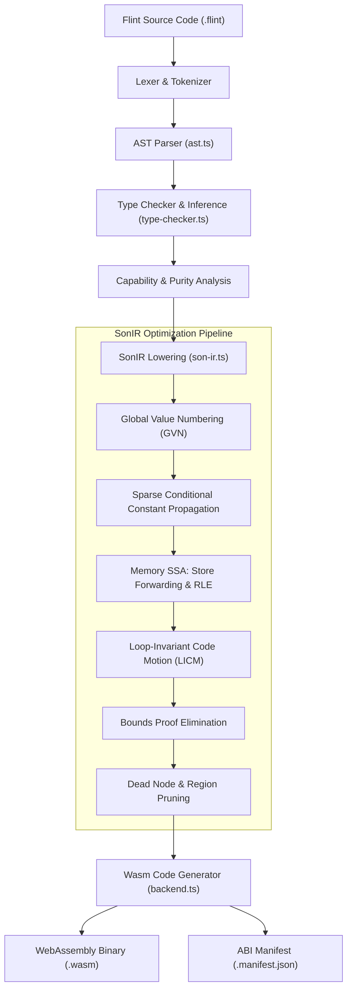
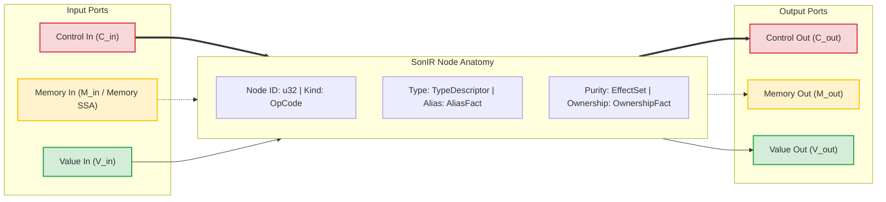
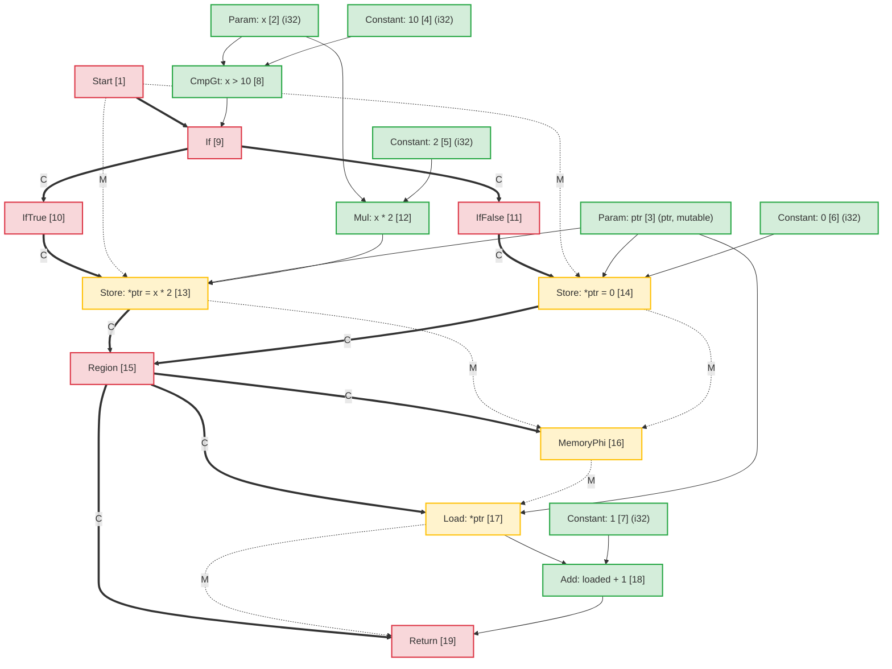
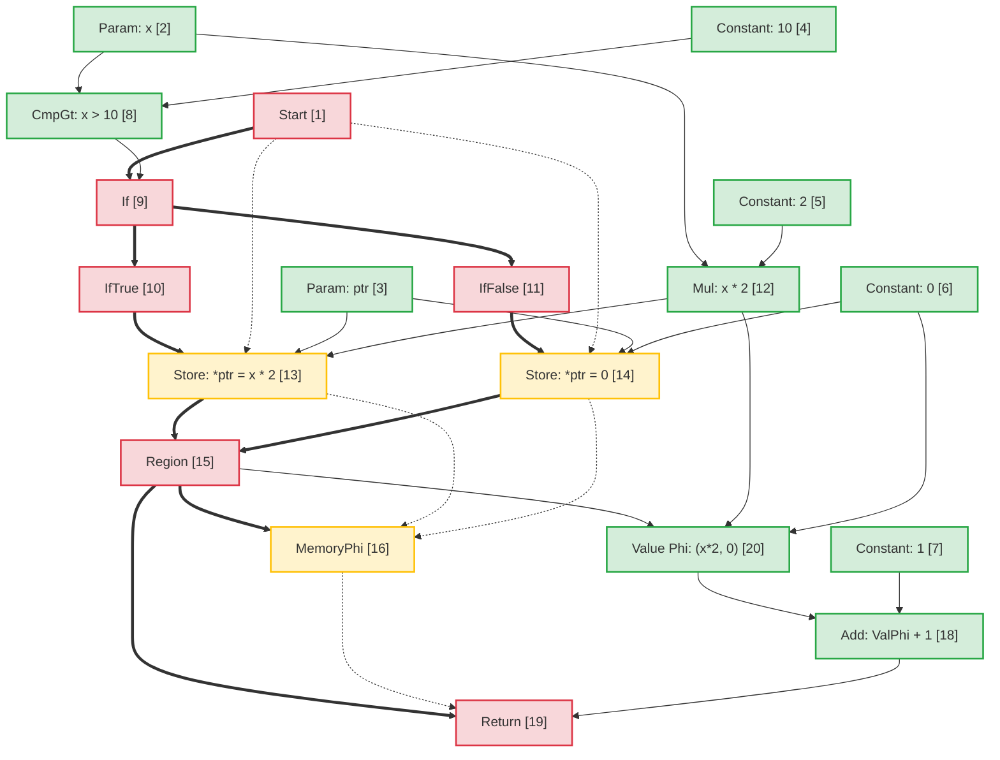
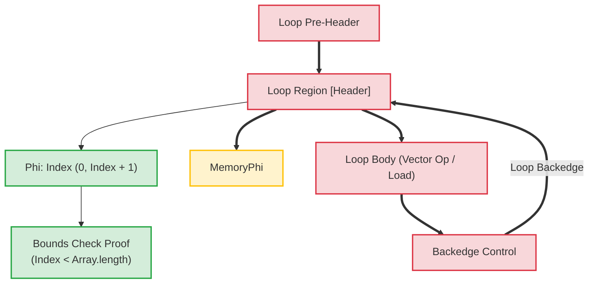

# بنية مترجم فلينت: التمثيل المتوسط ​​لبحر العقد (SonIR)

ترجمة آلية مساعدة من المصدر الإنجليزي الأساسي. تُراجع يدويًا عند الحاجة. تبقى أسماء الحزم والأوامر والمسارات والمعرّفات التقنية دون تغيير.

> docs/architecture/compiler-pipelines.md: [docs/architecture/compiler-pipelines.md](../../../architecture/compiler-pipelines.md)
> اللغة: العربية (ar)

توفر هذه الوثيقة المواصفات المعمارية لخط أنابيب برنامج التحويل البرمجي **Flint**، مع التركيز على تمثيله الوسيط الأساسي: **SonIR** (Sea-of-Nodes IR).

تقوم SonIR بتكييف حساب التفاضل والتكامل Sea-of-Nodes الخاص بـ Cliff Click لتجميع WebAssembly عالي الأداء. من خلال توحيد تدفق التحكم، وتدفق البيانات النقي، والتأثيرات الجانبية للذاكرة في رسم بياني واحد مع منافذ مكتوبة بشكل واضح، يتيح SonIR تمريرات التحسين القوية - بما في ذلك ترقيم القيمة العالمية (GVN)، والنشر الشرطي الثابت المتناثر (SCCP)، وإزالة التحميل الزائد للذاكرة SSA (RLE)، وحركة التعليمات البرمجية غير المتغيرة (LICM)، وإزالة إثبات حدود وقت الترجمة.

---

## 1. خط أنابيب التجميع رفيع المستوى

يحول خط أنابيب برنامج التحويل البرمجي Flint كود مصدر Flint عالي المستوى إلى WebAssembly الذي تم التحقق منه ومخفف القدرة:



---

## 2. نموذج SonIR المعماري: بحر العقد ثلاثي المنافذ

في بنيات المترجم التقليدية، يتم تمثيل تدفق التحكم كرسم بياني لتدفق التحكم (CFG) للكتل الأساسية، بينما يتم تمثيل تدفق البيانات داخل الكتل الأساسية عبر سجلات SSA. يؤدي هذا الفصل إلى إنشاء حمل إضافي للمزامنة أثناء عمليات التحسين مثل حركة التعليمات البرمجية أو إزالة التعبير الزائد.

يقوم SonIR بإزالة حدود الكتلة الأساسية. يتم تمثيل الوظائف كرسم بياني موجه موحد حيث تقوم العقد بحساب القيم أو تنفيذ التأثيرات، وتمثل الحواف التبعيات. للحفاظ على السلامة، يقوم كل node بفصل حواف الإدخال والإخراج بشكل صريح عبر **ثلاث فئات متميزة للمنافذ**:



### 2.1 فئات الحواف الثلاثة / المنافذ

| فئة المنفذ |   تدوين الحافة | دلالات وضمانات الترتيب | العقد التمثيلية |
| :------------- | :----------------: | :-------------------------------------------------------------------------------------------------------------------------------------------------------------------------------------------------------------- | :------------------------------------------------------------- |
| **التحكم** | Solid غامق (`==>`) | يحكم أمر التنفيذ المتسلسل، وقرارات التفرع المشروط، ورؤوس الحلقات، وإنهاء الوظيفة. لا تحتوي عقد القيمة النقية على مدخلات تحكم.                                                           | `Start`، `Region`، `If`، `IfTrue`، `IfFalse`، `Loop`، `Return` |
| **ذاكرة SSA** |  متقطع (`-.->`) | المواضيع رموز حالة الذاكرة المجردة التي تمثل تبعيات التأثير. يضمن التزام عمليات التحميل/التخزين بقيود القراءة بعد الكتابة والكتابة بعد الكتابة دون الإفراط في تقييد الذاكرة المستقلة. | `MemoryPhi`، `Load`، `Store`، `HeapAlloc`، `Fence`، `Call` |
| **القيمة** | Solid رفيع (`-->`) | يحمل قيمًا خالصة ونتائج حسابية. خالية من قيود التحكم في التدفق؛ يمكن للعقد ذات مدخلات القيمة النقية أن تطفو بحرية في بحر العقد، وتخضع فقط لتبعيات البيانات.                             | `Constant`، `Add`، `Sub`، `Mul`، `Cmp`، `Phi`، `VectorAdd` |

---

## 3. التشريح Node والتمثيل TypeScript

ضمن `@mission-platform/flint`، يتم تمثيل العقد بواسطة واجهة `FlintSoNNode` ويتم تسلسلها إلى عناصر وحدة `.sonir.json` الحتمية.

### 3.1 هيكل الواجهة Node

```typescript
export interface FlintSoNNode {
  /** Unique sequential identifier within the compilation unit */
  readonly id: number;
  /** Operation classification (e.g., 'start', 'constant', 'load', 'store', 'region', 'if', 'return') */
  readonly kind: string;
  /** Enclosing function name */
  readonly functionName: string;
  /** Input node dependencies (in SonIR 2.0 partitioned into control, memory, and value inputs) */
  readonly inputs: readonly number[];
  /** Effect classifications: 'pure' | 'read' | 'write' | 'call' | 'control' | 'allocation' | 'unknown' */
  readonly effects: readonly FlintSoNEffect[];
  /** Alias analysis classification: 'none' | 'local' | 'borrowed' | 'mutable' | 'unknown' */
  readonly alias: FlintSoNAliasFact;
  /** Affine ownership classification: 'value' | 'borrowed' | 'owned' | 'shared' | 'unknown' */
  readonly ownership: FlintSoNOwnershipFact;
  /** Value type representation (e.g., 'i32', 'f64', 'bool', 'ptr', 'v128') */
  readonly type?: string;
  /** Literal constant payload */
  readonly value?: boolean | number | string;
  /** Callee name for call nodes */
  readonly callee?: string;
  /** Source span provenance for diagnostics and debugging */
  readonly span?: FlintSourceSpan;
}
```

### 3.2 تصنيفات Node وتوجيه المنافذ

```
┌─────────────────┬─────────────────────┬─────────────────────┬──────────────────────┐
│ Node OpCode     │ Incoming Ports      │ Outgoing Ports      │ Description          │
├─────────────────┼─────────────────────┼─────────────────────┼──────────────────────┤
│ Start           │ None                │ Control, Memory     │ Function entry point │
│ Constant        │ None                │ Value               │ Literal constant     │
│ Add / Sub / Mul │ Value, Value        │ Value               │ Pure arithmetic      │
│ If              │ Control, Value      │ Control (T/F proj)  │ Branch predicate     │
│ IfTrue / False  │ Control (from If)   │ Control             │ Branch projection    │
│ Region          │ Control, Control    │ Control             │ Control merge point  │
│ Phi             │ Region, Value, Val  │ Value               │ Value merge point    │
│ MemoryPhi       │ Region, Mem, Mem    │ Memory              │ Memory SSA merge     │
│ Load            │ Control, Mem, Ptr   │ Memory, Value       │ Heap / stack read    │
│ Store           │ Control, Mem, Ptr, V│ Memory              │ Heap / stack write   │
│ Return          │ Control, Mem, Value │ None                │ Function exit        │
└─────────────────┴─────────────────────┴─────────────────────┴──────────────────────┘
```

---

## 4. تحليل الاسم المستعار والذاكرة SSA

تعامل ذاكرة SSA الذاكرة كرمز مميز للقيمة الصريحة. يستهلك `Store` node رمز الذاكرة $M_{in}$ ويصدر رمزًا مميزًا جديدًا $M_{out}$. يأخذ `Load` node رمز الذاكرة $M_{in}$ والعنوان $V_{ptr}$، وينبعث منه القيمة المحملة $V_{out}$ ويحمل رمز الذاكرة إلى الأمام.

### 4.1 تصنيف تحليل الاسم المستعار

يتم وضع علامة على كل node الذي يحمل عناوين الذاكرة أو يعالجها بحقيقة الاسم المستعار:

- **`none`**: قيم أولية خالصة (عددية) أو عقد لا تحتوي على أي اتجاه غير مباشر للذاكرة.
- **`local`**: الذاكرة المخصصة في إطار أو منطقة التنشيط الحالية. ضمان عدم الهروب من النطاق المحلي؛ لا يمكن الوصول إليها للمتصلين.
- **`borrowed`**: مرجع غير قابل للتغيير (`&T`) إلى الذاكرة المملوكة في مكان آخر. لا يمكن تعديله من خلال هذا المقبض؛ القراءات المتزامنة آمنة.
- **`mutable`**: مرجع حصري قابل للتغيير (`&mut T`). يضمن عدم وجود مرجع آخر يسمي هذه الذاكرة خلال فترة حياتها.
- **`unknown`**: المراجع التي تم تجاوزها، أو عمليات استيراد القدرة، أو مؤشرات الكومة الديناميكية ذات المصدر غير المحدد.

### 4.2 توضيح الاسم المستعار المنفصل في إعادة توجيه من المتجر إلى التحميل

عندما يكون للمؤشرين $P_1$ و$P_2$ نطاقات مستعارة منفصلة بشكل مثبت:
$$\text{AliasClass}(P_1) \cap \text{AliasClass}(P_2) = \emptyset$$

يثبت المحسن أن `Store` إلى $P_2$ لا يمكنه تغيير محتويات $P_1$. هذا يسمح:

1. **إزالة التحميل الزائد (RLE)** عبر المخازن المتداخلة إلى الذاكرة غير المستعارة.
2. **إعادة التوجيه من المتجر إلى التحميل**: يقوم `Load` الذي يتبع `Store` إلى نفس العنوان بإعادة استخدام معامل القيمة المخزنة مباشرة دون انتظار الذاكرة.
3. **إزالة المتجر الميت**: إذا قام مخزنان بالكتابة إلى نفس المؤشر `local` أو `mutable` دون التدخل في عمليات القراءة، فسيتم تقليم المتجر الأول.

---

## 5. مثال على التحويل من طرف إلى طرف: طفرة الذاكرة المشروطة

لتوضيح كيفية تعيين التعليمات البرمجية عالية المستوى إلى SonIR، وإخضاعها للتحسين، وتخفيضها إلى Wasm، خذ بعين الاعتبار وظيفة Flint هذه:

```flint
fn compute(x: i32, ptr: &mut i32) -> i32 {
  if x > 10 {
    *ptr = x * 2;
  } else {
    *ptr = 0;
  }
  return *ptr + 1;
}
```

### 5.1 الرسم البياني الأولي SonIR المنخفض

في الرسم البياني غير الأمثل، يقوم كلا الفرعين بإجراء مخازن مستقلة لـ `ptr`. عند نقطة الدمج، يقوم `Region` node بدمج التحكم، ويقوم `MemoryPhi` بتقارب حالة الذاكرة. يقرأ `Load` اللاحق من `ptr` باستخدام رمز الذاكرة المتقاربة:



### 5.2 تمريرات التحسين وإزالة الأحمال الزائدة (RLE)

أثناء خط أنابيب التحسين:

1. **تحليل SSA للذاكرة**: يقوم المُحسِّن بفحص `Load [17]`. عنوان الإدخال الخاص به هو `ptr [3]`، وإدخال الذاكرة الخاص به هو `MemoryPhi [16]`.
2. **تتبع السلف**:
   - على المسار الوارد `IfTrue`، كتب `StoreThen [13]` `Mul [12]` (`x * 2`) إلى `ptr [3]`.
   - على المسار الوارد `IfFalse`، كتب `StoreElse [14]` `Constant: 0 [6]` إلى `ptr [3]`.
3. **إعادة التوجيه من المتجر إلى التحميل**: نظرًا لأن `ptr` تمت كتابته دون قيد أو شرط على جميع المسارات التي تدخل إلى `Region [15]` و`ptr` له اسم مستعار حصري لـ `mutable` بدون أي عمليات كتابة متداخلة:
   - تم تصنيع **القيمة `Phi`** النقية node في `Region [15]`:
     $$\text{Phi[20] = \text{Phi}(\text{منطقة[15]، \text{Mul[12]، \text{Constant[6])$$
   - يتم استبدال إخراج `Load [17]` بـ `Phi [20]`.
   - لا يحتوي `Load [17]` على أي مستخدمين متبقين ويقوم رمز الذاكرة الخاص به ببساطة بتمرير `MemoryPhi [16]` إلى `Return [19]`. يتم تقليم `Load [17]` كرمز ميت.

### 5.3 الرسم البياني SonIR الأمثل



### 5.4 تعليمات WebAssembly المنبعثة

نظرًا لأنه تم التخلص تمامًا من قراءة الذاكرة في SonIR، فإن WebAssembly المنبعث يتجنب تعليمات `i32.load` باهظة الثمن:

```wat
(func $compute (param $x i32) (param $ptr i32) (result i32)
  (local $val i32)
  local.get $x
  i32.const 10
  i32.gt_s
  if
    local.get $x
    i32.const 1
    i32.shl           ;; x * 2 optimized to shift
    local.tee $val
    local.get $ptr
    i32.store         ;; *ptr = x * 2
  else
    i32.const 0
    local.tee $val
    local.get $ptr
    i32.store         ;; *ptr = 0
  end
  local.get $val      ;; Reuses register value directly from Phi
  i32.const 1
  i32.add             ;; val + 1 without reading memory
  return
)
```

---

## 6. تحويلات الحلقة وتجميع البراهين الخاصة بحدود الزمن

في حلقات الصفيف/المتجه، تحلق نماذج SonIR الرؤوس مع مناطق التحكم `Loop` وعقد `Phi` و`MemoryPhi` المقابلة.



### أبرز التحسين في الحلقات:

1. **حركة الكود الثابتة الحلقية (LICM)**: العقد التي تنشأ مدخلات قيمتها وذاكرتها بالكامل خارج منطقة `Loop` يتم طرحها خارج جسم الحلقة إلى الرأس المسبق.
2. **إزالة إثبات الحدود**: يقوم المترجم بإنشاء فترات زمنية استقرائية لمؤشرات الحلقة ($0 \le i < N$). إذا كان $N \le \text{length}$، فسيتم إثبات أن عمليات التحقق من الحدود آمنة في وقت الترجمة ويتم التخلص منها، مما يؤدي إلى إزالة تعليمات فرع وقت التشغيل من الحلقات الداخلية.
3. **تحويل SIMD**: يتم تخفيض حلقات المصفوفة المتسلسلة الخطية المطابقة للنمط مباشرةً إلى عقد SIMD ذات 128 بت (`v128.load`، `i32x4.add`)، ومعالجة 4 عناصر لكل دورة ساعة.

---

## 7. مخطط قطعة أثرية وتكامل الأدوات

تُصدر كل وحدة Flint مجمعة رسمًا بيانيًا SonIR تم التحقق منه جنبًا إلى جنب مع ثنائيات Wasm:

- اصطلاح مسار القطعة الأثرية: `<target>.sonir.json`
- تقوم أدوات مثل `mcp_mission-platform_flint_inspect_sonir` و`mcp_mission-platform_flint_verify_artifact` بفحص هذه الأداة للتحقق من عمليات التحقق من الحدود، وتجزئة الرسم البياني، والامتثال للقدرة قبل النشر في صناديق الحماية.
