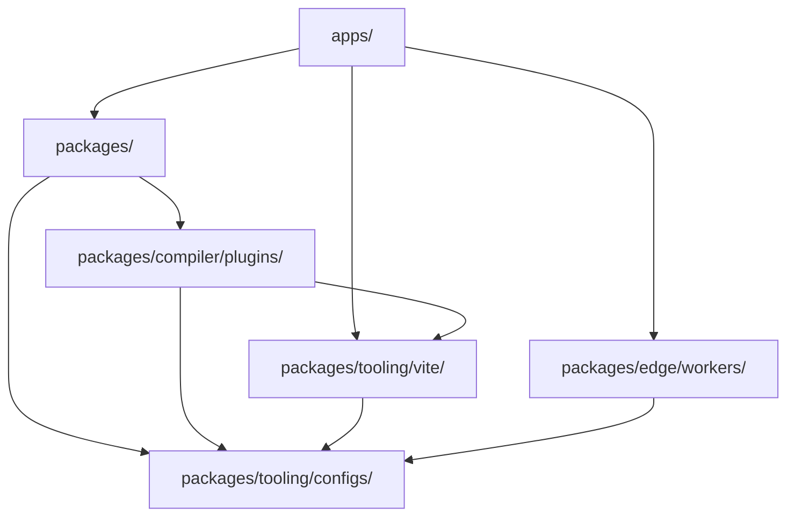

# Missionsplattformarchitektur

Maschinenunterstützte Übersetzung aus der kanonischen englischen Quelle. Bei Bedarf manuell nachprüfen. Paketnamen, Befehle, Pfade und technische Bezeichner bleiben unverändert.

> docs/architecture.md: [docs/architecture.md](../../architecture.md)
> Sprache: Deutsch (de)

Mission Platform ist auf maximale Wiederverwendbarkeit und rahmenübergreifende Flexibilität ausgelegt. Dieses Dokument erklärt die
Architekturprinzipien, die Framework-neutrale Engine und die Build-Systeme, die die Plattform antreiben.

## Architektonischer Entwurf

Die Plattform folgt einer **zusammensetzbaren, paketgesteuerten Architektur**. Das bedeutet, dass Anwendungen nicht monolithisch sind;
Stattdessen sind sie aus vielen kleineren, unabhängigen Paketen „zusammengesetzt“, die jeweils ein bestimmtes Anliegen behandeln (z. B. Routing,
Internationalisierung, UI-Komponenten).

### Die goldene Regel: Abhängigkeitsrichtung

Im gesamten Monorepo wird ein strikter einseitiger Abhängigkeitsfluss erzwungen, um zirkuläre Abhängigkeiten zu verhindern und die Übersichtlichkeit zu gewährleisten
Grenzen:

1. **Anwendungen (`apps/`)**: Pakete, Vite-Plugins und Worker verbrauchen. Sie exportieren niemals Code in andere Teile des
   Monorepo.
2. **Pakete (`packages/`)**: Stellen wiederverwendbare Logik und Komponenten bereit. Sie können sich aufeinander verlassen, aber niemals aufeinander
   Anwendungen.
3. **Forge-Plugins (`packages/compiler/plugins/`)**: Compiler-Ausgabeziele – Framework-Plugins und CMS-Ziele. Sie können sich darauf verlassen
   `packages/tooling/vite/` und `packages/tooling/configs/` und niemals auf `apps/` oder auf den Geschwistern des jeweils anderen; Ein CMS-Adapter hängt nur davon ab
   `forge-cms-plugin-api`.
4. **Konfigurationen (`packages/tooling/configs/`)**: Gemeinsame Werkzeugeinstellungen (ESLint, TypeScript usw.). Sie sind das Fundament und auf sie angewiesen
   nichts im Monorepo.

## Framework-neutrale Engine: Forge

Das Herzstück der Mission Platform ist `@mission-platform/forge-jsx`, ein Framework-neutrales Autorenmodell für Komponenten und
Composables. `@mission-platform/vite-plugin-forge` ist der neutrale Compiler-Treiber: Er analysiert und normalisiert die Quelle mit
Oxc erstellt semantische IR, führt gemeinsame Analysen und Optimierungen durch und sendet sie an eine explizit bereitgestellte
`FrameworkOutputPlugin`.

Framework-Pakete wie `@mission-platform/forge-plugin-react`, `@mission-platform/forge-plugin-vue`,
`@mission-platform/forge-plugin-solid`, `@mission-platform/forge-plugin-svelte` und
`@mission-platform/forge-plugin-web-components` eigene Zielabsenkung, Zieloptimierung, native Quellengenerierung,
Diagnose, Laufzeitmetadaten und Vite/tsdown-Adapter. Es gibt keinen zentralen Framework-Emitter oder String-to-Framework
Registrierung im Treiber. Benutzerdefinierte Ziele werden registriert, indem ein `FrameworkOutputPlugin` mit einem open implementiert wird
`FrameworkId` (`JsxFramework | (string & {})`), während `JsxFramework` eine geschlossene Union für integrierte Annehmlichkeiten bleibt.
Paketerstellungskonfigurationen wählen die Plugin-Instanzen aus, die sie veröffentlichen, sodass die Zielimplementierungsabhängigkeiten bestehen bleiben
die Rahmengrenze.

Der resultierende Fluss ist **parsen/normalisieren (Oxc) → neutral optimieren → semantische IR → Ziel senken → Ziel optimieren → generieren →
nativer Build**. Senkung und Zieloptimierung sind vor der Generierung unbedingt erforderlich; Zielgeneratoren akzeptieren nur
gesenkte Absichten validiert durch `assertTargetIntentionsLowered`. Der native Build wird von den ausgewählten Plugins durchgeführt
Vite oder tsdown-Adapter, der auch die Deklarationen, Externals und Ausgabekonventionen des Ziels bereitstellt.

Eine zweite, orthogonale Achse projiziert dieselben neutralen Komponenten auf **Inhaltsplattformen**.
`@mission-platform/forge-cms-plugin-api` besitzt ein plattformneutrales Inhaltsmodell, den `CmsOutputPlugin`-Vertrag und a
generischer Treiber; die Adapterpakete `forge-cms-storyblok`, `forge-cms-astro`, `forge-cms-ghost`, `forge-cms-jekyll`,
und `forge-cms-webflow` besitzen jeweils eine Plattform. Ein CMS-Ziel _komponiert_ ein Framework-Plugin, anstatt eines zu ersetzen
Alle Plattformpaare werden mit jedem Framework kombiniert und die Ausgabe landet in `dist/cms/<cms>/<framework>/**`.

Die vollständige Pipeline, Komponenten- und Hook-Konsumenten, CMS-Projektion und Erweiterungsanleitungen finden Sie unter
[Forge-Compiler-Pipeline](../../../packages/tooling/vite/forge/docs/locales/de/reference/compiler.md). Informationen zur Build-Orchestrierungsansicht finden Sie unter
[Build-System](build-system.md).

## Design-Token-System

Die visuelle Konsistenz wird durch ein ausgeklügeltes Design-Token-System gewährleistet, das von `@mission-platform/tokens` verwaltet wird.

- **DTCG-Standard**: Token werden im W3C Design Tokens Community Group-Format (v2025.10) erstellt.
- **OKLab-Farbraum**: Primitive nutzen den OKLab-Farbraum für wahrnehmungsmäßig einheitliche Farbverläufe und Themen.
- **Automatisierte Artefakte**: `@mission-platform/vite-plugin-tokens` generiert automatisch SCSS-Variablen, benutzerdefiniertes CSS
  Eigenschaften und TypeScript-Konstanten aus einer einzigen Quelle der Wahrheit.

## Framework-unabhängiges Routing und I18n

Kernanwendungsdienste wie Routing und Internationalisierung sind Framework-unabhängig konzipiert.

- **`@mission-platform/router`**: Bietet strukturierte Routenziele, reine URL-/Standort-Helfer und Compiler-Markierungen wie z
  als `MpLink`, `useMpRoute`, `useMpRouter` und `MpRouterView`. Es gibt kein UI-Framework oder keine Router-Bibliothekslaufzeit
  Abhängigkeiten und besitzt niemals die Routing-Tabelle einer Anwendung.
- **Forge-Router-Ziele**: `@mission-platform/forge-router-vue`, `-react`, `-solid`, `-svelte`, `-redwood` und
  `-web-components` senkt diese Markierungen auf den nativen Router, der von der verbrauchenden Anwendung ausgewählt wurde. Bewerbungen bleiben erhalten
  Besitz nativer Routendefinitionen, Anbieter, Wächter, Lader und Router-Instanzen; Das Ziel liefert nur
  Verbrauchsmöglichkeiten.
- **`@mission-platform/i18n`**: Ein Wrapper um `i18next`, der eine universelle `createForgeI18N`-Factory bereitstellt.
  Frameworkspezifische Adapter stellen `useI18n`-Hooks und Komponenten für Vue und React bereit.

## Build- und Bereitstellungsstrategie

### Aufgabenorchestrierung mit Turborepo

Turborepo übernimmt die schwere Arbeit des Aufbaus, Testens und Flusens im gesamten Monorepo. Es verwendet einen globalen Cache, um
Stellen Sie sicher, dass Aufgaben nur dann ausgeführt werden, wenn sich ihre Eingaben geändert haben.

### Vite-basierte Builds

Jedes Paket und jede App verwendet Vite für Entwicklungs- und Produktions-Builds und nutzt dabei eine gemeinsam genutzte Basiskonfiguration von
`@mission-platform/vite-config`.

### Cloudflare-Bereitstellung

Anwendungen werden hauptsächlich auf **Cloudflare Pages** bereitgestellt, wobei **Cloudflare Workers** (unter `packages/edge/workers/`) bereitgestellt wird
Speziallogik für API-Proxying und SPA-Asset-Serving.

## Zusammenfassung

Bei der Mission Platform-Architektur stehen Isolation, Typsicherheit und Framework-Flexibilität im Vordergrund. Durch die Entkopplung des Kerns
Durch die Integration der Logik aus dem UI-Framework und die Durchsetzung einer strikten Abhängigkeitsrichtung gewährleistet die Plattform eine langfristige Wartbarkeit
und Skalierbarkeit für komplexe Anwendungsökosysteme.
