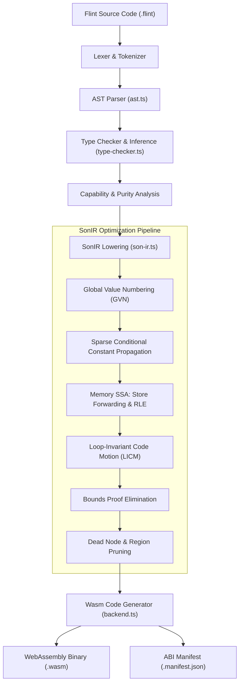
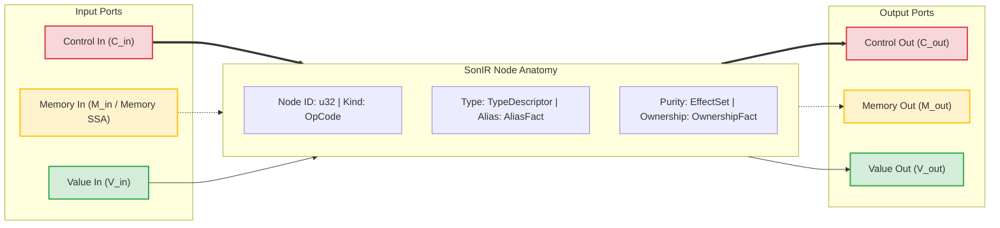
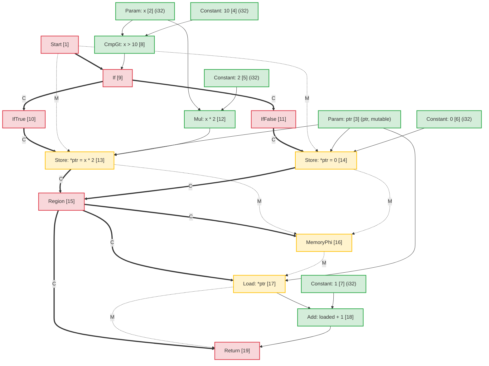
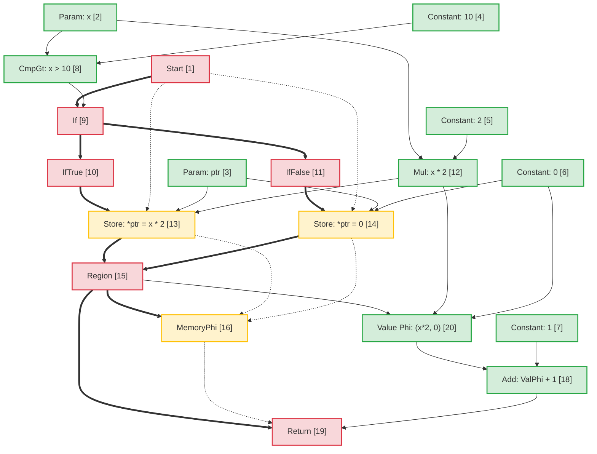
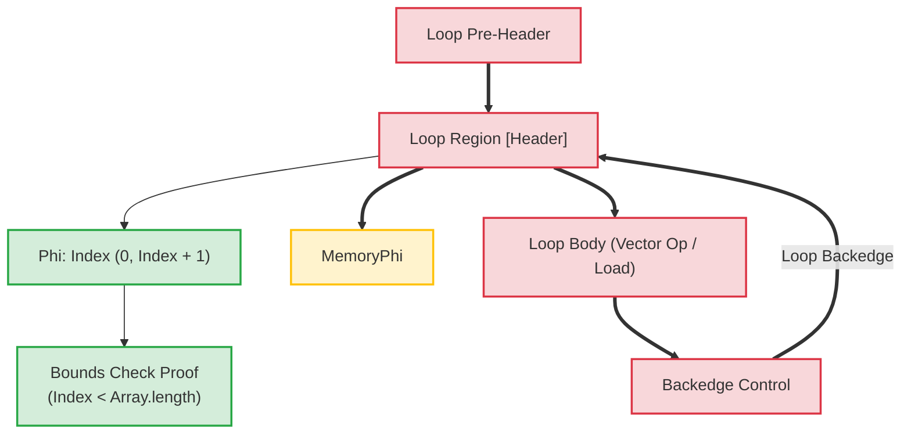

# Flint-Compiler-Architektur: Sea-of-Nodes Intermediate Representation (SonIR)

Maschinenunterstützte Übersetzung aus der kanonischen englischen Quelle. Bei Bedarf manuell nachprüfen. Paketnamen, Befehle, Pfade und technische Bezeichner bleiben unverändert.

> docs/architecture/compiler-pipelines.md: [docs/architecture/compiler-pipelines.md](../../../architecture/compiler-pipelines.md)
> Sprache: Deutsch (de)

Dieses Dokument stellt die Architekturspezifikation für die **Flint**-Compiler-Pipeline bereit und konzentriert sich auf ihre zentrale Zwischendarstellung: **SonIR** (Sea-of-Nodes IR).

SonIR passt den Sea-of-Nodes-Kalkül von Cliff Click an die leistungsstarke WebAssembly-Kompilierung an. Durch die Vereinheitlichung von Kontrollfluss, reinem Datenfluss und Speichernebeneffekten in einem einzigen Diagramm mit explizit typisierten Ports ermöglicht SonIR aggressive Optimierungsdurchgänge – einschließlich Global Value Numbering (GVN), Sparse Conditional Constant Propagation (SCCP), Memory SSA Redundant Load Elimination (RLE), Loop-Invariant Code Motion (LICM) und Compile-Time Bounds Proof Elimination.

---

## 1. Kompilierungspipeline auf hoher Ebene

Die Flint-Compiler-Pipeline wandelt Flint-Quellcode auf hoher Ebene in verifizierte, funktionsreduzierte WebAssembly um:



---

## 2. SonIR-Architekturmodell: Das Triple-Port-Sea-of-Nodes

In herkömmlichen Compiler-Architekturen wird der Kontrollfluss als Kontrollflussgraph (CFG) von Basisblöcken dargestellt, während der Datenfluss innerhalb von Basisblöcken über SSA-Register dargestellt wird. Durch diese Trennung entsteht ein Synchronisierungsaufwand bei Optimierungsdurchgängen wie Codebewegung oder Eliminierung redundanter Ausdrücke.

SonIR eliminiert grundlegende Blockgrenzen. Funktionen werden als einheitlicher gerichteter Graph dargestellt, in dem Knoten Werte berechnen oder Effekte ausführen und Kanten Abhängigkeiten darstellen. Um die Solidität zu gewährleisten, trennt jedes node seine Eingabe- und Ausgabekanten explizit auf **drei verschiedene Portkategorien**:



### 2.1 Die drei Edge-/Port-Kategorien

| Hafenkategorie |   Kantennotation | Semantik- und Ordnungsgarantien | Repräsentative Knoten |
| :------------- | :----------------: | :-------------------------------------------------------------------------------------------------------------------------------------------------------------------------------------------------------------- | :------------------------------------------------------------- |
| **Kontrolle** | Solid Fett (`==>`) | Reguliert die sequentielle Ausführungsreihenfolge, bedingte Verzweigungsentscheidungen, Schleifenheader und die Funktionsbeendigung. Reine Wertknoten haben keine Steuereingänge.                                                           | `Start`, `Region`, `If`, `IfTrue`, `IfFalse`, `Loop`, `Return` |
| **Speicher-SSA** |  Gestrichelt (`-.->`) | Threads abstrahieren Speicherzustandstoken, die Effektabhängigkeiten darstellen. Stellt sicher, dass Lade-/Speichervorgänge die Lese-nach-Schreib- und Schreib-nach-Schreib-Einschränkungen einhalten, ohne den unabhängigen Speicher übermäßig einzuschränken. | `MemoryPhi`, `Load`, `Store`, `HeapAlloc`, `Fence`, `Call` |
| **Wert** | Solid Dünn (`-->`) | Trägt reine Werte und arithmetische Ergebnisse. Frei von Kontrollflussbeschränkungen; Knoten mit reinen Werteingaben können frei im Knotenmeer schweben und unterliegen nur Datenabhängigkeiten.                             | `Constant`, `Add`, `Sub`, `Mul`, `Cmp`, `Phi`, `VectorAdd` |

---

## 3. Node Anatomie und TypeScript Darstellung

Innerhalb von `@mission-platform/flint` werden Knoten durch die Schnittstelle `FlintSoNNode` dargestellt und in deterministische Modulartefakte `.sonir.json` serialisiert.

### 3.1 Node-Schnittstellenstruktur

```typescript
export interface FlintSoNNode {
  /** Unique sequential identifier within the compilation unit */
  readonly id: number;
  /** Operation classification (e.g., 'start', 'constant', 'load', 'store', 'region', 'if', 'return') */
  readonly kind: string;
  /** Enclosing function name */
  readonly functionName: string;
  /** Input node dependencies (in SonIR 2.0 partitioned into control, memory, and value inputs) */
  readonly inputs: readonly number[];
  /** Effect classifications: 'pure' | 'read' | 'write' | 'call' | 'control' | 'allocation' | 'unknown' */
  readonly effects: readonly FlintSoNEffect[];
  /** Alias analysis classification: 'none' | 'local' | 'borrowed' | 'mutable' | 'unknown' */
  readonly alias: FlintSoNAliasFact;
  /** Affine ownership classification: 'value' | 'borrowed' | 'owned' | 'shared' | 'unknown' */
  readonly ownership: FlintSoNOwnershipFact;
  /** Value type representation (e.g., 'i32', 'f64', 'bool', 'ptr', 'v128') */
  readonly type?: string;
  /** Literal constant payload */
  readonly value?: boolean | number | string;
  /** Callee name for call nodes */
  readonly callee?: string;
  /** Source span provenance for diagnostics and debugging */
  readonly span?: FlintSourceSpan;
}
```

### 3.2 Node-Klassifizierungen und Port-Routing

```
┌─────────────────┬─────────────────────┬─────────────────────┬──────────────────────┐
│ Node OpCode     │ Incoming Ports      │ Outgoing Ports      │ Description          │
├─────────────────┼─────────────────────┼─────────────────────┼──────────────────────┤
│ Start           │ None                │ Control, Memory     │ Function entry point │
│ Constant        │ None                │ Value               │ Literal constant     │
│ Add / Sub / Mul │ Value, Value        │ Value               │ Pure arithmetic      │
│ If              │ Control, Value      │ Control (T/F proj)  │ Branch predicate     │
│ IfTrue / False  │ Control (from If)   │ Control             │ Branch projection    │
│ Region          │ Control, Control    │ Control             │ Control merge point  │
│ Phi             │ Region, Value, Val  │ Value               │ Value merge point    │
│ MemoryPhi       │ Region, Mem, Mem    │ Memory              │ Memory SSA merge     │
│ Load            │ Control, Mem, Ptr   │ Memory, Value       │ Heap / stack read    │
│ Store           │ Control, Mem, Ptr, V│ Memory              │ Heap / stack write   │
│ Return          │ Control, Mem, Value │ None                │ Function exit        │
└─────────────────┴─────────────────────┴─────────────────────┴──────────────────────┘
```

---

## 4. Alias-Analyse und Speicher-SSA

Speicher-SSA behandelt Speicher als explizites Werttoken. Ein `Store` node verbraucht ein Speichertoken $M_{in}$ und gibt ein neues Token $M_{out}$ aus. Ein `Load` node nimmt ein Speichertoken $M_{in}$ und eine Adresse $V_{ptr}$, gibt den geladenen Wert $V_{out}$ aus und trägt das Speichertoken weiter.

### 4.1 Klassifizierung der Alias-Analyse

Jeder node, der Speicheradressen trägt oder manipuliert, ist mit einem Alias-Fakt gekennzeichnet:

- **`none`**: Reine Grundwerte (Skalare) oder Knoten ohne Speicherindirektion.
– **`local`**: Im aktuellen Aktivierungsrahmen oder in der aktuellen Aktivierungsregion zugewiesener Speicher. Garantiert, dass es dem lokalen Geltungsbereich nicht entgeht; für Anrufer unzugänglich.
– **`borrowed`**: Ein unveränderlicher Verweis (`&T`) auf Speicher, der sich anderswo befindet. Kann über dieses Handle nicht geändert werden; Gleichzeitige Lesevorgänge sind sicher.
- **`mutable`**: Eine exklusive veränderbare Referenz (`&mut T`). Garantiert, dass dieser Speicher während seiner Lebensdauer nicht von einer anderen Referenz aliasiert wird.
– **`unknown`**: Escape-Referenzen, Funktionsimporte oder dynamische Heap-Zeiger mit unbestimmter Herkunft.

### 4.2 Disjunkte Alias-Begriffsklärung bei der Store-to-Load-Weiterleitung

Wenn zwei Zeiger $P_1$ und $P_2$ nachweislich disjunkte Alias-Domänen haben:
$$\text{AliasClass}(P_1) \cap \text{AliasClass}(P_2) = \emptyset$$

Der Optimierer beweist, dass ein `Store` zu $P_2$ den Inhalt von $P_1$ nicht ändern kann. Dies ermöglicht:

1. **Redundant Load Elimination (RLE)** zwischen dazwischen liegenden Speichern und nicht-aliasiertem Speicher.
2. **Store-to-Load-Weiterleitung**: Ein `Load`, das einem `Store` an dieselbe Adresse folgt, verwendet den gespeicherten Wertoperanden direkt wieder, ohne auf den Speicher zu warten.
3. **Beseitigung toter Speicher**: Wenn zwei Speicher ohne dazwischenliegende Lesevorgänge auf denselben `local`- oder `mutable`-Zeiger schreiben, wird der erste Speicher bereinigt.

---

## 5. Beispiel einer End-to-End-Transformation: Bedingte Gedächtnismutation

Um zu veranschaulichen, wie High-Level-Code SonIR zugeordnet wird, optimiert wird und auf Wasm reduziert wird, betrachten Sie diese Flint-Funktion:

```flint
fn compute(x: i32, ptr: &mut i32) -> i32 {
  if x > 10 {
    *ptr = x * 2;
  } else {
    *ptr = 0;
  }
  return *ptr + 1;
}
```

### 5.1 Anfänglich abgesenktes SonIR-Diagramm

Im nicht optimierten Diagramm führen beide Zweige unabhängige Speicherungen in `ptr` durch. Am Zusammenführungspunkt konvergiert ein `Region` node die Steuerung und ein `MemoryPhi` konvergiert den Speicherstatus. Der nachfolgende `Load` liest aus `ptr` unter Verwendung des konvergierten Speichertokens:



### 5.2 Optimierungsdurchläufe und Beseitigung redundanter Lasten (RLE)

Während der Optimierungspipeline:

1. **Speicher-SSA-Analyse**: Der Optimierer prüft `Load [17]`. Sein Adresseingang ist `ptr [3]` und sein Speichereingang ist `MemoryPhi [16]`.
2. **Vorgängerverfolgung**:
   – Auf dem eingehenden Pfad `IfTrue` hat `StoreThen [13]` `Mul [12]` (`x * 2`) in `ptr [3]` geschrieben.
   – Auf dem eingehenden Pfad `IfFalse` schrieb `StoreElse [14]` `Constant: 0 [6]` bis `ptr [3]`.
3. **Store-to-Load-Weiterleitung**: Da `ptr` bedingungslos auf allen Pfaden geschrieben wurde, die `Region [15]` betreten, und `ptr` über das exklusive `mutable`-Aliasing ohne dazwischenliegende Schreibvorgänge verfügt:
   - Ein reiner **Wert `Phi`** node wird zu `Region [15]` synthetisiert:
     $$\text{Phi}[20] = \text{Phi}(\text{Region}[15], \text{Mul}[12], \text{Konstante}[6])$$
   - Die Ausgabe von `Load [17]` wird durch `Phi [20]` ersetzt.
   – `Load [17]` hat keine verbleibenden Wertbenutzer und sein Speichertoken leitet `MemoryPhi [16]` einfach an `Return [19]` weiter. `Load [17]` wird als toter Code gelöscht.

### 5.3 Optimiertes SonIR-Diagramm



### 5.4 Ausgegebene WebAssembly-Anweisungen

Da das Lesen des Speichers in SonIR vollständig eliminiert wurde, vermeidet die ausgegebene WebAssembly eine teure `i32.load`-Anweisung:

```wat
(func $compute (param $x i32) (param $ptr i32) (result i32)
  (local $val i32)
  local.get $x
  i32.const 10
  i32.gt_s
  if
    local.get $x
    i32.const 1
    i32.shl           ;; x * 2 optimized to shift
    local.tee $val
    local.get $ptr
    i32.store         ;; *ptr = x * 2
  else
    i32.const 0
    local.tee $val
    local.get $ptr
    i32.store         ;; *ptr = 0
  end
  local.get $val      ;; Reuses register value directly from Phi
  i32.const 1
  i32.add             ;; val + 1 without reading memory
  return
)
```

---

## 6. Schleifentransformationen und Beweise für Kompilierzeitgrenzen

In Array-/Vektorschleifen modelliert SonIR Schleifenheader mit `Loop`-Kontrollregionen und entsprechenden `Phi`- und `MemoryPhi`-Knoten.



### Optimierungs-Highlights in Schleifen:

1. **Loop-Invariante Code Motion (LICM)**: Knoten, deren Wert- und Speichereingaben vollständig außerhalb der `Loop`-Region stammen, werden aus dem Schleifenkörper in den Vorheader verschoben.
2. **Elimination von Grenzbeweisen**: Der Compiler erstellt induktive Bereichsintervalle für Schleifenindizes ($0 \le i < N$). Bei $N \le \text{length}$ erweisen sich Grenzprüfungen zur Kompilierungszeit als sicher und werden eliminiert, wodurch Laufzeitverzweigungsanweisungen aus inneren Schleifen entfallen.
3. **SIMD-Vektorisierung**: Lineare sequentielle Array-Schleifen, die dem Muster entsprechen, werden direkt in 128-Bit-SIMD-Knoten (`v128.load`, `i32x4.add`) abgesenkt und verarbeiten 4 Elemente pro Taktzyklus.

---

## 7. Artefaktschema und Tooling-Integration

Jedes kompilierte Flint-Modul gibt sein verifiziertes SonIR-Diagramm neben Wasm-Binärdateien aus:

– Artefaktpfadkonvention: `<target>.sonir.json`
– Tools wie `mcp_mission-platform_flint_inspect_sonir` und `mcp_mission-platform_flint_verify_artifact` untersuchen dieses Artefakt, um Grenzprüfungen, Diagramm-Hashes und Funktionskonformität vor der Bereitstellung in Sandboxen zu überprüfen.
