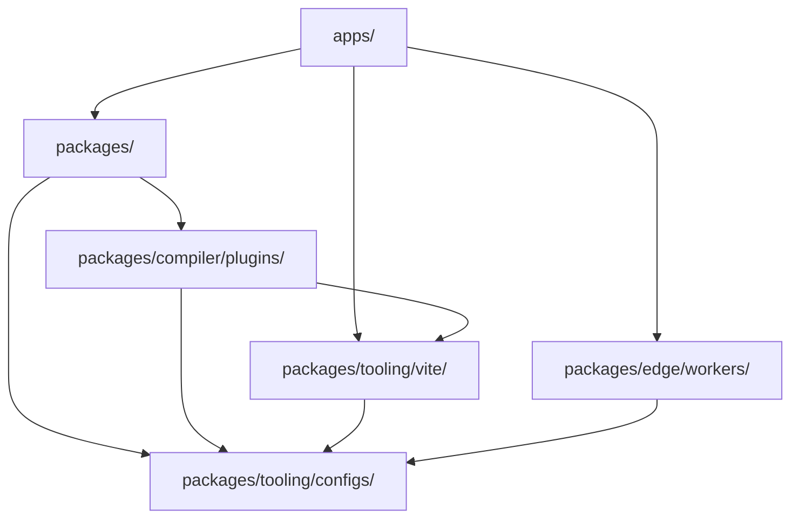

# Arquitectura de la plataforma de la misión

Traducción asistida por máquina a partir de la fuente canónica en inglés. Revisar manualmente cuando sea necesario. Los nombres de paquetes, comandos, rutas e identificadores técnicos no se modifican.

> docs/architecture.md: [docs/architecture.md](../../architecture.md)
> Idioma: Español (es)

Mission Platform está diseñada para ofrecer la máxima reutilización y flexibilidad entre marcos. Este documento explica la
principios arquitectónicos, el motor neutral del marco y los sistemas de construcción que impulsan la plataforma.

## Plano arquitectónico

La plataforma sigue una **arquitectura componible basada en paquetes**. Esto significa que las aplicaciones no son monolíticas;
en cambio, están "compuestos" a partir de muchos paquetes más pequeños e independientes, cada uno de los cuales maneja una preocupación específica (por ejemplo, enrutamiento,
internacionalización, componentes UI).

### La regla de oro: dirección de la dependencia

Se aplica un flujo de dependencia unidireccional estricto en todo el monorepo para evitar dependencias circulares y mantener una relación clara.
límites:

1. **Aplicaciones (`apps/`)**: Consume paquetes, complementos Vite y trabajadores. Nunca exportan código a otras partes del
   monorepo.
2. **Paquetes (`packages/`)**: proporciona lógica y componentes reutilizables. Pueden depender unos de otros pero nunca de
   aplicaciones.
3. **Complementos de Forge (`packages/compiler/plugins/`)**: Destinos de salida del compilador: complementos del marco y destinos de CMS. Pueden depender de
   `packages/tooling/vite/` y `packages/tooling/configs/`, y nunca en `apps/` ni en los hermanos de cada uno; un adaptador CMS depende sólo de
   `forge-cms-plugin-api`.
4. **Configuraciones (`packages/tooling/configs/`)**: Configuración de herramientas compartidas (ESLint, TypeScript, etc.). Son la base y dependen de
   nada dentro del monorepo.

## Motor neutral en el marco: Forge

El corazón de Mission Platform es `@mission-platform/forge-jsx`, un modelo de creación de marco neutral para componentes y
componibles. `@mission-platform/vite-plugin-forge` es el controlador del compilador neutral: analiza y normaliza el código fuente con
Oxc, crea IR semántica, ejecuta análisis y optimización compartidos y envía a un proveedor proporcionado explícitamente.
`FrameworkOutputPlugin`.

Paquetes de marco como `@mission-platform/forge-plugin-react`, `@mission-platform/forge-plugin-vue`,
`@mission-platform/forge-plugin-solid`, `@mission-platform/forge-plugin-svelte` y
`@mission-platform/forge-plugin-web-components` reducción de objetivos propios, optimización de objetivos, generación de fuentes nativas,
diagnósticos, metadatos de tiempo de ejecución y adaptadores Vite/tsdown. No existe un emisor de marco central ni cadena a marco.
registro en el controlador. Los objetivos personalizados se registran implementando un `FrameworkOutputPlugin` con un código abierto
`FrameworkId` (`JsxFramework | (string & {})`), mientras que `JsxFramework` sigue siendo una unión cerrada para comodidades integradas.
Las configuraciones de compilación de paquetes seleccionan las instancias de complementos que publican, por lo que las dependencias de implementación de destino permanecen en
el límite del marco.

El flujo resultante es **analizar/normalizar (Oxc) → optimización neutral → IR semántica → objetivo inferior → optimización de objetivo → generar →
compilación nativa**. La reducción y la optimización del objetivo son estrictamente necesarias antes de la generación; Los generadores de destino solo aceptan
Intenciones reducidas validadas por `assertTargetIntentionsLowered`. La compilación nativa la realiza el complemento seleccionado.
Vite o adaptador tsdown, que también proporciona las declaraciones, los elementos externos y las convenciones de salida del destino.

Un segundo eje ortogonal proyecta los mismos componentes neutrales en **plataformas de contenido**.
`@mission-platform/forge-cms-plugin-api` posee un modelo de contenido de plataforma neutral, el contrato `CmsOutputPlugin` y un
controlador genérico; los paquetes de adaptadores `forge-cms-storyblok`, `forge-cms-astro`, `forge-cms-ghost`, `forge-cms-jekyll`,
y `forge-cms-webflow` poseen cada uno una plataforma. Un destino CMS _compone_ un complemento de marco en lugar de reemplazarlo, por lo que
cualquier plataforma se empareja con cualquier marco y el resultado llega a `dist/cms/<cms>/<framework>/**`.

Para conocer la canalización completa, los consumidores de componentes y ganchos, la proyección de CMS y la guía de extensión, consulte
[Canalización del compilador Forge](../../../packages/tooling/vite/forge/docs/locales/es/reference/compiler.md). Para la vista de orquestación de compilación, consulte
[Construir sistema](build-system.md).

## Sistema de tokens de diseño

La coherencia visual se mantiene a través de un sofisticado sistema de tokens de diseño administrado por `@mission-platform/tokens`.

- **Estándar DTCG**: los tokens se crean en el formato del grupo comunitario de tokens de diseño del W3C (v2025.10).
- **Espacio de color OKLab**: los primitivos utilizan el espacio de color OKLab para gradientes y temas perceptualmente uniformes.
- **Artefactos automatizados**: `@mission-platform/vite-plugin-tokens` genera automáticamente variables SCSS, CSS personalizado
  propiedades y constantes TypeScript de una única fuente de verdad.

## Enrutamiento independiente del marco e I18n

Los servicios de aplicaciones centrales, como el enrutamiento y la internacionalización, están diseñados para ser independientes del marco.

- **`@mission-platform/router`**: proporciona destinos de ruta estructurados, ayudantes de URL/ubicación pura y marcadores de compilador como
  como `MpLink`, `useMpRoute`, `useMpRouter` y `MpRouterView`. No tiene marco de interfaz de usuario ni tiempo de ejecución de biblioteca de enrutador
  dependencias y nunca posee la tabla de rutas de una aplicación.
- **Forjar objetivos de enrutador**: `@mission-platform/forge-router-vue`, `-react`, `-solid`, `-svelte`, `-redwood` y
  `-web-components` baja esos marcadores al enrutador nativo seleccionado por la aplicación consumidora. Las aplicaciones retienen
  propiedad de definiciones de rutas nativas, proveedores, guardias, cargadores e instancias de enrutador; el objetivo solo suministra
  capacidades de consumo.
- **`@mission-platform/i18n`**: Un contenedor alrededor de `i18next` que proporciona una fábrica universal de `createForgeI18N`.
  Los adaptadores específicos del marco proporcionan ganchos y componentes `useI18n` para Vue y React.

## Estrategia de construcción e implementación

### Orquestación de tareas con Turborepo

Turborepo se encarga del trabajo pesado de construcción, pruebas y linting en todo el monorepo. Utiliza un caché global para
Asegúrese de que las tareas solo se ejecuten cuando sus entradas hayan cambiado.

### Compilaciones impulsadas por Vite

Cada paquete y aplicación utiliza Vite para compilaciones de desarrollo y producción, aprovechando una configuración base compartida de
`@mission-platform/vite-config`.

### Implementación de Cloudflare

Las aplicaciones se implementan principalmente en **Páginas de Cloudflare**, y **Cloudflare Workers** (bajo `packages/edge/workers/`) proporciona
Lógica especializada para proxy API y servicio de activos SPA.

## Resumen

La arquitectura de Mission Platform prioriza el aislamiento, la seguridad de tipos y la flexibilidad del marco. Al desacoplar el núcleo
lógica del marco de la interfaz de usuario y al aplicar una dirección de dependencia estricta, la plataforma garantiza la mantenibilidad a largo plazo
y escalabilidad para ecosistemas de aplicaciones complejos.
