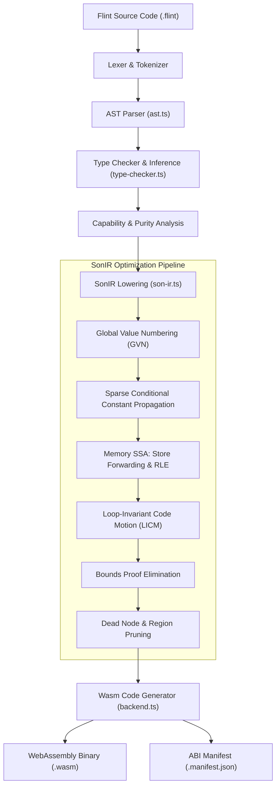
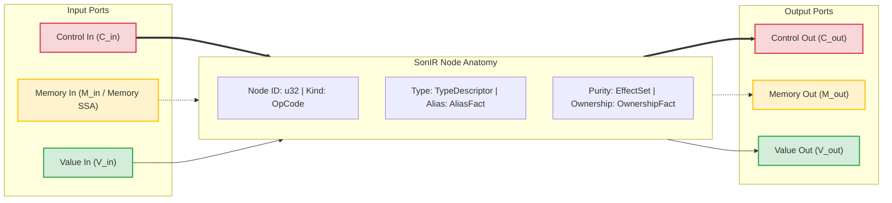
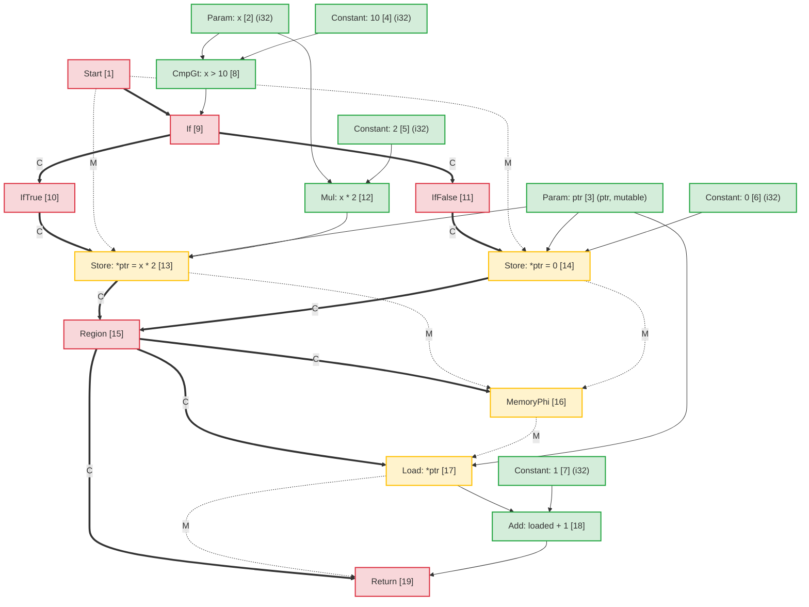
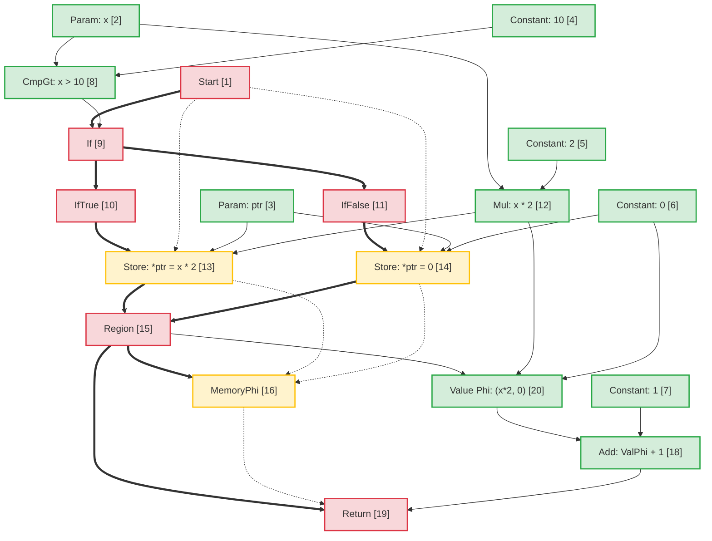
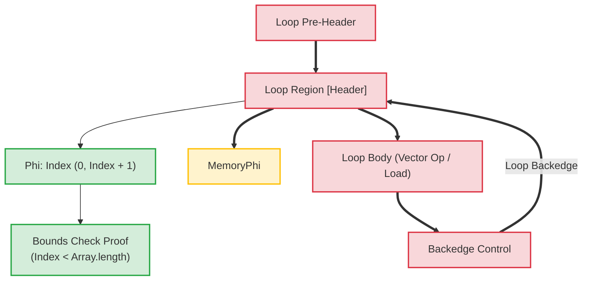

# Arquitectura del compilador Flint: representación intermedia de mar de nodos (SonIR)

Traducción asistida por máquina a partir de la fuente canónica en inglés. Revisar manualmente cuando sea necesario. Los nombres de paquetes, comandos, rutas e identificadores técnicos no se modifican.

> docs/architecture/compiler-pipelines.md: [docs/architecture/compiler-pipelines.md](../../../architecture/compiler-pipelines.md)
> Idioma: Español (es)

Este documento proporciona la especificación arquitectónica para la canalización del compilador **Flint**, centrándose en su representación intermedia principal: **SonIR** (Sea-of-Nodes IR).

SonIR adapta el cálculo Sea-of-Nodes de Cliff Click a la compilación WebAssembly de alto rendimiento. Al unificar el flujo de control, el flujo de datos puro y los efectos secundarios de la memoria en un único gráfico con puertos escritos explícitos, SonIR permite pasos de optimización agresivos, incluida la numeración de valores globales (GVN), la propagación constante condicional dispersa (SCCP), la eliminación de carga redundante de SSA de memoria (RLE), el movimiento de código invariante de bucle (LICM) y la eliminación de prueba de límites de tiempo de compilación.

---

## 1. Canal de compilación de alto nivel

La canalización del compilador de Flint transforma el código fuente de Flint de alto nivel en WebAssembly verificado y con capacidad atenuada:



---

## 2. Modelo arquitectónico de SonIR: el mar de nodos del triple puerto

En las arquitecturas de compilador tradicionales, el flujo de control se representa como un gráfico de flujo de control (CFG) de bloques básicos, mientras que el flujo de datos se representa dentro de bloques básicos mediante registros SSA. Esta separación crea una sobrecarga de sincronización durante los pasos de optimización, como el movimiento del código o la eliminación de expresiones redundantes.

SonIR elimina los límites básicos de los bloques. Las funciones se representan como un gráfico dirigido unificado donde los nodos calculan valores o realizan efectos, y los bordes representan dependencias. Para mantener la solidez, cada node segrega explícitamente sus bordes de entrada y salida en **tres categorías de puertos distintas**:



### 2.1 Las tres categorías de borde/puerto

| Categoría de puerto |   Notación de borde | Semántica y garantías de ordenamiento | Nodos representativos |
| :------------- | :----------------: | :-------------------------------------------------------------------------------------------------------------------------------------------------------------------------------------------------------------- | :------------------------------------------------------------- |
| **Controlar** | Solid Negrita (`==>`) | Gobierna el orden de ejecución secuencial, las decisiones de bifurcación condicional, los encabezados de bucle y la terminación de funciones. Los nodos de valor puro no tienen entradas de control.                                                           | `Start`, `Region`, `If`, `IfTrue`, `IfFalse`, `Loop`, `Return` |
| **Memoria SSA** |  Discontinuo (`-.->`) | Los subprocesos resumen tokens de estado de memoria que representan dependencias de efectos. Garantiza que las operaciones de carga/almacenamiento cumplan con las restricciones de lectura tras escritura y escritura tras escritura sin limitar excesivamente la memoria independiente. | `MemoryPhi`, `Load`, `Store`, `HeapAlloc`, `Fence`, `Call` |
| **Valor** | Solid Delgado (`-->`) | Lleva valores puros y resultados aritméticos. Libre de restricciones de flujo de control; Los nodos con entradas de valor puro pueden flotar libremente en el mar de nodos, sujetos únicamente a las dependencias de datos.                             | `Constant`, `Add`, `Sub`, `Mul`, `Cmp`, `Phi`, `VectorAdd` |

---

## 3. Node Anatomía y TypeScript Representación

Dentro de `@mission-platform/flint`, los nodos están representados por la interfaz `FlintSoNNode` y serializados en artefactos deterministas del módulo `.sonir.json`.

### 3.1 Estructura de la interfaz Node

```typescript
export interface FlintSoNNode {
  /** Unique sequential identifier within the compilation unit */
  readonly id: number;
  /** Operation classification (e.g., 'start', 'constant', 'load', 'store', 'region', 'if', 'return') */
  readonly kind: string;
  /** Enclosing function name */
  readonly functionName: string;
  /** Input node dependencies (in SonIR 2.0 partitioned into control, memory, and value inputs) */
  readonly inputs: readonly number[];
  /** Effect classifications: 'pure' | 'read' | 'write' | 'call' | 'control' | 'allocation' | 'unknown' */
  readonly effects: readonly FlintSoNEffect[];
  /** Alias analysis classification: 'none' | 'local' | 'borrowed' | 'mutable' | 'unknown' */
  readonly alias: FlintSoNAliasFact;
  /** Affine ownership classification: 'value' | 'borrowed' | 'owned' | 'shared' | 'unknown' */
  readonly ownership: FlintSoNOwnershipFact;
  /** Value type representation (e.g., 'i32', 'f64', 'bool', 'ptr', 'v128') */
  readonly type?: string;
  /** Literal constant payload */
  readonly value?: boolean | number | string;
  /** Callee name for call nodes */
  readonly callee?: string;
  /** Source span provenance for diagnostics and debugging */
  readonly span?: FlintSourceSpan;
}
```

### 3.2 Clasificaciones Node y enrutamiento portuario

```
┌─────────────────┬─────────────────────┬─────────────────────┬──────────────────────┐
│ Node OpCode     │ Incoming Ports      │ Outgoing Ports      │ Description          │
├─────────────────┼─────────────────────┼─────────────────────┼──────────────────────┤
│ Start           │ None                │ Control, Memory     │ Function entry point │
│ Constant        │ None                │ Value               │ Literal constant     │
│ Add / Sub / Mul │ Value, Value        │ Value               │ Pure arithmetic      │
│ If              │ Control, Value      │ Control (T/F proj)  │ Branch predicate     │
│ IfTrue / False  │ Control (from If)   │ Control             │ Branch projection    │
│ Region          │ Control, Control    │ Control             │ Control merge point  │
│ Phi             │ Region, Value, Val  │ Value               │ Value merge point    │
│ MemoryPhi       │ Region, Mem, Mem    │ Memory              │ Memory SSA merge     │
│ Load            │ Control, Mem, Ptr   │ Memory, Value       │ Heap / stack read    │
│ Store           │ Control, Mem, Ptr, V│ Memory              │ Heap / stack write   │
│ Return          │ Control, Mem, Value │ None                │ Function exit        │
└─────────────────┴─────────────────────┴─────────────────────┴──────────────────────┘
```

---

## 4. Análisis de alias y memoria SSA

Memoria SSA trata la memoria como un token de valor explícito. Un `Store` node consume un token de memoria $M_{in}$ y emite un nuevo token $M_{out}$. Un `Load` node toma un token de memoria $M_{in}$ y la dirección $V_{ptr}$, emitiendo el valor cargado $V_{out}$ y llevando el token de memoria hacia adelante.

### 4.1 Clasificación del análisis de alias

Cada node que transporta o manipula direcciones de memoria está etiquetado con un hecho de alias:

- **`none`**: Valores primitivos puros (escalares) o nodos sin dirección indirecta de memoria.
- **`local`**: Memoria asignada en el marco o región de activación actual. Garantizado para no escapar del ámbito local; inaccesible para las personas que llaman.
- **`borrowed`**: una referencia inmutable (`&T`) a la memoria que se posee en otro lugar. No se puede modificar a través de este identificador; las lecturas simultáneas son seguras.
- **`mutable`**: Una referencia mutable exclusiva (`&mut T`). No garantiza ninguna otra referencia a esta memoria durante su vida útil.
- **`unknown`**: referencias de escape, importaciones de capacidades o punteros de montón dinámicos con procedencia indeterminada.

### 4.2 Desambiguación de alias separados en el reenvío de tienda a carga

Cuando dos punteros $P_1$ y $P_2$ tienen dominios de alias demostrablemente separados:
$$\text{AliasClass}(P_1) \cap \text{AliasClass}(P_2) = \emptyset$$

El optimizador demuestra que un `Store` a $P_2$ no puede alterar el contenido de $P_1$. Esto permite:

1. **Eliminación de carga redundante (RLE)** entre los almacenes intermedios y la memoria sin alias.
2. **Reenvío de almacenamiento a carga**: un `Load` que sigue a un `Store` a la misma dirección reutiliza directamente el operando del valor almacenado sin esperar en la memoria.
3. **Eliminación del almacén muerto**: si dos almacenes escriben en el mismo puntero `local` o `mutable` sin lecturas intermedias, el primer almacén se elimina.

---

## 5. Ejemplo de transformación de un extremo a otro: mutación de memoria condicional

Para ilustrar cómo el código de alto nivel se asigna a SonIR, se optimiza y desciende a Wasm, considere esta función de Flint:

```flint
fn compute(x: i32, ptr: &mut i32) -> i32 {
  if x > 10 {
    *ptr = x * 2;
  } else {
    *ptr = 0;
  }
  return *ptr + 1;
}
```

### 5.1 Gráfico inicial de SonIR reducido

En el gráfico no optimizado, ambas sucursales realizan almacenes independientes a `ptr`. En el punto de fusión, un `Region` node converge el control y un `MemoryPhi` converge el estado de la memoria. El `Load` posterior lee desde `ptr` utilizando el token de memoria convergente:



### 5.2 Pases de optimización y eliminación de carga redundante (RLE)

Durante el proceso de optimización:

1. **Análisis de memoria SSA**: el optimizador inspecciona `Load [17]`. Su entrada de dirección es `ptr [3]` y su entrada de memoria es `MemoryPhi [16]`.
2. **Seguimiento del predecesor**:
   - En la ruta entrante `IfTrue`, `StoreThen [13]` escribió `Mul [12]` (`x * 2`) en `ptr [3]`.
   - En la ruta entrante `IfFalse`, `StoreElse [14]` escribió `Constant: 0 [6]` en `ptr [3]`.
3. **Reenvío de almacenamiento a carga**: debido a que `ptr` se escribió incondicionalmente en todas las rutas que ingresan a `Region [15]` y `ptr` tiene un alias `mutable` exclusivo sin escrituras intermedias:
   - Un **Valor `Phi`** node puro se sintetiza en `Region [15]`:
     $$\text{Phi}[20] = \text{Phi}(\text{Región}[15], \text{Mul}[12], \text{Constante}[6])$$
   - La salida de `Load [17]` se reemplaza por `Phi [20]`.
   - `Load [17]` no tiene usuarios de valor restantes y su token de memoria simplemente pasa `MemoryPhi [16]` a `Return [19]`. `Load [17]` se elimina como código inactivo.

### 5.3 Gráfico SonIR optimizado



### 5.4 Instrucciones de WebAssembly emitidas

Debido a que la lectura de memoria se eliminó por completo en SonIR, el WebAssembly emitido evita una costosa instrucción `i32.load`:

```wat
(func $compute (param $x i32) (param $ptr i32) (result i32)
  (local $val i32)
  local.get $x
  i32.const 10
  i32.gt_s
  if
    local.get $x
    i32.const 1
    i32.shl           ;; x * 2 optimized to shift
    local.tee $val
    local.get $ptr
    i32.store         ;; *ptr = x * 2
  else
    i32.const 0
    local.tee $val
    local.get $ptr
    i32.store         ;; *ptr = 0
  end
  local.get $val      ;; Reuses register value directly from Phi
  i32.const 1
  i32.add             ;; val + 1 without reading memory
  return
)
```

---

## 6. Transformaciones de bucle y pruebas de límites en tiempo de compilación

En bucles de matriz/vector, SonIR modela encabezados de bucle con regiones de control `Loop` y los nodos `Phi` y `MemoryPhi` correspondientes.



### Aspectos destacados de la optimización en bucles:

1. **Movimiento de código invariante de bucle (LICM)**: los nodos cuyo valor y entradas de memoria se originan completamente fuera de la región `Loop` flotan fuera del cuerpo del bucle hacia el encabezado previo.
2. **Eliminación de prueba de límites**: el compilador construye intervalos de rango inductivo para índices de bucle ($0 \le i < N$). Si $N \le \text{length}$, las comprobaciones de límites se demuestran seguras en el momento de la compilación y se eliminan, eliminando las instrucciones de bifurcación en tiempo de ejecución de los bucles internos.
3. **Vectorización SIMD**: los bucles de matriz secuencial lineal que coinciden con el patrón se bajan directamente a nodos SIMD de 128 bits (`v128.load`, `i32x4.add`), procesando 4 elementos por ciclo de reloj.

---

## 7. Integración de herramientas y esquemas de artefactos

Cada módulo Flint compilado emite su gráfico SonIR verificado junto con los binarios de Wasm:

- Convención de ruta de artefacto: `<target>.sonir.json`
- Herramientas como `mcp_mission-platform_flint_inspect_sonir` y `mcp_mission-platform_flint_verify_artifact` inspeccionan este artefacto para verificar las comprobaciones de límites, los hashes de gráficos y el cumplimiento de capacidades antes de la implementación en entornos sandbox.
