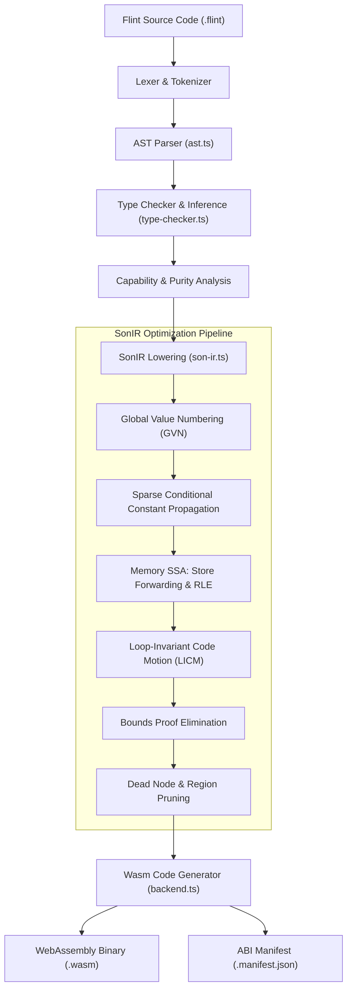
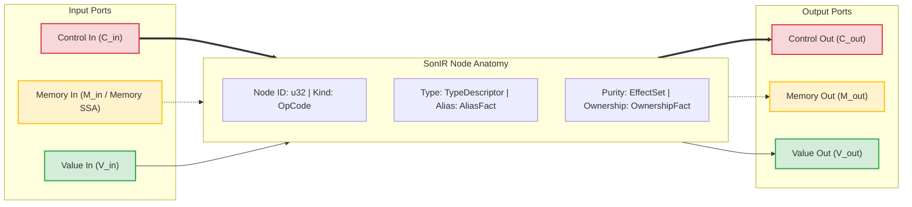
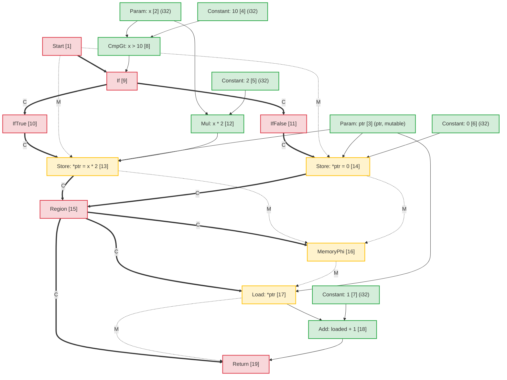
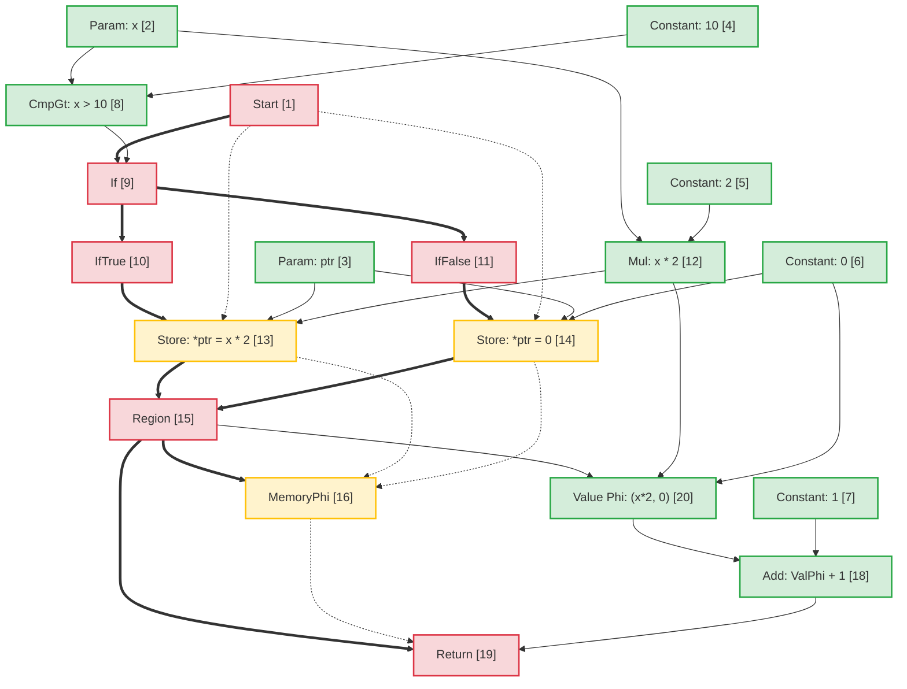
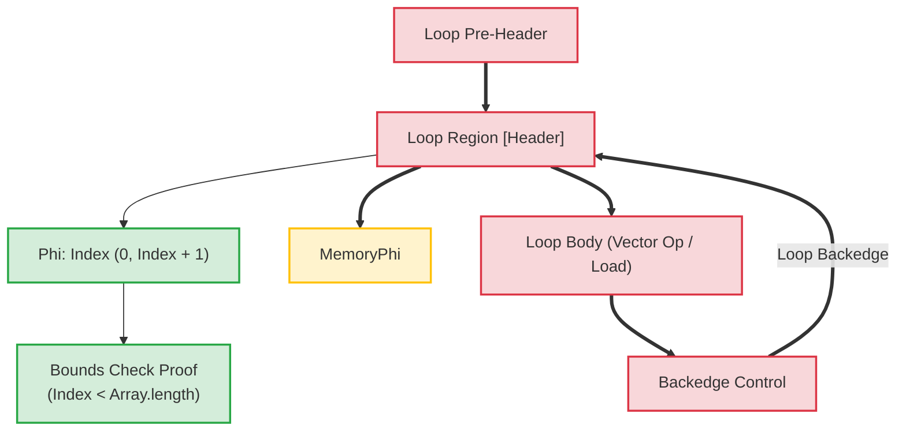

# Architecture du compilateur Flint : représentation intermédiaire en mer de nœuds (SonIR)

Traduction assistée par machine à partir de la source anglaise canonique. À relire manuellement si besoin. Les noms de paquets, commandes, chemins et identifiants techniques restent inchangés.

> docs/architecture/compiler-pipelines.md: [docs/architecture/compiler-pipelines.md](../../../architecture/compiler-pipelines.md)
> Langue: Français (fr)

Ce document fournit la spécification architecturale du pipeline du compilateur **Flint**, en se concentrant sur sa représentation intermédiaire principale : **SonIR** (Sea-of-Nodes IR).

SonIR adapte le calcul Sea-of-Nodes de Cliff Click à la compilation WebAssembly hautes performances. En unifiant le flux de contrôle, le flux de données pur et les effets secondaires de la mémoire dans un seul graphique avec des ports typés explicitement, SonIR permet des passes d'optimisation agressives, notamment la numérotation des valeurs globales (GVN), la propagation constante conditionnelle sparse (SCCP), l'élimination de la charge redondante SSA de la mémoire (RLE), le mouvement de code invariant de boucle (LICM) et l'élimination de la preuve des limites au moment de la compilation.

---

## 1. Pipeline de compilation de haut niveau

Le pipeline du compilateur Flint transforme le code source Flint de haut niveau en WebAssembly vérifié et atténué en fonctionnalités :



---

## 2. Modèle architectural SonIR : la mer de nœuds à triple port

Dans les architectures de compilateur traditionnelles, le flux de contrôle est représenté sous la forme d'un graphe de flux de contrôle (CFG) de blocs de base, tandis que le flux de données est représenté dans les blocs de base via des registres SSA. Cette séparation crée une surcharge de synchronisation lors des passes d'optimisation telles que le mouvement du code ou l'élimination des expressions redondantes.

SonIR élimine les limites de blocs de base. Les fonctions sont représentées sous la forme d'un graphe orienté unifié dans lequel les nœuds calculent des valeurs ou exécutent des effets, et les bords représentent des dépendances. Pour maintenir la solidité, chaque node sépare explicitement ses bords d'entrée et de sortie sur **trois catégories de ports distinctes** :



### 2.1 Les trois catégories Edge/Port

| Catégorie portuaire |   Notation des bords | Sémantique et garanties de commande | Nœuds représentatifs |
| :------------- | :----------------: | :-------------------------------------------------------------------------------------------------------------------------------------------------------------------------------------------------------------- | :------------------------------------------------------------- |
| **Contrôle** | Solid Gras (`==>`) | Régit l’ordre d’exécution séquentiel, les décisions de branchement conditionnel, les en-têtes de boucle et la terminaison des fonctions. Les nœuds de valeur pure n’ont aucune entrée de contrôle.                                                           | `Start`, `Region`, `If`, `IfTrue`, `IfFalse`, `Loop`, `Return` |
| **Mémoire SSA** |  En pointillés (`-.->`) | Les threads abstraits des jetons d’état de la mémoire représentant les dépendances d’effet. Garantit que les opérations de chargement/stockage respectent les contraintes de lecture après écriture et d’écriture après écriture sans surcharger la mémoire indépendante. | `MemoryPhi`, `Load`, `Store`, `HeapAlloc`, `Fence`, `Call` |
| **Valeur** | Solid Mince (`-->`) | Transporte des valeurs pures et des résultats arithmétiques. Libre de contraintes de flux de contrôle ; les nœuds avec des entrées de valeur pure peuvent flotter librement dans la mer de nœuds, sous réserve uniquement des dépendances de données.                             | `Constant`, `Add`, `Sub`, `Mul`, `Cmp`, `Phi`, `VectorAdd` |

---

## 3. Anatomie Node et représentation TypeScript

Dans `@mission-platform/flint`, les nœuds sont représentés par l'interface `FlintSoNNode` et sérialisés dans des artefacts de module déterministes `.sonir.json`.

### 3.1 Structure de l'interface Node

```typescript
export interface FlintSoNNode {
  /** Unique sequential identifier within the compilation unit */
  readonly id: number;
  /** Operation classification (e.g., 'start', 'constant', 'load', 'store', 'region', 'if', 'return') */
  readonly kind: string;
  /** Enclosing function name */
  readonly functionName: string;
  /** Input node dependencies (in SonIR 2.0 partitioned into control, memory, and value inputs) */
  readonly inputs: readonly number[];
  /** Effect classifications: 'pure' | 'read' | 'write' | 'call' | 'control' | 'allocation' | 'unknown' */
  readonly effects: readonly FlintSoNEffect[];
  /** Alias analysis classification: 'none' | 'local' | 'borrowed' | 'mutable' | 'unknown' */
  readonly alias: FlintSoNAliasFact;
  /** Affine ownership classification: 'value' | 'borrowed' | 'owned' | 'shared' | 'unknown' */
  readonly ownership: FlintSoNOwnershipFact;
  /** Value type representation (e.g., 'i32', 'f64', 'bool', 'ptr', 'v128') */
  readonly type?: string;
  /** Literal constant payload */
  readonly value?: boolean | number | string;
  /** Callee name for call nodes */
  readonly callee?: string;
  /** Source span provenance for diagnostics and debugging */
  readonly span?: FlintSourceSpan;
}
```

### 3.2 Classifications Node et routage des ports

```
┌─────────────────┬─────────────────────┬─────────────────────┬──────────────────────┐
│ Node OpCode     │ Incoming Ports      │ Outgoing Ports      │ Description          │
├─────────────────┼─────────────────────┼─────────────────────┼──────────────────────┤
│ Start           │ None                │ Control, Memory     │ Function entry point │
│ Constant        │ None                │ Value               │ Literal constant     │
│ Add / Sub / Mul │ Value, Value        │ Value               │ Pure arithmetic      │
│ If              │ Control, Value      │ Control (T/F proj)  │ Branch predicate     │
│ IfTrue / False  │ Control (from If)   │ Control             │ Branch projection    │
│ Region          │ Control, Control    │ Control             │ Control merge point  │
│ Phi             │ Region, Value, Val  │ Value               │ Value merge point    │
│ MemoryPhi       │ Region, Mem, Mem    │ Memory              │ Memory SSA merge     │
│ Load            │ Control, Mem, Ptr   │ Memory, Value       │ Heap / stack read    │
│ Store           │ Control, Mem, Ptr, V│ Memory              │ Heap / stack write   │
│ Return          │ Control, Mem, Value │ None                │ Function exit        │
└─────────────────┴─────────────────────┴─────────────────────┴──────────────────────┘
```

---

## 4. Analyse d'alias et mémoire SSA

Mémoire SSA traite la mémoire comme un jeton de valeur explicite. Un `Store` node consomme un jeton mémoire $M_{in}$ et émet un nouveau jeton $M_{out}$. Un `Load` node prend un jeton mémoire $M_{in}$ et une adresse $V_{ptr}$, émettant la valeur chargée $V_{out}$ et transportant le jeton mémoire vers l'avant.

### 4.1 Classification de l'analyse des alias

Chaque node transportant ou manipulant des adresses mémoire est étiqueté avec un alias :

- **`none`** : Valeurs primitives pures (scalaires) ou nœuds sans indirection mémoire.
- **`local`** : Mémoire allouée dans la trame ou la région d'activation actuelle. Garanti de ne pas échapper au périmètre local ; inaccessible aux appelants.
- **`borrowed`** : une référence immuable (`&T`) à la mémoire détenue ailleurs. Ne peut pas être modifié via ce handle ; les lectures simultanées sont sûres.
- **`mutable`** : Une référence mutable exclusive (`&mut T`). Garantit qu'aucune autre référence n'alias cette mémoire pendant sa durée de vie.
- **`unknown`** : références échappées, importations de fonctionnalités ou pointeurs de tas dynamiques de provenance indéterminée.

### 4.2 Désambiguïsation des alias disjoints dans le transfert de magasin à chargement

Lorsque deux pointeurs $P_1$ et $P_2$ ont des domaines d'alias manifestement disjoints :
$$\text{AliasClass}(P_1) \cap \text{AliasClass}(P_2) = \emptyset$$

L'optimiseur prouve qu'un `Store` à $P_2$ ne peut pas modifier le contenu de $P_1$. Cela permet :

1. **Élimination de charge redondante (RLE)** dans les magasins intermédiaires vers une mémoire sans alias.
2. **Redirection Store-to-Load** : Un `Load` suivant un `Store` à la même adresse réutilise directement l'opérande de valeur stockée sans attendre la mémoire.
3. **Élimination des magasins morts** : si deux magasins écrivent sur le même pointeur `local` ou `mutable` sans lecture intermédiaire, le premier magasin est élagué.

---

## 5. Exemple de transformation de bout en bout : mutation de mémoire conditionnelle

Pour illustrer comment le code de haut niveau correspond à SonIR, subit une optimisation et s'abaisse à Wasm, considérons cette fonction Flint :

```flint
fn compute(x: i32, ptr: &mut i32) -> i32 {
  if x > 10 {
    *ptr = x * 2;
  } else {
    *ptr = 0;
  }
  return *ptr + 1;
}
```

### 5.1 Graphique SonIR initial abaissé

Dans le graphique non optimisé, les deux succursales effectuent des magasins indépendants jusqu'à `ptr`. Au point de fusion, un `Region` node fait converger le contrôle et un `MemoryPhi` fait converger l'état de la mémoire. Le `Load` suivant lit à partir de `ptr` à l'aide du jeton de mémoire convergée :



### 5.2 Passes d'optimisation et élimination des charges redondantes (RLE)

Pendant le pipeline d'optimisation :

1. **Analyse mémoire SSA** : l'optimiseur inspecte `Load [17]`. Son entrée d'adresse est `ptr [3]` et son entrée mémoire est `MemoryPhi [16]`.
2. **Traçage des prédécesseurs** :
   - Sur le chemin entrant `IfTrue`, `StoreThen [13]` a écrit `Mul [12]` (`x * 2`) dans `ptr [3]`.
   - Sur le chemin entrant `IfFalse`, `StoreElse [14]` a écrit `Constant: 0 [6]` dans `ptr [3]`.
3. **Redirection du stockage au chargement** : étant donné que `ptr` a été écrit de manière inconditionnelle sur tous les chemins entrant dans `Region [15]` et que `ptr` a un alias `mutable` exclusif sans écriture intermédiaire :
   - Une **Valeur `Phi`** node pure est synthétisée en `Region [15]` :
     $$\text{Phi}[20] = \text{Phi}(\text{Région}[15], \text{Mul}[12], \text{Constant}[6])$$
   - La sortie de `Load [17]` est remplacée par `Phi [20]`.
   - `Load [17]` n'a plus de valeur d'utilisateur et son jeton de mémoire transmet simplement `MemoryPhi [16]` à `Return [19]`. `Load [17]` est élagué en tant que code mort.

### 5.3 Graphique SonIR optimisé



### 5.4 Instructions WebAssembly émises

Étant donné que la lecture de la mémoire a été complètement éliminée dans SonIR, le WebAssembly émis évite une instruction `i32.load` coûteuse :

```wat
(func $compute (param $x i32) (param $ptr i32) (result i32)
  (local $val i32)
  local.get $x
  i32.const 10
  i32.gt_s
  if
    local.get $x
    i32.const 1
    i32.shl           ;; x * 2 optimized to shift
    local.tee $val
    local.get $ptr
    i32.store         ;; *ptr = x * 2
  else
    i32.const 0
    local.tee $val
    local.get $ptr
    i32.store         ;; *ptr = 0
  end
  local.get $val      ;; Reuses register value directly from Phi
  i32.const 1
  i32.add             ;; val + 1 without reading memory
  return
)
```

---

## 6. Transformations de boucles et preuves de limites au moment de la compilation

Dans les boucles tableau/vecteur, SonIR modélise les en-têtes de boucle avec les régions de contrôle `Loop` et les nœuds `Phi` et `MemoryPhi` correspondants.



### Points forts de l'optimisation dans les boucles :

1. **Mouvement de code invariant de boucle (LICM)** : les nœuds dont les entrées de valeur et de mémoire proviennent entièrement de l'extérieur de la région `Loop` flottent hors du corps de la boucle dans le pré-en-tête.
2. **Élimination de la preuve des limites** : le compilateur construit des intervalles de plage inductifs pour les indices de boucle ($0 \le i < N$). Si $N \le \text{length}$, les vérifications de limites sont prouvées sûres au moment de la compilation et éliminées, éliminant ainsi les instructions de branchement d'exécution des boucles internes.
3. **Vectorisation SIMD** : les boucles de tableau séquentiel linéaire correspondant au modèle sont abaissées directement dans des nœuds SIMD de 128 bits (`v128.load`, `i32x4.add`), traitant 4 éléments par cycle d'horloge.

---

## 7. Schéma d'artefact et intégration d'outils

Chaque module Flint compilé émet son graphe SonIR vérifié aux côtés des binaires Wasm :

- Convention de chemin d'artefact : `<target>.sonir.json`
- Des outils tels que `mcp_mission-platform_flint_inspect_sonir` et `mcp_mission-platform_flint_verify_artifact` inspectent cet artefact pour vérifier les contrôles de limites, les hachages de graphiques et la conformité des capacités avant le déploiement dans des bacs à sable.
