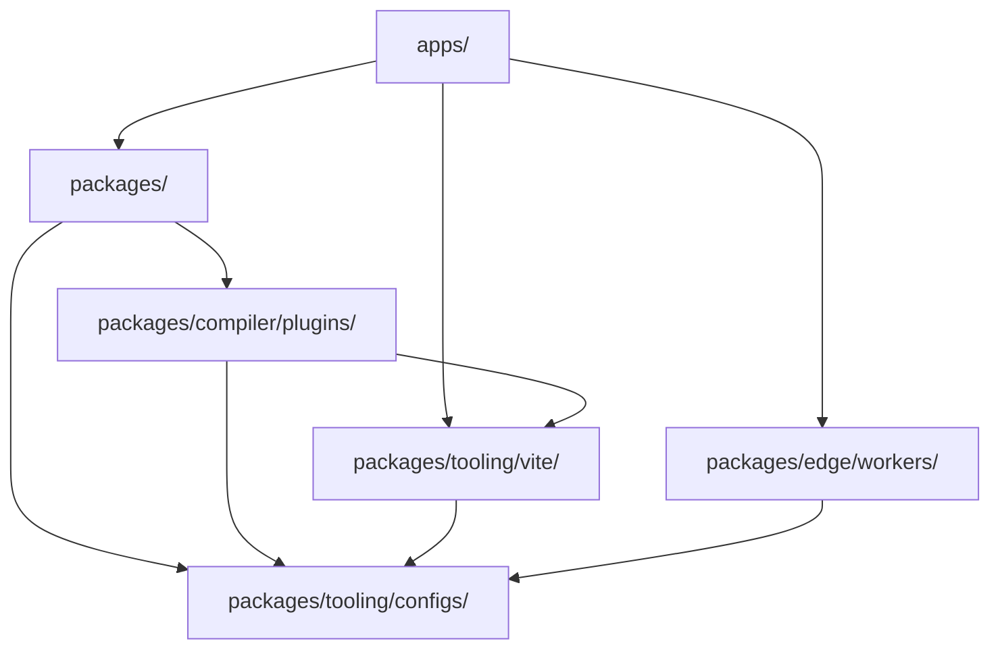

# ארכיטקטורת פלטפורמת המשימה

תרגום בסיוע מכונה מהמקור האנגלי הקנוני. יש לבדוק ידנית בעת הצורך. שמות חבילות, פקודות, נתיבים ומזהים טכניים נשארים ללא שינוי.

> docs/architecture.md: [docs/architecture.md](../../architecture.md)
> שפה: עברית (he)

Mission Platform מתוכננת לשימוש חוזר מקסימלי וגמישות חוצת מסגרות. מסמך זה מסביר את
עקרונות ארכיטקטוניים, המנוע ניטרלי המסגרת ומערכות הבנייה המניעות את הפלטפורמה.

## שרטוט אדריכלי

הפלטפורמה עוקבת אחר ארכיטקטורה **ניתנת להרכבה, מונעת חבילה**. משמעות הדבר היא שיישומים אינם מונוליטיים;
במקום זאת, הם "מורכבים" מחבילות קטנות ועצמאיות רבות שכל אחת מטפלת בבעיה ספציפית (למשל, ניתוב,
בינלאומיות, רכיבי ממשק משתמש).

### כלל הזהב: כיוון התלות

זרימת תלות חד-כיוונית קפדנית נאכפת על פני המונורפו כדי למנוע תלות מעגלית ולשמור על ברור
גבולות:

1. **יישומים (`apps/`)**: צרוך חבילות, תוספים Vite ועובדים. הם אף פעם לא מייצאים קוד לחלקים אחרים של
   מונורפו.
2. **חבילות (`packages/`)**: ספק היגיון ורכיבים לשימוש חוזר. הם יכולים לסמוך אחד על השני אבל לעולם לא
   יישומים.
3. **תוספי Forge (`packages/compiler/plugins/`)**: יעדי פלט מהדר - תוספי מסגרת ויעדי CMS. הם עשויים להיות תלויים
   `packages/tooling/vite/` ו-`packages/tooling/configs/`, ולעולם לא על `apps/` או על אחיו של זה; מתאם CMS תלוי רק ב
   `forge-cms-plugin-api`.
4. **הגדרות (`packages/tooling/configs/`)**: הגדרות כלי עבודה משותפות (ESLint, TypeScript וכו'). הם הבסיס ותלויים בהם
   שום דבר בתוך המונורפו.

## מנוע ניטרלי מסגרת: Forge

הלב של Mission Platform הוא `@mission-platform/forge-jsx`, מודל יצירת מסגרת ניטרלי עבור רכיבים ו
חומרים מורכבים. `@mission-platform/vite-plugin-forge` הוא מנהל ההדר הנייטרלי: הוא מנתח ומנרמל את המקור עם
Oxc, בונה IR סמנטי, מפעילה ניתוח ואופטימיזציה משותפים, ומשגרת למכשיר מסופק במפורש
`FrameworkOutputPlugin`.

חבילות מסגרת כגון `@mission-platform/forge-plugin-react`, `@mission-platform/forge-plugin-vue`,
`@mission-platform/forge-plugin-solid`, `@mission-platform/forge-plugin-svelte`, ו
`@mission-platform/forge-plugin-web-components` הורדת יעד משלו, אופטימיזציה של יעדים, יצירת מקור מקורי,
אבחון, מטא נתונים של זמן ריצה ומתאמי Vite/tsdown. אין פולט מסגרת מרכזי או מחרוזת למסגרת
רישום במנהל ההתקן. יעדים מותאמים אישית נרשמים על ידי יישום `FrameworkOutputPlugin` עם פתיחה
`FrameworkId` (`JsxFramework | (string & {})`), בעוד `JsxFramework` נשאר איגוד סגור לנוחות מובנית.
תצורות של בניית חבילות בוחרות את מופעי הפלאגין שהם מפרסמים, כך שתלויות הטמעת היעד נשארות
גבול המסגרת.

הזרימה המתקבלת היא **נתח/נרמל (Oxc) → אופטימיזציה ניטראלית → IR סמנטי → יעד נמוך יותר → מיטוב יעד → יצירת →
מבנה מקורי**. הנמכה ואופטימיזציה של יעדים נדרשים בהחלט לפני היצירה; מחוללי יעד מקבלים רק
כוונות נמוכות מאומתות על ידי `assertTargetIntentionsLowered`. הבנייה המקורית מבוצעת על ידי התוספים שנבחרו
מתאם Vite או tsdown, המספק גם את ההצהרות, הערכים החיצוניים והפלט של היעד.

ציר שני אורתוגונלי מקרין את אותם רכיבים ניטרליים על גבי **פלטפורמות תוכן**.
`@mission-platform/forge-cms-plugin-api` הוא הבעלים של מודל תוכן ניטרלי פלטפורמה, חוזה `CmsOutputPlugin`, ו-
נהג גנרי; חבילות המתאמים `forge-cms-storyblok`, `forge-cms-astro`, `forge-cms-ghost`, `forge-cms-jekyll`,
ו-`forge-cms-webflow` כל אחד מחזיק בפלטפורמה אחת. יעד CMS _מרכיב_ תוסף מסגרת במקום להחליף אחד, אז
כל פלטפורמה משתלבת עם כל מסגרת והפלט נוחת ב-`dist/cms/<cms>/<framework>/**`.

לקבלת הצינור המלא, צרכני הרכיבים והקרס, הקרנת CMS והנחיית הרחבה, ראה
[Forge Compiler Pipeline](../../../packages/tooling/vite/forge/docs/locales/he/reference/compiler.md). לתצוגת תזמור הבנייה, ראה
[בניית מערכת](build-system.md).

## מערכת אסימון עיצוב

עקביות חזותית נשמרת באמצעות מערכת אסימוני עיצוב מתוחכמת המנוהלת על ידי `@mission-platform/tokens`.

- **DTCG Standard**: האסימונים נכתבו בפורמט W3C Design Tokens Community Group (v2025.10).
- **מרחב צבע OKLab**: פרימיטיבים משתמשים במרחב הצבעים של OKLab עבור מעברים ונושאים אחידים מבחינה תפיסתית.
- **חפצים אוטומטיים**: `@mission-platform/vite-plugin-tokens` מייצר אוטומטית משתני SCSS, CSS מותאם אישית
  מאפיינים וקבועים TypeScript ממקור אחד של אמת.

## Framework-Agnostic Routing & I18n

שירותי ליבה של יישומים כמו ניתוב ובינלאומיזציה מתוכננים להיות אגנוסטיים למסגרת.

- **`@mission-platform/router`**: מספק יעדי מסלול מובנים, עוזרי URL/מיקום טהורים וסמני מהדר כגון
  כמו `MpLink`, `useMpRoute`, `useMpRouter` ו-`MpRouterView`. אין לו מסגרת ממשק משתמש או זמן ריצה של ספריית נתב
  תלות ולעולם אינו הבעלים של טבלת המסלולים של יישום.
- **זיוף יעדי נתב**: `@mission-platform/forge-router-vue`, `-react`, `-solid`, `-svelte`, `-redwood`, ו
  `-web-components` הורידו את הסמנים האלה לנתב המקורי שנבחר על ידי האפליקציה הצורכת. יישומים נשמרים
  בעלות על הגדרות מסלול מקוריות, ספקים, שומרים, מעמיסים ומופעי נתב; המטרה רק מספקת
  יכולות צריכה.
- **`@mission-platform/i18n`**: עטיפה סביב `i18next` המספקת מפעל `createForgeI18N` אוניברסלי.
  מתאמים ספציפיים למסגרת מספקים ווים ורכיבים `useI18n` עבור Vue ו-React.

## אסטרטגיית בנייה ופריסה

### תזמור משימות עם טורבורפו

Turborepo מטפל בהרמה כבדה של בנייה, בדיקה ומוך על פני המונורפו. הוא משתמש במטמון גלובלי כדי
להבטיח שמשימות מבוצעות רק כאשר התשומות שלהן השתנו.

### מבנים המופעלים על ידי Vite

כל חבילה ואפליקציה משתמשת ב-Vite לבניית פיתוח וייצור, תוך מינוף תצורת בסיס משותפת מ-
`@mission-platform/vite-config`.

### פריסת Cloudflare

יישומים נפרסים בעיקר ב-**Cloudflare Pages**, כאשר **Cloudflare Workers** (תחת `packages/edge/workers/`) מספקים
לוגיקה מיוחדת ל-Proxying API והגשת נכסי SPA.

## תַקצִיר

ארכיטקטורת Mission Platform נותנת עדיפות לבידוד, בטיחות סוג וגמישות מסגרת. על ידי ניתוק הליבה
היגיון ממסגרת ממשק המשתמש ואכיפת כיוון תלות קפדני, הפלטפורמה מבטיחה תחזוקה לטווח ארוך
ומדרגיות עבור מערכות אקולוגיות מורכבות של יישומים.
