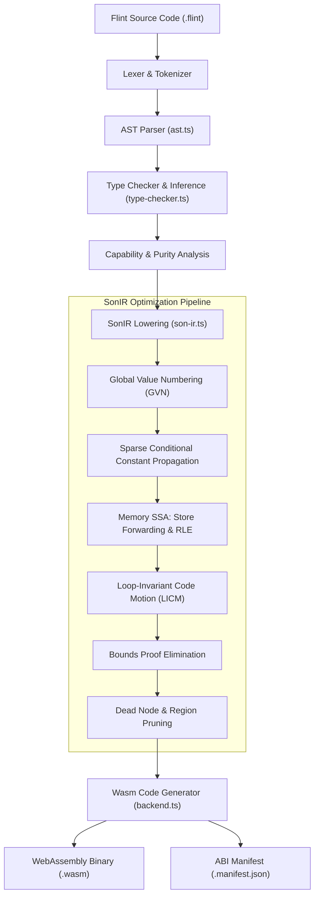
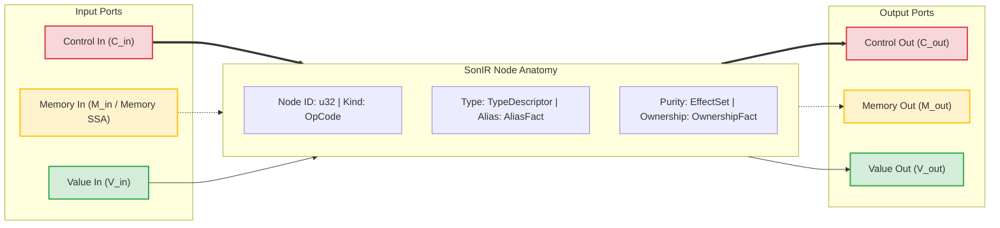
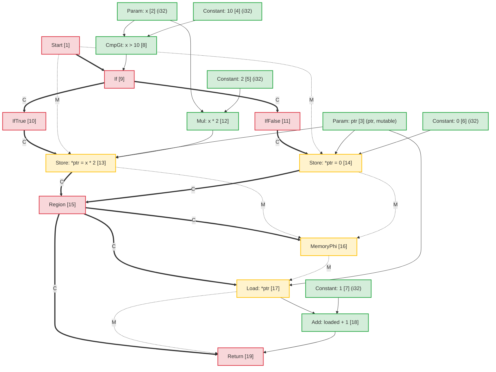
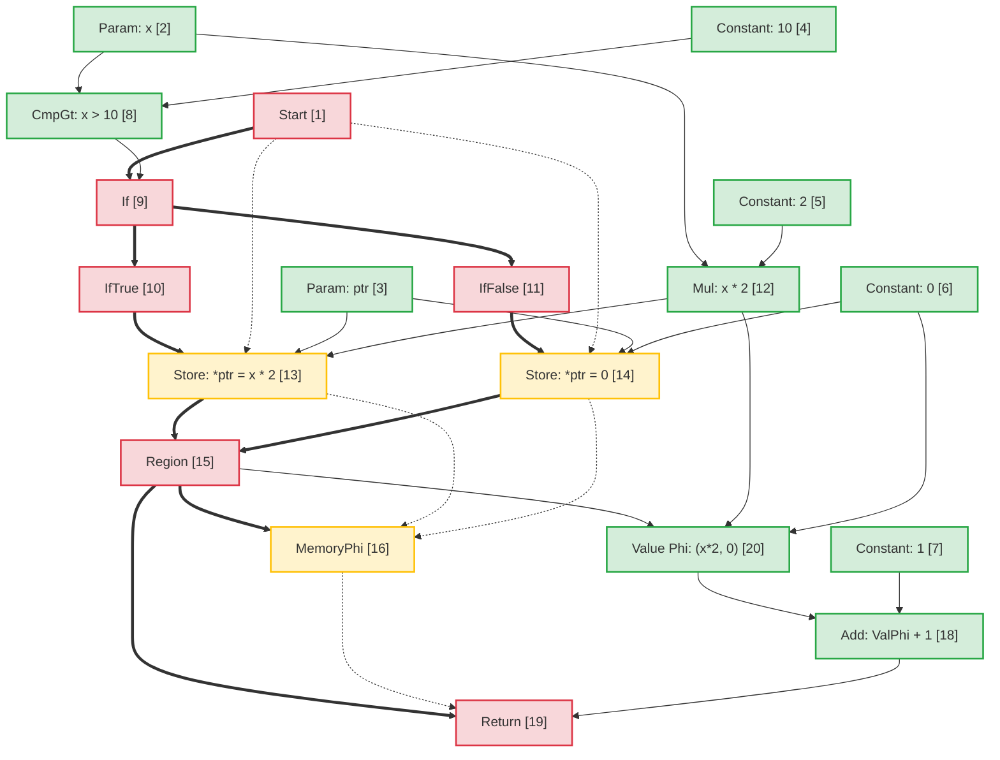
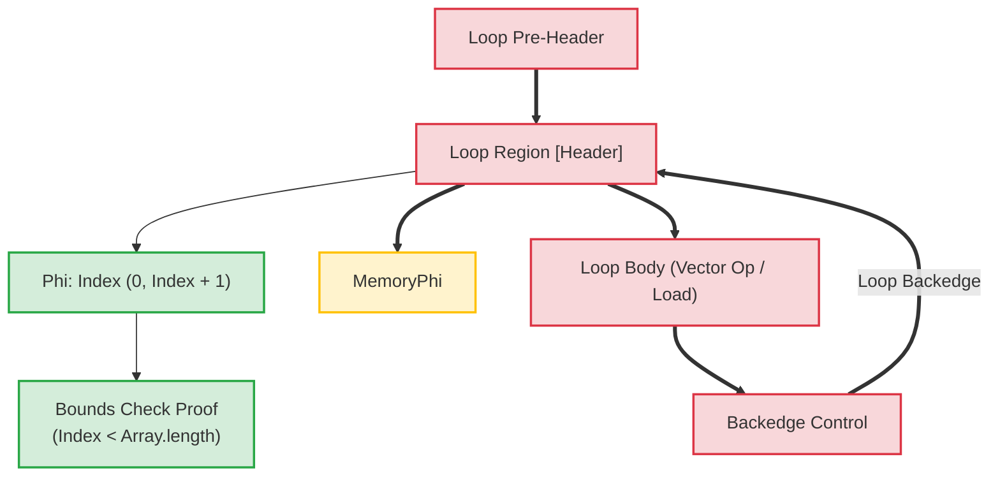

# ארכיטקטורת מהדר פלינט: ייצוג ביניים של Sea-of-Nodes (SonIR)

תרגום בסיוע מכונה מהמקור האנגלי הקנוני. יש לבדוק ידנית בעת הצורך. שמות חבילות, פקודות, נתיבים ומזהים טכניים נשארים ללא שינוי.

> docs/architecture/compiler-pipelines.md: [docs/architecture/compiler-pipelines.md](../../../architecture/compiler-pipelines.md)
> שפה: עברית (he)

מסמך זה מספק את המפרט הארכיטקטוני עבור צינור המהדר **Flint**, תוך התמקדות בייצוג הביניים הליבה שלו: **SonIR** (Sea-of-Nodes IR).

SonIR מתאימה את חישוב Sea-of-Nodes של Cliff Click להידור WebAssembly בעל ביצועים גבוהים. על ידי איחוד זרימת בקרה, זרימת נתונים טהורה ותופעות לוואי של זיכרון לתוך גרף אחד עם יציאות מוקלדות מפורשות, SonIR מאפשרת מעברי אופטימיזציה אגרסיביים - כולל מספור ערך גלובלי (GVN), התפשטות קבועה מותנית דלילה (SCCP), חיסול עומסים מיותרים של זיכרון SSA (RLE), Loop-Invariant Code B) ו-Promotion Code (LICM)

---

## 1. צינור קומפילציה ברמה גבוהה

צינור המהדר של Flint הופך קוד מקור פלינט ברמה גבוהה ל-WebAssembly מאומת, מוחלש ביכולות:



---

## 2. דגם אדריכלי של SonIR: ים הצמתים המשולש נמלים

בארכיטקטורות מהדר מסורתיות, זרימת הבקרה מיוצגת כגרף זרימת בקרה (CFG) של בלוקים בסיסיים, בעוד שזרימת נתונים מיוצגת בתוך בלוקים בסיסיים באמצעות אוגרי SSA. הפרדה זו יוצרת תקורה של סנכרון במהלך מעברי אופטימיזציה כמו תנועת קוד או חיסול ביטוי מיותר.

SonIR מבטל גבולות בלוקים בסיסיים. פונקציות מיוצגות כגרף מכוון מאוחד שבו צמתים מחשבים ערכים או מבצעים אפקטים, וקצוות מייצגים תלות. כדי לשמור על תקינות, כל node מפריד במפורש את קצוות הקלט והפלט שלו על פני **שלוש קטגוריות יציאות שונות**:



### 2.1 קטגוריות שלושת הקצה/פורטים

| קטגוריית נמל |   סימון קצה | סמנטיקה וערבות הזמנה | צמתים נציג |
| :------------- | :----------------: | :-------------------------------------------------------------------------------------------------------------------------------------------------------------------------------------------------------------- | :------------------------------------------------------------- |
| **שליטה** | Solid מודגש (`==>`) | שולט בצו ביצוע רציף, החלטות הסתעפות מותנית, כותרות לולאה וסיום פונקציה. לצמתי ערך טהור אין כניסות בקרה.                                                           | `Start`, `Region`, `If`, `IfTrue`, `IfFalse`, `Loop`, `Return` |
| **זיכרון SSA** |  מקווקו (`-.->`) | שרשורים אסימוני מצב זיכרון מופשטים המייצגים תלות באפקט. מבטיח שפעולות הטעינה/אחסון תואמות לאילוצי קריאה-אחרי-כתיבה וכתיבה-אחרי-כתיבה מבלי להגביל יתר על המידה זיכרון עצמאי. | `MemoryPhi`, `Load`, `Store`, `HeapAlloc`, `Fence`, `Call` |
| **ערך** | Solid דק (`-->`) | נושא ערכים טהורים ותוצאות אריתמטיות. ללא אילוצי זרימה בקרה; צמתים עם קלט ערך טהור יכולים לצוף בחופשיות בים הצמתים, בכפוף רק לתלות בנתונים.                             | `Constant`, `Add`, `Sub`, `Mul`, `Cmp`, `Phi`, `VectorAdd` |

---

## 3. Node אנטומיה וייצוג TypeScript

בתוך `@mission-platform/flint`, צמתים מיוצגים על ידי ממשק `FlintSoNNode` ומוסדרים לממצאים דטרמיניסטים של מודול `.sonir.json`.

### 3.1 Node מבנה ממשק

```typescript
export interface FlintSoNNode {
  /** Unique sequential identifier within the compilation unit */
  readonly id: number;
  /** Operation classification (e.g., 'start', 'constant', 'load', 'store', 'region', 'if', 'return') */
  readonly kind: string;
  /** Enclosing function name */
  readonly functionName: string;
  /** Input node dependencies (in SonIR 2.0 partitioned into control, memory, and value inputs) */
  readonly inputs: readonly number[];
  /** Effect classifications: 'pure' | 'read' | 'write' | 'call' | 'control' | 'allocation' | 'unknown' */
  readonly effects: readonly FlintSoNEffect[];
  /** Alias analysis classification: 'none' | 'local' | 'borrowed' | 'mutable' | 'unknown' */
  readonly alias: FlintSoNAliasFact;
  /** Affine ownership classification: 'value' | 'borrowed' | 'owned' | 'shared' | 'unknown' */
  readonly ownership: FlintSoNOwnershipFact;
  /** Value type representation (e.g., 'i32', 'f64', 'bool', 'ptr', 'v128') */
  readonly type?: string;
  /** Literal constant payload */
  readonly value?: boolean | number | string;
  /** Callee name for call nodes */
  readonly callee?: string;
  /** Source span provenance for diagnostics and debugging */
  readonly span?: FlintSourceSpan;
}
```

### 3.2 Node סיווגים וניתוב נמלים

```
┌─────────────────┬─────────────────────┬─────────────────────┬──────────────────────┐
│ Node OpCode     │ Incoming Ports      │ Outgoing Ports      │ Description          │
├─────────────────┼─────────────────────┼─────────────────────┼──────────────────────┤
│ Start           │ None                │ Control, Memory     │ Function entry point │
│ Constant        │ None                │ Value               │ Literal constant     │
│ Add / Sub / Mul │ Value, Value        │ Value               │ Pure arithmetic      │
│ If              │ Control, Value      │ Control (T/F proj)  │ Branch predicate     │
│ IfTrue / False  │ Control (from If)   │ Control             │ Branch projection    │
│ Region          │ Control, Control    │ Control             │ Control merge point  │
│ Phi             │ Region, Value, Val  │ Value               │ Value merge point    │
│ MemoryPhi       │ Region, Mem, Mem    │ Memory              │ Memory SSA merge     │
│ Load            │ Control, Mem, Ptr   │ Memory, Value       │ Heap / stack read    │
│ Store           │ Control, Mem, Ptr, V│ Memory              │ Heap / stack write   │
│ Return          │ Control, Mem, Value │ None                │ Function exit        │
└─────────────────┴─────────────────────┴─────────────────────┴──────────────────────┘
```

---

## 4. ניתוח כינוי וזיכרון SSA

Memory SSA מתייחס לזיכרון כאל אסימון ערך מפורש. `Store` node צורך אסימון זיכרון $M_{in}$ ופולט אסימון חדש $M_{out}$. `Load` node לוקח אסימון זיכרון $M_{in}$ וכתובת $V_{ptr}$, פולט את הערך הנטען $V_{out}$ וסוחב את אסימון הזיכרון קדימה.

### 4.1 סיווג ניתוח כינוי

כל node הנושא או מתפעל כתובות זיכרון מתויג עם עובדה כינוי:

- **`none`**: ערכים פרימיטיביים טהורים (סקלרים) או צמתים ללא עקיפה של זיכרון.
- **`local`**: זיכרון שהוקצה במסגרת ההפעלה הנוכחית או באזור. מובטח לא לחמוק מההיקף המקומי; לא נגיש למתקשרים.
- **`borrowed`**: הפניה בלתי ניתנת לשינוי (`&T`) לזיכרון שבבעלות מקום אחר. לא ניתן לשנות באמצעות ידית זו; קריאה במקביל בטוחה.
- **`mutable`**: הפניה בלעדית הניתנת לשינוי (`&mut T`). מבטיח שאף אסמכתא אחרת לא מכינה זיכרון זה במהלך חייו.
- **`unknown`**: הפניות נמלטות, ייבוא ​​יכולות או מצביעי ערימה דינמיים עם מקור לא ידוע.

### 4.2 ביעור כינוי לא משותף בהעברת חנות לטעינה

כאשר לשני מצביעים $P_1$ ו-$P_2$ יש דומיינים כינויים מפורשים:
$$\text{AliasClass}(P_1) \cap \text{AliasClass}(P_2) = \emptyset$$

כלי האופטימיזציה מוכיח ש-`Store` עד $P_2$ לא יכול לשנות את התוכן של $P_1$. זה מאפשר:

1. ** חיסול עומס מיותר (RLE)** על פני מאגרי התערבות לזיכרון ללא כינוי.
2. **העברה מחנות לטעינה**: `Load` העוקב אחר `Store` לאותה כתובת עושה שימוש חוזר ישירות באופרנד הערך המאוחסן מבלי להמתין לזיכרון.
3. **ביטול חנות מתה**: אם שתי חנויות כותבות לאותו מצביע `local` או `mutable` ללא קריאות מתערבות, החנות הראשונה נגזמת.

---

## 5. דוגמה לטרנספורמציה מקצה לקצה: מוטציית זיכרון מותנית

כדי להמחיש כיצד קוד ברמה גבוהה ממפה ל-SonIR, עובר אופטימיזציה ומוריד ל-Wasm, שקול את הפונקציה הזו של פלינט:

```flint
fn compute(x: i32, ptr: &mut i32) -> i32 {
  if x > 10 {
    *ptr = x * 2;
  } else {
    *ptr = 0;
  }
  return *ptr + 1;
}
```

### 5.1 גרף SonIR הוריד ראשוני

בגרף הלא אופטימלי, שני הסניפים מבצעים חנויות עצמאיות ל-`ptr`. בנקודת המיזוג, `Region` node מכנס שליטה, ו-`MemoryPhi` מכנס את מצב הזיכרון. ה-`Load` שלאחר מכן קורא מ-`ptr` באמצעות אסימון הזיכרון המתכנס:



### 5.2 מעברי אופטימיזציה וביטול עומס מיותר (RLE)

במהלך צינור האופטימיזציה:

1. **ניתוח SSA של זיכרון**: כלי האופטימיזציה בודק את `Load [17]`. קלט הכתובת שלו הוא `ptr [3]`, וקלט הזיכרון שלו הוא `MemoryPhi [16]`.
2. **מעקב אחר קודמו**:
   - בנתיב הנכנס `IfTrue`, `StoreThen [13]` כתב `Mul [12]` (`x * 2`) ל-`ptr [3]`.
   - בנתיב הנכנס `IfFalse`, `StoreElse [14]` כתב `Constant: 0 [6]` ל-`ptr [3]`.
3. **העברה מחנות לטעינה**: מכיוון ש-`ptr` נכתב ללא תנאי בכל הנתיבים הנכנסים ל-`Region [15]` ול-`ptr` יש כינוי `mutable` בלעדי ללא כתיבה מתערבת:
   - **Value `Phi`** node מסונתז ב-`Region [15]`:
     $$\text{Phi}[20] = \text{Phi}(\text{Region}[15], \text{Mul}[12], \text{Constant}[6])$$
   - הפלט של `Load [17]` מוחלף ב-`Phi [20]`.
   - ל-`Load [17]` אין משתמשי ערך נשארים ואסימון הזיכרון שלו פשוט מעביר את `MemoryPhi [16]` ל-`Return [19]`. `Load [17]` נגזם כקוד מת.

### 5.3 גרף SonIR אופטימלי



### 5.4 הוראות WebAssembly שנפלטו

מכיוון שקריאת הזיכרון בוטלה לחלוטין ב-SonIR, ה-WebAssembly הנפלט נמנע מהוראה `i32.load` יקרה:

```wat
(func $compute (param $x i32) (param $ptr i32) (result i32)
  (local $val i32)
  local.get $x
  i32.const 10
  i32.gt_s
  if
    local.get $x
    i32.const 1
    i32.shl           ;; x * 2 optimized to shift
    local.tee $val
    local.get $ptr
    i32.store         ;; *ptr = x * 2
  else
    i32.const 0
    local.tee $val
    local.get $ptr
    i32.store         ;; *ptr = 0
  end
  local.get $val      ;; Reuses register value directly from Phi
  i32.const 1
  i32.add             ;; val + 1 without reading memory
  return
)
```

---

## 6. טרנספורמציות לולאות והוכחות לגבולות זמן קומפילציה

בלולאות מערך/וקטור, SonIR מדגמנת כותרות לולאות עם אזורי בקרה `Loop` וצמתי `Phi` ו-`MemoryPhi` המתאימים.



### דגשים באופטימיזציה בלולאות:

1. **Loop-Invariant Code Motion (LICM)**: צמתים שהערך וכניסות הזיכרון שלהם מקורם לחלוטין מחוץ לאזור `Loop` מרחפים אל מחוץ לגוף הלולאה אל ה-Pre-header.
2. **Bounds Proof Elimination**: המהדר בונה מרווחי טווח אינדוקטיביים עבור מדדי לולאה ($0 \le i < N$). אם $N \le \text{length}$, בדיקות גבולות מוכחות כבטוחות בזמן הקומפילציה ומבוטלות, תוך ביטול הוראות ענף בזמן ריצה מלולאות פנימיות.
3. **וקטוריזציה של SIMD**: לולאות מערך רציפות ליניאריות התואמות לתבנית יורדות ישירות לצמתי SIMD של 128 סיביות (`v128.load`, `i32x4.add`), תוך עיבוד של 4 אלמנטים בכל מחזור שעון.

---

## 7. סכימת חפצים ושילוב כלי עבודה

כל מודול Flint מקופל פולט את גרף SonIR המאומת שלו לצד קבצים בינאריים של Wasm:

- מוסכמה של נתיב חפץ: `<target>.sonir.json`
- כלים כגון `mcp_mission-platform_flint_inspect_sonir` ו-`mcp_mission-platform_flint_verify_artifact` בודקים חפץ זה כדי לאמת בדיקות גבולות, גיבוב גרפים ותאימות ליכולות לפני הפריסה לארגזי חול.
