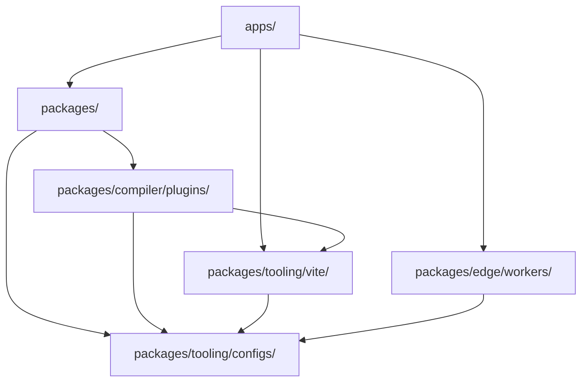

# Architettura della piattaforma di missione

Traduzione assistita da macchina dalla fonte inglese canonica. Da rivedere manualmente se necessario. Nomi di pacchetti, comandi, percorsi e identificatori tecnici restano invariati.

> docs/architecture.md: [docs/architecture.md](../../architecture.md)
> Lingua: Italiano (it)

Mission Platform è progettata per la massima riutilizzabilità e flessibilità tra framework. Questo documento spiega il
principi architettonici, il motore indipendente dal framework e i sistemi di creazione che alimentano la piattaforma.

## Progetto architettonico

La piattaforma segue un'**architettura componibile e basata su pacchetti**. Ciò significa che le applicazioni non sono monolitiche;
sono invece "composti" da molti pacchetti più piccoli e indipendenti, ciascuno dei quali gestisce un problema specifico (ad esempio, routing,
internazionalizzazione, componenti UI).

### La regola d'oro: direzione della dipendenza

Viene applicato un rigido flusso di dipendenza unidirezionale nel monorepo per prevenire dipendenze circolari e mantenerlo chiaro
confini:

1. **Applicazioni (`apps/`)**: utilizza pacchetti, plug-in Vite e lavoratori. Non esportano mai il codice in altre parti del
   monorepo.
2. **Pacchetti (`packages/`)**: forniscono logica e componenti riutilizzabili. Possono dipendere l'uno dall'altro, ma mai l'uno dall'altro
   applicazioni.
3. **Plugin Forge (`packages/compiler/plugins/`)**: destinazioni di output del compilatore: plug-in del framework e destinazioni CMS. Possono dipendere da
   `packages/tooling/vite/` e `packages/tooling/configs/`, e mai su `apps/` o sui rispettivi fratelli; un adattatore CMS dipende solo da
   `forge-cms-plugin-api`.
4. **Configs (`packages/tooling/configs/`)**: impostazioni degli strumenti condivisi (ESLint, TypeScript, ecc.). Sono il fondamento e da cui dipendono
   niente all'interno del monorepo.

## Motore neutro rispetto al framework: Forge

Il cuore di Mission Platform è `@mission-platform/forge-jsx`, un modello di creazione indipendente dal framework per componenti e
componibili. `@mission-platform/vite-plugin-forge` è il driver del compilatore neutro: analizza e normalizza il sorgente con
Oxc, crea IR semantico, esegue analisi e ottimizzazione condivise e invia a un file esplicitamente fornito
`FrameworkOutputPlugin`.

Pacchetti framework come `@mission-platform/forge-plugin-react`, `@mission-platform/forge-plugin-vue`,
`@mission-platform/forge-plugin-solid`, `@mission-platform/forge-plugin-svelte` e
`@mission-platform/forge-plugin-web-components` riduzione del target proprio, ottimizzazione del target, generazione di sorgenti native,
diagnostica, metadati di runtime e adattatori Vite/tsdown. Non esiste un emettitore di framework centrale o un sistema da stringa a framework
registro nel driver. Le destinazioni personalizzate vengono registrate implementando un `FrameworkOutputPlugin` con un open
`FrameworkId` (`JsxFramework | (string & {})`), mentre `JsxFramework` rimane un'unione chiusa per comodità integrate.
Le configurazioni di compilazione del pacchetto selezionano le istanze del plugin che pubblicano, in modo che le dipendenze di implementazione di destinazione rimangano
il confine del quadro.

Il flusso risultante è **parse/normalize (Oxc) → ottimizzazione neutra → IR semantico → target inferiore → target optimization → genera →
build nativa**. L'abbassamento e l'ottimizzazione del target sono strettamente richiesti prima della generazione; i generatori di target accettano solo
intenzioni ridotte convalidate da `assertTargetIntentionsLowered`. La compilazione nativa viene eseguita dal plugin selezionato
Vite o adattatore tsdown, che fornisce anche le dichiarazioni di destinazione, gli elementi esterni e le convenzioni di output.

Un secondo asse ortogonale proietta gli stessi componenti neutrali su **piattaforme di contenuto**.
`@mission-platform/forge-cms-plugin-api` possiede un modello di contenuto indipendente dalla piattaforma, il contratto `CmsOutputPlugin`, e un
driver generico; i pacchetti adattatori `forge-cms-storyblok`, `forge-cms-astro`, `forge-cms-ghost`, `forge-cms-jekyll`,
e `forge-cms-webflow` possiedono ciascuno una piattaforma. Un target CMS _compone_ un plugin framework invece di sostituirne uno, quindi
qualsiasi piattaforma si accoppia con qualsiasi framework e l'output arriva in `dist/cms/<cms>/<framework>/**`.

Per la pipeline completa, i consumatori di componenti e hook, la proiezione CMS e le indicazioni sull'estensione, vedere
[Pipeline del compilatore Forge](../../../packages/tooling/vite/forge/docs/locales/it/reference/compiler.md). Per la visualizzazione dell'orchestrazione della build, vedere
[Crea sistema](build-system.md).

## Sistema di token di progettazione

La coerenza visiva viene mantenuta attraverso un sofisticato sistema di token di progettazione gestito da `@mission-platform/tokens`.

- **Standard DTCG**: i token sono creati nel formato W3C Design Tokens Community Group (v2025.10).
- **Spazio colore OKLab**: le primitive utilizzano lo spazio colore OKLab per gradienti e temi percettivamente uniformi.
- **Artefatti automatizzati**: `@mission-platform/vite-plugin-tokens` genera automaticamente variabili SCSS, CSS personalizzato
  proprietà e costanti TypeScript da un'unica fonte attendibile.

## Routing indipendente dal framework e I18n

I servizi applicativi principali come il routing e l'internazionalizzazione sono progettati per essere indipendenti dal framework.

- **`@mission-platform/router`**: fornisce target di percorso strutturati, helper URL/posizione puri e indicatori del compilatore come
  come `MpLink`, `useMpRoute`, `useMpRouter` e `MpRouterView`. Non ha un framework UI o un runtime di libreria router
  dipendenze e non possiede mai la tabella di routing di un'applicazione.
- **Destinazioni router forgiato**: `@mission-platform/forge-router-vue`, `-react`, `-solid`, `-svelte`, `-redwood` e
  `-web-components` abbassa tali indicatori al router nativo selezionato dall'applicazione che lo utilizza. Le applicazioni vengono mantenute
  proprietà di definizioni di percorsi nativi, fornitori, guardie, caricatori e istanze di router; l'obiettivo fornisce solo
  capacità di consumo.
- **`@mission-platform/i18n`**: un wrapper attorno a `i18next` che fornisce una factory `createForgeI18N` universale.
  Gli adattatori specifici del framework forniscono hook `useI18n` e componenti per Vue e React.

## Strategia di creazione e distribuzione

### Orchestrazione delle attività con Turborepo

Turborepo gestisce il lavoro pesante di creazione, test e rilascio di residui nel monorepo. Utilizza una cache globale per
garantire che le attività vengano eseguite solo quando i loro input sono cambiati.

### Build basate su Vite

Ogni pacchetto e app utilizza Vite per build di sviluppo e produzione, sfruttando una configurazione di base condivisa da
`@mission-platform/vite-config`.

### Distribuzione di Cloudflare

Le applicazioni vengono distribuite principalmente su **Pagine Cloudflare**, con **Operatori Cloudflare** (sotto `packages/edge/workers/`) che forniscono
logica specializzata per il proxy API e il servizio di risorse SPA.

## Riepilogo

L'architettura Mission Platform dà priorità all'isolamento, alla sicurezza dei tipi e alla flessibilità del framework. Disaccoppiando il nucleo
logica dal framework dell'interfaccia utente e imponendo una rigorosa direzione delle dipendenze, la piattaforma garantisce la manutenibilità a lungo termine
e scalabilità per ecosistemi applicativi complessi.
