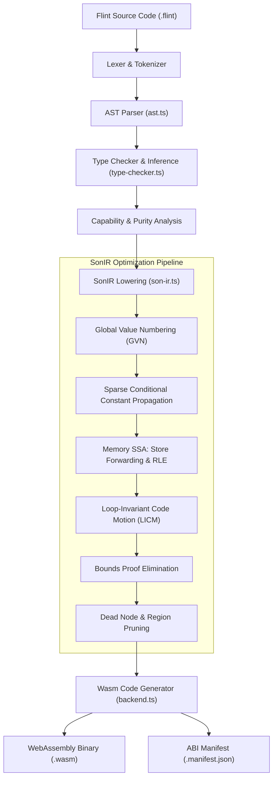
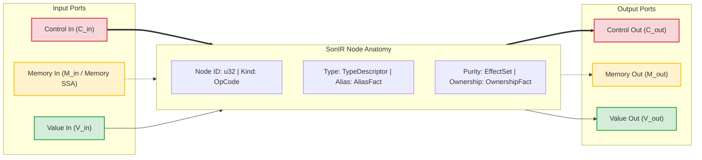
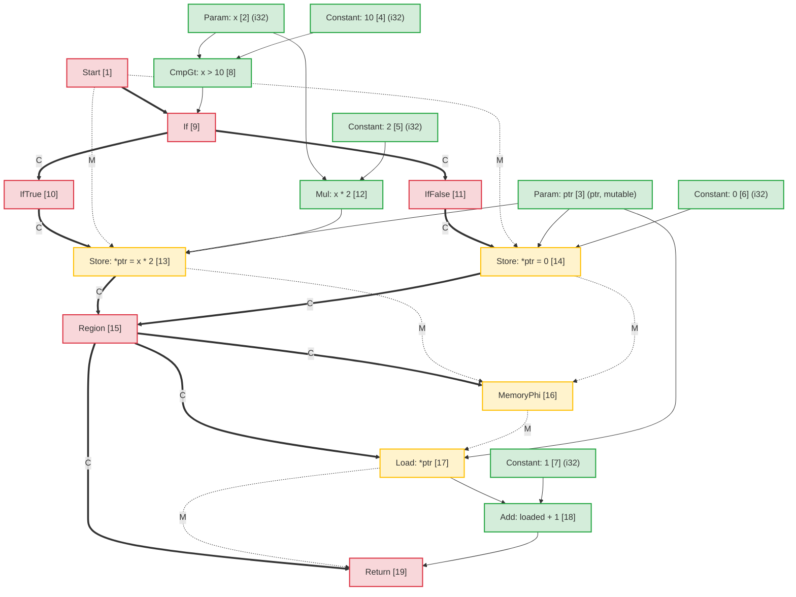
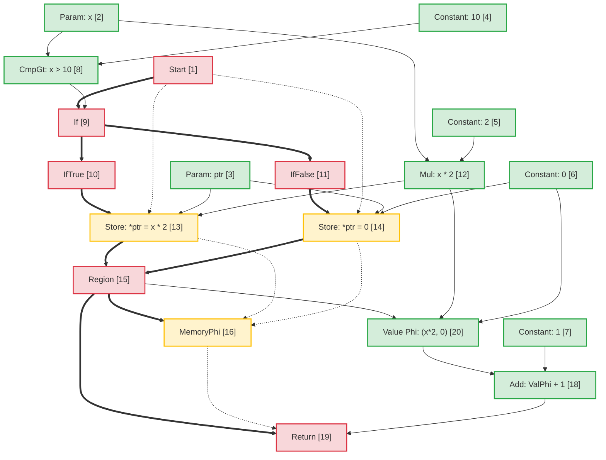
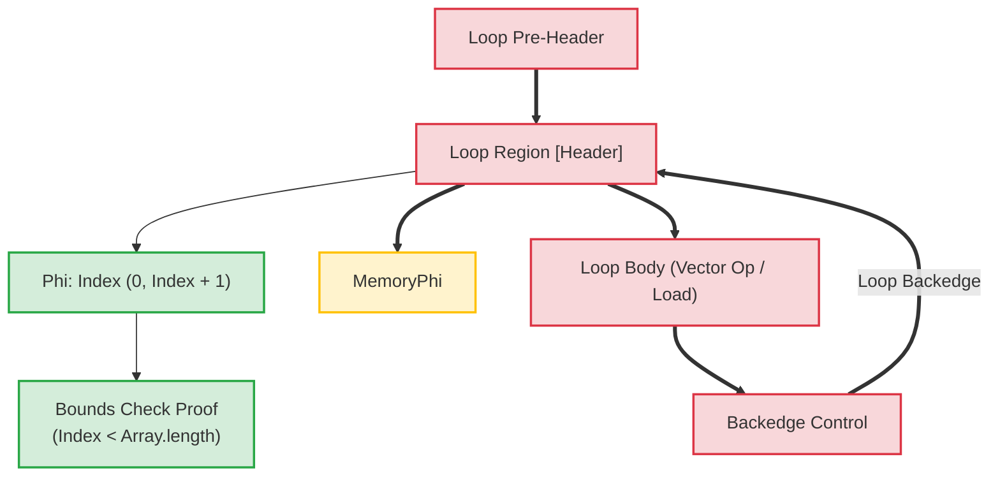

# Architettura del compilatore Flint: rappresentazione intermedia Sea-of-Nodes (SonIR)

Traduzione assistita da macchina dalla fonte inglese canonica. Da rivedere manualmente se necessario. Nomi di pacchetti, comandi, percorsi e identificatori tecnici restano invariati.

> docs/architecture/compiler-pipelines.md: [docs/architecture/compiler-pipelines.md](../../../architecture/compiler-pipelines.md)
> Lingua: Italiano (it)

Questo documento fornisce le specifiche architetturali per la pipeline del compilatore **Flint**, concentrandosi sulla sua rappresentazione intermedia principale: **SonIR** (Sea-of-Nodes IR).

SonIR adatta il calcolo Sea-of-Nodes di Cliff Click alla compilazione WebAssembly ad alte prestazioni. Unificando il flusso di controllo, il flusso di dati puro e gli effetti collaterali della memoria in un unico grafico con porte tipizzate esplicite, SonIR consente passaggi di ottimizzazione aggressivi, tra cui Global Value Numbering (GVN), Sparse Conditional Constant Propagation (SCCP), Memory SSA Redundant Load Elimination (RLE), Loop-Invariant Code Motion (LICM) e Compile-Time Bounds Proof Elimination.

---

## 1. Pipeline di compilazione di alto livello

La pipeline del compilatore Flint trasforma il codice sorgente Flint di alto livello in WebAssembly verificato e con funzionalità attenuate:



---

## 2. Modello architettonico SonIR: il mare di nodi a tre porte

Nelle architetture dei compilatori tradizionali, il flusso di controllo è rappresentato come un grafico del flusso di controllo (CFG) di blocchi di base, mentre il flusso di dati è rappresentato all'interno dei blocchi di base tramite registri SSA. Questa separazione crea un sovraccarico di sincronizzazione durante i passaggi di ottimizzazione come lo spostamento del codice o l'eliminazione delle espressioni ridondanti.

SonIR elimina i confini dei blocchi di base. Le funzioni sono rappresentate come un grafico diretto unificato in cui i nodi calcolano valori o eseguono effetti e gli spigoli rappresentano le dipendenze. Per mantenere la solidità, ogni node separa esplicitamente i suoi fronti di input e output su **tre distinte categorie di porte**:



### 2.1 Le tre categorie Edge/Porte

| Categoria porto |   Notazione dei bordi | Semantica e garanzie di ordinamento | Nodi rappresentativi |
| :------------- | :----------------: | :-------------------------------------------------------------------------------------------------------------------------------------------------------------------------------------------------------------- | :------------------------------------------------------------- |
| **Controllo** | Solid Grassetto (`==>`) | Governa l'ordine di esecuzione sequenziale, le decisioni di ramificazione condizionale, le intestazioni del loop e la terminazione della funzione. I nodi di puro valore non hanno input di controllo.                                                           | `Start`, `Region`, `If`, `IfTrue`, `IfFalse`, `Loop`, `Return` |
| **Memoria SSA** |  Tratteggiato (`-.->`) | I thread astraggono i token dello stato della memoria che rappresentano le dipendenze degli effetti. Garantisce che le operazioni di caricamento/archiviazione rispettino i vincoli di lettura dopo scrittura e scrittura dopo scrittura senza vincolare eccessivamente la memoria indipendente. | `MemoryPhi`, `Load`, `Store`, `HeapAlloc`, `Fence`, `Call` |
| **Valore** | Solid Sottile (`-->`) | Porta valori puri e risultati aritmetici. Libero da vincoli di flusso di controllo; i nodi con input di puro valore possono fluttuare liberamente nel mare dei nodi, soggetti solo alla dipendenza dai dati.                             | `Constant`, `Add`, `Sub`, `Mul`, `Cmp`, `Phi`, `VectorAdd` |

---

## 3. Anatomia Node e rappresentazione TypeScript

All'interno di `@mission-platform/flint`, i nodi sono rappresentati dall'interfaccia `FlintSoNNode` e serializzati in artefatti deterministici del modulo `.sonir.json`.

### 3.1 Struttura dell'interfaccia Node

```typescript
export interface FlintSoNNode {
  /** Unique sequential identifier within the compilation unit */
  readonly id: number;
  /** Operation classification (e.g., 'start', 'constant', 'load', 'store', 'region', 'if', 'return') */
  readonly kind: string;
  /** Enclosing function name */
  readonly functionName: string;
  /** Input node dependencies (in SonIR 2.0 partitioned into control, memory, and value inputs) */
  readonly inputs: readonly number[];
  /** Effect classifications: 'pure' | 'read' | 'write' | 'call' | 'control' | 'allocation' | 'unknown' */
  readonly effects: readonly FlintSoNEffect[];
  /** Alias analysis classification: 'none' | 'local' | 'borrowed' | 'mutable' | 'unknown' */
  readonly alias: FlintSoNAliasFact;
  /** Affine ownership classification: 'value' | 'borrowed' | 'owned' | 'shared' | 'unknown' */
  readonly ownership: FlintSoNOwnershipFact;
  /** Value type representation (e.g., 'i32', 'f64', 'bool', 'ptr', 'v128') */
  readonly type?: string;
  /** Literal constant payload */
  readonly value?: boolean | number | string;
  /** Callee name for call nodes */
  readonly callee?: string;
  /** Source span provenance for diagnostics and debugging */
  readonly span?: FlintSourceSpan;
}
```

### 3.2 Node Classificazioni e routing dei porti

```
┌─────────────────┬─────────────────────┬─────────────────────┬──────────────────────┐
│ Node OpCode     │ Incoming Ports      │ Outgoing Ports      │ Description          │
├─────────────────┼─────────────────────┼─────────────────────┼──────────────────────┤
│ Start           │ None                │ Control, Memory     │ Function entry point │
│ Constant        │ None                │ Value               │ Literal constant     │
│ Add / Sub / Mul │ Value, Value        │ Value               │ Pure arithmetic      │
│ If              │ Control, Value      │ Control (T/F proj)  │ Branch predicate     │
│ IfTrue / False  │ Control (from If)   │ Control             │ Branch projection    │
│ Region          │ Control, Control    │ Control             │ Control merge point  │
│ Phi             │ Region, Value, Val  │ Value               │ Value merge point    │
│ MemoryPhi       │ Region, Mem, Mem    │ Memory              │ Memory SSA merge     │
│ Load            │ Control, Mem, Ptr   │ Memory, Value       │ Heap / stack read    │
│ Store           │ Control, Mem, Ptr, V│ Memory              │ Heap / stack write   │
│ Return          │ Control, Mem, Value │ None                │ Function exit        │
└─────────────────┴─────────────────────┴─────────────────────┴──────────────────────┘
```

---

## 4. Analisi alias e memoria SSA

Memory SSA tratta la memoria come un token con valore esplicito. Un `Store` node consuma un token di memoria $M_{in}$ ed emette un nuovo token $M_{out}$. Un `Load` node prende un token di memoria $M_{in}$ e indirizza $V_{ptr}$, emettendo il valore caricato $V_{out}$ e portando avanti il ​​token di memoria.

### 4.1 Classificazione dell'analisi degli alias

Ogni node che trasporta o manipola indirizzi di memoria è contrassegnato da un alias:

- **`none`**: valori primitivi puri (scalari) o nodi senza indirizzamento indiretto della memoria.
- **`local`**: memoria allocata nel frame o nella regione di attivazione corrente. Garantito per non sfuggire all'ambito locale; inaccessibile ai chiamanti.
- **`borrowed`**: riferimento immutabile (`&T`) alla memoria posseduta altrove. Non può essere modificato tramite questo handle; le letture simultanee sono sicure.
- **`mutable`**: un riferimento mutevole esclusivo (`&mut T`). Garantisce che nessun altro riferimento alias questa memoria durante la sua vita.
- **`unknown`**: riferimenti con escape, importazioni di funzionalità o puntatori heap dinamici con provenienza indeterminata.

### 4.2 Disambiguazione degli alias disgiunti nell'inoltro da negozio a carico

Quando due puntatori $P_1$ e $P_2$ hanno domini alias chiaramente disgiunti:
$$\text{AliasClass}(P_1) \cap \text{AliasClass}(P_2) = \emptyset$$

L'ottimizzatore dimostra che un `Store` fino a $P_2$ non può modificare il contenuto di $P_1$. Ciò consente:

1. **Eliminazione del carico ridondante (RLE)** tra gli archivi intermedi nella memoria senza alias.
2. **Inoltro da archivio a caricamento**: un `Load` che segue un `Store` allo stesso indirizzo riutilizza direttamente l'operando del valore memorizzato senza attendere memoria.
3. **Eliminazione del negozio morto**: se due negozi scrivono sullo stesso puntatore `local` o `mutable` senza letture intermedie, il primo negozio viene eliminato.

---

## 5. Esempio di trasformazione end-to-end: mutazione condizionale della memoria

Per illustrare come il codice di alto livello viene mappato a SonIR, sottoposto a ottimizzazione e ridotto a Wasm, considerare questa funzione Flint:

```flint
fn compute(x: i32, ptr: &mut i32) -> i32 {
  if x > 10 {
    *ptr = x * 2;
  } else {
    *ptr = 0;
  }
  return *ptr + 1;
}
```

### 5.1 Grafico SonIR iniziale abbassato

Nel grafico non ottimizzato, entrambe le filiali eseguono archiviazioni indipendenti su `ptr`. Nel punto di unione, un `Region` node converge il controllo e un `MemoryPhi` converge lo stato della memoria. Il successivo `Load` legge da `ptr` utilizzando il token di memoria convergente:



### 5.2 Passaggi di ottimizzazione ed eliminazione del carico ridondante (RLE)

Durante la pipeline di ottimizzazione:

1. **Analisi SSA della memoria**: l'ottimizzatore esamina `Load [17]`. Il suo ingresso di indirizzo è `ptr [3]` e il suo ingresso di memoria è `MemoryPhi [16]`.
2. **Tracciamento del predecessore**:
   - Nel percorso in entrata `IfTrue`, `StoreThen [13]` ha scritto `Mul [12]` (`x * 2`) in `ptr [3]`.
   - Nel percorso in entrata `IfFalse`, `StoreElse [14]` ha scritto `Constant: 0 [6]` in `ptr [3]`.
3. **Inoltro da archivio a caricamento**: poiché `ptr` è stato scritto incondizionatamente su tutti i percorsi che entrano in `Region [15]` e `ptr` ha un alias `mutable` esclusivo senza scritture intermedie:
   - Un puro **Valore `Phi`** node è sintetizzato in `Region [15]`:
     $$\text{Phi}[20] = \text{Phi}(\text{Regione}[15], \text{Mul}[12], \text{Costante}[6])$$
   - L'output di `Load [17]` viene sostituito con `Phi [20]`.
   - `Load [17]` non ha utenti di valore rimanenti e il suo token di memoria passa semplicemente da `MemoryPhi [16]` a `Return [19]`. `Load [17]` viene eliminato come codice inattivo.

### 5.3 Grafico SonIR ottimizzato



### 5.4 Istruzioni WebAssembly emesse

Poiché la lettura della memoria è stata completamente eliminata in SonIR, il WebAssembly emesso evita una costosa istruzione `i32.load`:

```wat
(func $compute (param $x i32) (param $ptr i32) (result i32)
  (local $val i32)
  local.get $x
  i32.const 10
  i32.gt_s
  if
    local.get $x
    i32.const 1
    i32.shl           ;; x * 2 optimized to shift
    local.tee $val
    local.get $ptr
    i32.store         ;; *ptr = x * 2
  else
    i32.const 0
    local.tee $val
    local.get $ptr
    i32.store         ;; *ptr = 0
  end
  local.get $val      ;; Reuses register value directly from Phi
  i32.const 1
  i32.add             ;; val + 1 without reading memory
  return
)
```

---

## 6. Trasformazioni del loop e dimostrazioni dei limiti del tempo di compilazione

Nei loop array/vettoriali, i modelli SonIR eseguono il loop delle intestazioni con le regioni di controllo `Loop` e i corrispondenti nodi `Phi` e `MemoryPhi`.



### Punti salienti dell'ottimizzazione nei loop:

1. **Loop-Invariant Code Motion (LICM)**: i nodi il cui valore e gli input di memoria hanno origine interamente all'esterno della regione `Loop` vengono spostati fuori dal corpo del loop nella pre-intestazione.
2. **Eliminazione della prova dei limiti**: il compilatore costruisce intervalli di intervallo induttivo per gli indici di ciclo ($0 \le i < N$). Se $N \le \text{length}$, i controlli sui limiti si sono dimostrati sicuri in fase di compilazione ed eliminati, eliminando le istruzioni di ramo di runtime dai cicli interni.
3. **Vettoriale SIMD**: i loop di array sequenziali lineari che corrispondono al modello vengono ridotti direttamente nei nodi SIMD a 128 bit (`v128.load`, `i32x4.add`), elaborando 4 elementi per ciclo di clock.

---

## 7. Schema degli artefatti e integrazione degli strumenti

Ogni modulo Flint compilato emette il suo grafico SonIR verificato insieme ai binari Wasm:

- Convenzione sul percorso dell'artefatto: `<target>.sonir.json`
- Strumenti come `mcp_mission-platform_flint_inspect_sonir` e `mcp_mission-platform_flint_verify_artifact` ispezionano questo artefatto per verificare i controlli dei limiti, gli hash dei grafici e la conformità delle funzionalità prima della distribuzione nei sandbox.
