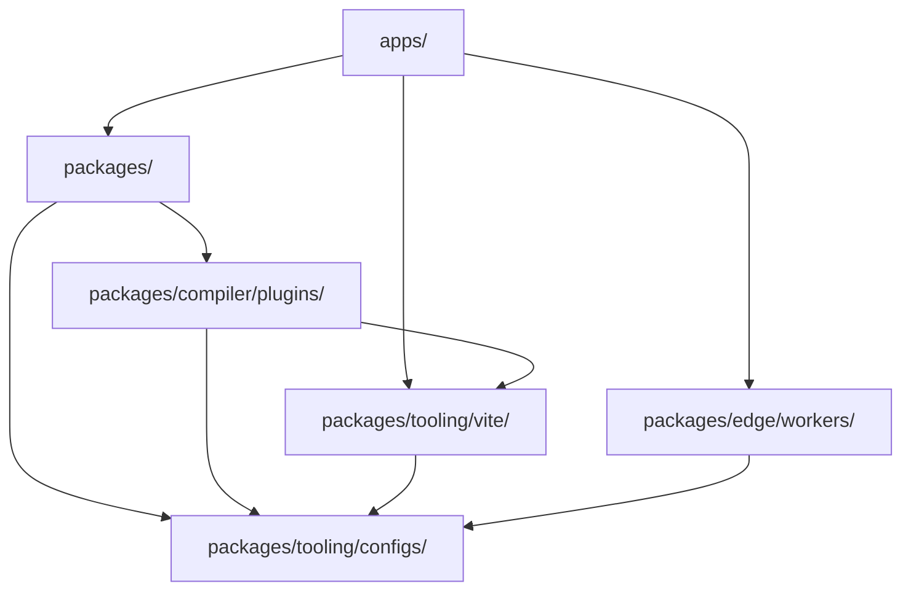

# ミッションプラットフォームのアーキテクチャ

正規の英語ソースからの機械支援翻訳です。必要に応じて人手で確認してください。パッケージ名、コマンド、パス、技術識別子は変更しません。

> docs/architecture.md: [docs/architecture.md](../../architecture.md)
> 言語: 日本語 (ja)

Mission Platform は、最大限の再利用性とフレームワーク間の柔軟性を実現するように設計されています。この文書では、
アーキテクチャの原則、フレームワーク中立のエンジン、プラットフォームを駆動するビルド システムです。

## 建築設計図

このプラットフォームは、**構成可能なパッケージ駆動型アーキテクチャ**に従っています。これは、アプリケーションがモノリシックではないことを意味します。
代わりに、それらは、それぞれが特定の懸念事項 (例: ルーティング、
国際化、UI コンポーネント)。

### 黄金律: 依存関係の方向

厳密な一方向の依存関係フローがモノリポジトリ全体に適用され、循環依存関係を防止し、明確な依存関係を維持します。
境界線:

1. **アプリケーション (`apps/`)**: パッケージ、Vite プラグイン、およびワーカーを使用します。コードを他の部分にエクスポートすることはありません。
   モノレポ。
2. **パッケージ (`packages/`)**: 再利用可能なロジックとコンポーネントを提供します。彼らはお互いに依存することはできますが、決して依存することはありません
   アプリケーション。
3. **Forge プラグイン (`packages/compiler/plugins/`)**: コンパイラー出力ターゲット - フレームワーク プラグインと CMS ターゲット。彼らは次のものに依存している可能性があります
   `packages/tooling/vite/` と `packages/tooling/configs/`、`apps/` または互いの兄弟では決して使用しないでください。 CMS アダプターは以下にのみ依存します
   `forge-cms-plugin-api`。
4. **構成 (`packages/tooling/configs/`)**: 共有ツール設定 (ESLint、TypeScript など)。それらは基盤であり、依存しています
   モノリポジトリ内には何もありません。

## フレームワーク中立エンジン: Forge

Mission Platform の中心となるのは、コンポーネントとコンポーネントのフレームワークに依存しないオーサリング モデルである `@mission-platform/forge-jsx` です。
コンポーザブル。 `@mission-platform/vite-plugin-forge` は中立的なコンパイラ ドライバです。ソースを解析して正規化します。
Oxc、セマンティック IR を構築し、共有分析と最適化を実行し、明示的に提供された
`FrameworkOutputPlugin`。

`@mission-platform/forge-plugin-react`、`@mission-platform/forge-plugin-vue`、
`@mission-platform/forge-plugin-solid`、`@mission-platform/forge-plugin-svelte`、および
`@mission-platform/forge-plugin-web-components` 独自のターゲットの引き下げ、ターゲットの最適化、ネイティブ ソースの生成、
診断、ランタイムメタデータ、Vite/tsdown アダプター。中央のフレームワーク エミッタや文字列からフレームワークへの接続はありません
ドライバー内のレジストリ。カスタム ターゲットは、`FrameworkOutputPlugin` をオープンで実装することで登録されます。
`FrameworkId` (`JsxFramework | (string & {})`) は、`JsxFramework` は組み込みの便宜のために閉じられた共用体のままです。
パッケージのビルド構成は、公開するプラグイン インスタンスを選択するため、ターゲット実装の依存関係はそのまま残ります。
フレームワークの境界。

結果として得られるフローは **解析/正規化 (Oxc) → ニュートラル最適化 → セマンティック IR → ターゲットの下限 → ターゲット最適化 → 生成 →
ネイティブビルド**。生成前に、引き下げとターゲットの最適化が厳密に必要です。ターゲットジェネレータはのみを受け入れます
`assertTargetIntentionsLowered` によって検証された意図の低下。ネイティブ ビルドは選択したプラグインによって実行されます
Vite または tsdown アダプター。ターゲットの宣言、外部、および出力規則も提供します。

2 番目の直交軸は、同じ中立コンポーネントを **コンテンツ プラットフォーム** に投影します。
`@mission-platform/forge-cms-plugin-api` は、プラットフォーム中立のコンテンツ モデル、`CmsOutputPlugin` コントラクト、および
汎用ドライバー。アダプター パッケージ `forge-cms-storyblok`、`forge-cms-astro`、`forge-cms-ghost`、`forge-cms-jekyll`、
と `forge-cms-webflow` はそれぞれ 1 つのプラットフォームを所有しています。 CMS ターゲットは、フレームワーク プラグインを置き換えるのではなく、フレームワーク プラグインを「構成」します。
任意のプラットフォームと任意のフレームワークのペアの場合、出力は `dist/cms/<cms>/<framework>/**` に配置されます。

完全なパイプライン、コンポーネントとフックのコンシューマー、CMS プロジェクション、および拡張機能のガイダンスについては、を参照してください。
[Forge コンパイラ パイプライン](../../../packages/tooling/vite/forge/docs/locales/ja/reference/compiler.md)。ビルド オーケストレーション ビューについては、次を参照してください。
[ビルドシステム](build-system.md)。

## Design Token System

`@mission-platform/tokens` によって管理される洗練されたデザインのトークン システムによって、視覚的な一貫性が維持されます。

- **DTCG 標準**: トークンは、W3C デザイン トークン コミュニティ グループ形式 (v2025.10) で作成されます。
- **OKLab カラー スペース**: プリミティブは、知覚的に均一なグラデーションとテーマに OKLab カラー スペースを使用します。
- **自動化されたアーティファクト**: `@mission-platform/vite-plugin-tokens` は SCSS 変数、CSS カスタムを自動的に生成します
  プロパティと TypeScript 定数を単一の信頼できる情報源から取得します。

## フレームワークに依存しないルーティングと I18n

ルーティングや国際化などのコア アプリケーション サービスは、フレームワークに依存しないように設計されています。

- **`@mission-platform/router`**: 構造化されたルート ターゲット、純粋な URL/場所ヘルパー、およびコンパイラ マーカーを提供します。
  `MpLink`、`useMpRoute`、`useMpRouter`、および `MpRouterView` として。 UI フレームワークやルーター ライブラリ ランタイムはありません
  依存関係を管理し、アプリケーションのルート テーブルを所有することはありません。
- **ルーター ターゲットの偽造**: `@mission-platform/forge-router-vue`、`-react`、`-solid`、`-svelte`、`-redwood`、および
  `-web-components` は、それらのマーカーを、使用側アプリケーションによって選択されたネイティブ ルーターに下げます。アプリケーションは保持します
  ネイティブ ルート定義、プロバイダー、ガード、ローダー、およびルーター インスタンスの所有権。ターゲットは供給のみ
  消費能力。
- **`@mission-platform/i18n`**: ユニバーサル `createForgeI18N` ファクトリを提供する `i18next` のラッパー。
  フレームワーク固有のアダプターは、`useI18n` フックと、Vue および React 用のコンポーネントを提供します。

## 構築と導入戦略

### Turborepo を使用したタスク オーケストレーション

Turborepo は、モノレポ全体にわたるビルド、テスト、リンティングという重労働を処理します。グローバルキャッシュを使用して、
タスクの入力が変更された場合にのみタスクが実行されるようにします。

### Vite を利用したビルド

各パッケージとアプリは、開発および運用ビルドに Vite を使用し、共有の基本構成を活用します。
`@mission-platform/vite-config`。

### Cloudflareの導入

アプリケーションは主に **Cloudflare ページ**にデプロイされ、**Cloudflare ワーカー** (`packages/edge/workers/` の下) によって提供されます。
API プロキシと SPA アセット サービスに特化したロジック。

## まとめ

Mission Platform アーキテクチャは、分離、型安全性、およびフレームワークの柔軟性を優先します。コアを切り離すことで
UI フレームワークからロジックを取得し、厳密な依存関係の方向を強制することで、プラットフォームは長期的な保守性を保証します。
複雑なアプリケーションエコシステムのためのスケーラビリティ。
