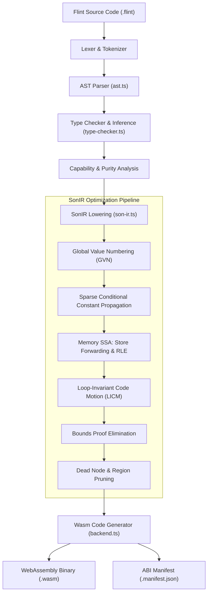
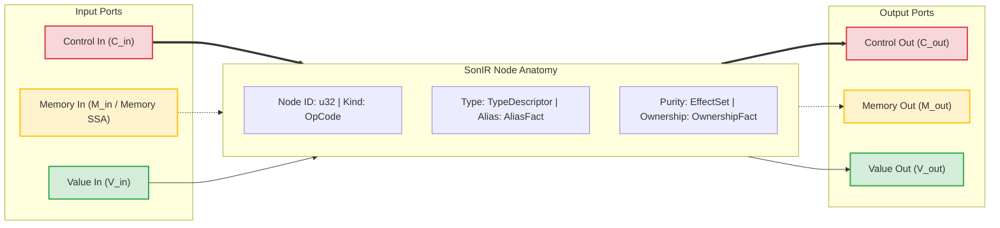
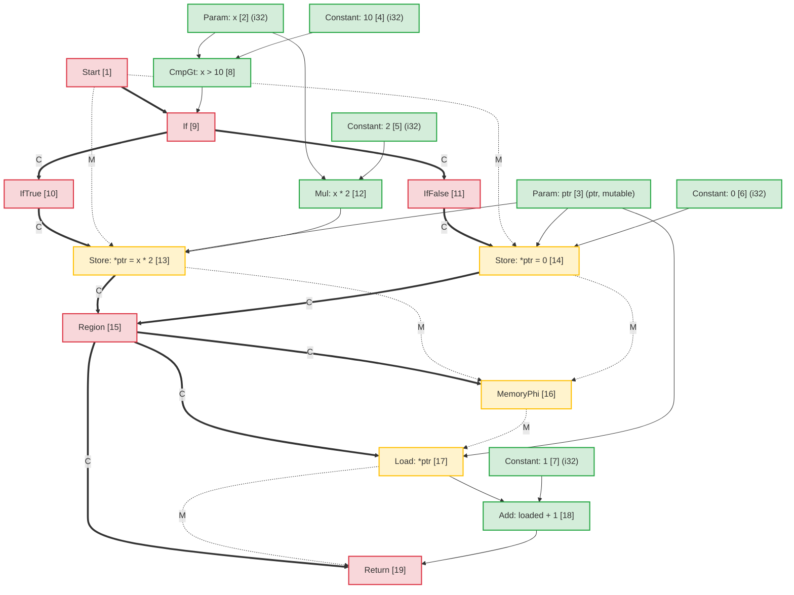
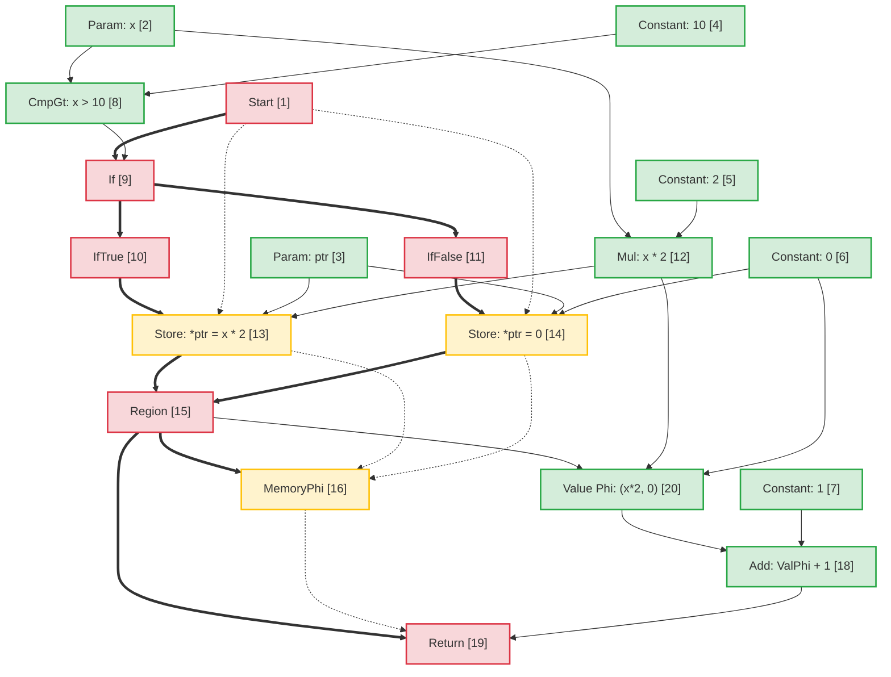
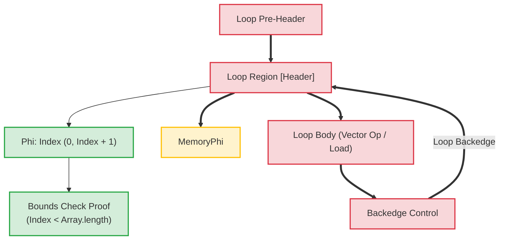

# Flint コンパイラ アーキテクチャ: Sea-of-Nodes 中間表現 (SonIR)

正規の英語ソースからの機械支援翻訳です。必要に応じて人手で確認してください。パッケージ名、コマンド、パス、技術識別子は変更しません。

> docs/architecture/compiler-pipelines.md: [docs/architecture/compiler-pipelines.md](../../../architecture/compiler-pipelines.md)
> 言語: 日本語 (ja)

このドキュメントでは、**Flint** コンパイラ パイプラインのアーキテクチャ仕様を提供し、そのコア中間表現である **SonIR** (Sea-of-Nodes IR) に焦点を当てます。

SonIR は、Cliff Click の Sea-of-Nodes 計算を高パフォーマンスの WebAssembly コンパイルに適合させます。 SonIR は、制御フロー、純粋なデータフロー、およびメモリの副作用を明示的に型指定されたポートを備えた単一のグラフに統合することにより、グローバル値番号付け (GVN)、スパース条件付き定数伝播 (SCCP)、メモリ SSA 冗長負荷排除 (RLE)、ループ不変コード モーション (LICM)、およびコンパイル時境界証明の削除などの積極的な最適化パスを可能にします。

---

## 1. 高レベルのコンパイル パイプライン

Flint コンパイラ パイプラインは、高レベルの Flint ソース コードを、検証済みの機能を軽減した WebAssembly に変換します。



---

## 2. SonIR アーキテクチャ モデル: トリプルポートのノードの海

従来のコンパイラ アーキテクチャでは、制御フローは基本ブロックの制御フロー グラフ (CFG) として表され、データ フローは SSA レジスタを介して基本ブロック内で表されます。この分離により、コードのモーションや冗長な式の削除などの最適化パス中に同期オーバーヘッドが発生します。

SonIR は基本ブロックの境界を排除します。関数は統合された有向グラフとして表現され、ノードは値を計算するか効果を実行し、エッジは依存関係を表します。健全性を維持するために、すべての node は、**3 つの異なるポート カテゴリ**にわたって入力エッジと出力エッジを明示的に分離します。



### 2.1 3 つのエッジ/ポート カテゴリ

|ポートカテゴリ |   エッジ表記 |セマンティクスと順序の保証 |代表的なノード |
| :------------- | :----------------: | :-------------------------------------------------------------------------------------------------------------------------------------------------------------------------------------------------------------- | :------------------------------------------------------------- |
| **コントロール** | Solid 太字 (`==>`) |順次実行順序、条件分岐の決定、ループ ヘッダー、および関数の終了を制御します。純粋な値ノードには制御入力がありません。                                                           | `Start`、`Region`、`If`、`IfTrue`、`IfFalse`、`Loop`、`Return` |
| **メモリ SSA** |  破線 (`-.->`) |スレッドは、効果の依存関係を表すメモリ状態トークンを抽象化します。独立したメモリを過度に制約することなく、ロード/ストア操作が書き込み後読み取りおよび書き込み後書き込みの制約に従うようにします。 | `MemoryPhi`、`Load`、`Store`、`HeapAlloc`、`Fence`、`Call` |
| **値** | Solid 薄型 (`-->`) |純粋な値と算術結果を保持します。制御フローの制約がありません。純粋な値入力を持つノードは、データの依存関係のみに依存して、ノードの海を自由に浮遊できます。                             | `Constant`、`Add`、`Sub`、`Mul`、`Cmp`、`Phi`、`VectorAdd` |

---

## 3. Node の構造と TypeScript の表現

`@mission-platform/flint` 内では、ノードは `FlintSoNNode` インターフェイスによって表され、決定論的な `.sonir.json` モジュール アーティファクトにシリアル化されます。

### 3.1 Node インターフェース構造

```typescript
export interface FlintSoNNode {
  /** Unique sequential identifier within the compilation unit */
  readonly id: number;
  /** Operation classification (e.g., 'start', 'constant', 'load', 'store', 'region', 'if', 'return') */
  readonly kind: string;
  /** Enclosing function name */
  readonly functionName: string;
  /** Input node dependencies (in SonIR 2.0 partitioned into control, memory, and value inputs) */
  readonly inputs: readonly number[];
  /** Effect classifications: 'pure' | 'read' | 'write' | 'call' | 'control' | 'allocation' | 'unknown' */
  readonly effects: readonly FlintSoNEffect[];
  /** Alias analysis classification: 'none' | 'local' | 'borrowed' | 'mutable' | 'unknown' */
  readonly alias: FlintSoNAliasFact;
  /** Affine ownership classification: 'value' | 'borrowed' | 'owned' | 'shared' | 'unknown' */
  readonly ownership: FlintSoNOwnershipFact;
  /** Value type representation (e.g., 'i32', 'f64', 'bool', 'ptr', 'v128') */
  readonly type?: string;
  /** Literal constant payload */
  readonly value?: boolean | number | string;
  /** Callee name for call nodes */
  readonly callee?: string;
  /** Source span provenance for diagnostics and debugging */
  readonly span?: FlintSourceSpan;
}
```

### 3.2 Node の分類とポートルーティング

```
┌─────────────────┬─────────────────────┬─────────────────────┬──────────────────────┐
│ Node OpCode     │ Incoming Ports      │ Outgoing Ports      │ Description          │
├─────────────────┼─────────────────────┼─────────────────────┼──────────────────────┤
│ Start           │ None                │ Control, Memory     │ Function entry point │
│ Constant        │ None                │ Value               │ Literal constant     │
│ Add / Sub / Mul │ Value, Value        │ Value               │ Pure arithmetic      │
│ If              │ Control, Value      │ Control (T/F proj)  │ Branch predicate     │
│ IfTrue / False  │ Control (from If)   │ Control             │ Branch projection    │
│ Region          │ Control, Control    │ Control             │ Control merge point  │
│ Phi             │ Region, Value, Val  │ Value               │ Value merge point    │
│ MemoryPhi       │ Region, Mem, Mem    │ Memory              │ Memory SSA merge     │
│ Load            │ Control, Mem, Ptr   │ Memory, Value       │ Heap / stack read    │
│ Store           │ Control, Mem, Ptr, V│ Memory              │ Heap / stack write   │
│ Return          │ Control, Mem, Value │ None                │ Function exit        │
└─────────────────┴─────────────────────┴─────────────────────┴──────────────────────┘
```

---

## 4. エイリアス解析とメモリ SSA

メモリ SSA はメモリを明示的な値トークンとして扱います。 `Store` node はメモリ トークン $M_{in}$ を消費し、新しいトークン $M_{out}$ を発行します。 `Load` node はメモリ トークン $M_{in}$ とアドレス $V_{ptr}$ を受け取り、ロードされた値 $V_{out}$ を発行し、メモリ トークンを転送します。

### 4.1 エイリアス解析の分類

メモリ アドレスを保持または操作するすべての node には、エイリアス ファクトがタグ付けされています。

- **`none`**: メモリ間接化のない純粋なプリミティブ値 (スカラー) またはノード。
- **`local`**: 現在のアクティブ化フレームまたは領域に割り当てられたメモリ。ローカル スコープをエスケープしないことが保証されています。発信者はアクセスできません。
- **`borrowed`**: 他の場所で所有されているメモリへの不変参照 (`&T`)。このハンドルを通じて変更することはできません。同時読み取りは安全です。
- **`mutable`**: 排他的な可変参照 (`&mut T`)。このメモリの存続期間中、他の参照がこのメモリのエイリアスを作成しないことを保証します。
- **`unknown`**: エスケープされた参照、機能インポート、または出所が不明な動的ヒープ ポインター。

### 4.2 ストアからロードへの転送における素のエイリアスの曖昧さの解消

2 つのポインタ $P_1$ と $P_2$ に明らかに互いに素なエイリアス ドメインがある場合:
$$\text{AliasClass}(P_1) \cap \text{AliasClass}(P_2) = \emptyset$$

オプティマイザは、`Store` から $P_2$ までが $P_1$ の内容を変更できないことを証明します。これにより、次のことが可能になります。

1. 非エイリアス化メモリへの介在ストアにわたる **冗長負荷排除 (RLE)**。
2. **ストアからロードへの転送**: 同じアドレスへの `Store` に続く `Load` は、メモリを待たずにストアされた値のオペランドを直接再利用します。
3. **デッド ストアの除去**: 2 つのストアが読み取りを介さずに同じ `local` または `mutable` ポインターに書き込む場合、最初のストアがプルーニングされます。

---

## 5. エンドツーエンド変換の例: 条件付きメモリ突然変異

高レベルのコードがどのように SonIR にマップされ、最適化を受け、Wasm に引き下げられるかを示すために、次の Flint 関数を考えてみましょう。

```flint
fn compute(x: i32, ptr: &mut i32) -> i32 {
  if x > 10 {
    *ptr = x * 2;
  } else {
    *ptr = 0;
  }
  return *ptr + 1;
}
```

### 5.1 初期の低下した SonIR グラフ

最適化されていないグラフでは、両方のブランチが `ptr` への独立したストアを実行します。マージ ポイントでは、`Region` node が制御を収束し、`MemoryPhi` がメモリ状態を収束します。後続の `Load` は、収束メモリ トークンを使用して `ptr` から読み取ります。



### 5.2 最適化パスと冗長負荷除去 (RLE)

最適化パイプライン中:

1. **メモリ SSA 分析**: オプティマイザは `Load [17]` を検査します。アドレス入力は `ptr [3]`、メモリ入力は `MemoryPhi [16]` です。
2. **先行トレース**:
   - `IfTrue` 受信パス上で、`StoreThen [13]` は `Mul [12]` (`x * 2`) を `ptr [3]` に書き込みました。
   - `IfFalse` 受信パス上で、`StoreElse [14]` は `Constant: 0 [6]` から `ptr [3]` に書き込みました。
3. **ストアからロードへの転送**: `ptr` は `Region [15]` に入るすべてのパスに無条件に書き込まれ、`ptr` には書き込みが介在することのない排他的な `mutable` エイリアシングがあるため、次のようになります。
   - 純粋な **Value `Phi`** node は `Region [15]` で合成されます。
     $$\text{ファイ}[20] = \text{ファイ}(\text{地域}[15], \text{Mul}[12], \text{定数}[6])$$
   - `Load [17]` の出力は `Phi [20]` に置き換えられます。
   - `Load [17]` にはユーザーの残りの値がなく、そのメモリ トークンは単に `MemoryPhi [16]` から `Return [19]` に渡されます。 `Load [17]` はデッド コードとして削除されます。

### 5.3 最適化された SonIR グラフ



### 5.4 発行された WebAssembly 命令

SonIR ではメモリ読み取りが完全に排除されたため、発行された WebAssembly はコストのかかる `i32.load` 命令を回避します。

```wat
(func $compute (param $x i32) (param $ptr i32) (result i32)
  (local $val i32)
  local.get $x
  i32.const 10
  i32.gt_s
  if
    local.get $x
    i32.const 1
    i32.shl           ;; x * 2 optimized to shift
    local.tee $val
    local.get $ptr
    i32.store         ;; *ptr = x * 2
  else
    i32.const 0
    local.tee $val
    local.get $ptr
    i32.store         ;; *ptr = 0
  end
  local.get $val      ;; Reuses register value directly from Phi
  i32.const 1
  i32.add             ;; val + 1 without reading memory
  return
)
```

---

## 6. ループ変換とコンパイル時間限界の証明

配列/ベクトル ループでは、SonIR は `Loop` 制御領域と対応する `Phi` ノードおよび `MemoryPhi` ノードを使用してループ ヘッダーをモデル化します。



### ループの最適化ハイライト:

1. **ループ不変コード モーション (LICM)**: 値とメモリ入力が完全に `Loop` 領域の外側から発生するノードは、ループ本体からプリヘッダーにフローティングされます。
2. **境界証明の削除**: コンパイラは、ループ インデックス ($0 \le i < N$) の帰納範囲区間を構築します。 $N \le \text{length}$ の場合、境界チェックはコンパイル時に安全であることが証明されて削除され、内部ループからの実行時の分岐命令が排除されます。
3. **SIMD ベクトル化**: パターンに一致する線形シーケンシャル配列ループは 128 ビット SIMD ノード (`v128.load`、`i32x4.add`) に直接降下され、クロック サイクルごとに 4 つの要素を処理します。

---

## 7. アーティファクトスキーマとツールの統合

コンパイルされたすべての Flint モジュールは、Wasm バイナリとともに検証済みの SonIR グラフを出力します。

- アーティファクト パス規則: `<target>.sonir.json`
- `mcp_mission-platform_flint_inspect_sonir` や `mcp_mission-platform_flint_verify_artifact` などのツールは、サンドボックスに展開する前にこのアーティファクトを検査して、境界チェック、グラフ ハッシュ、機能の準拠性を検証します。
