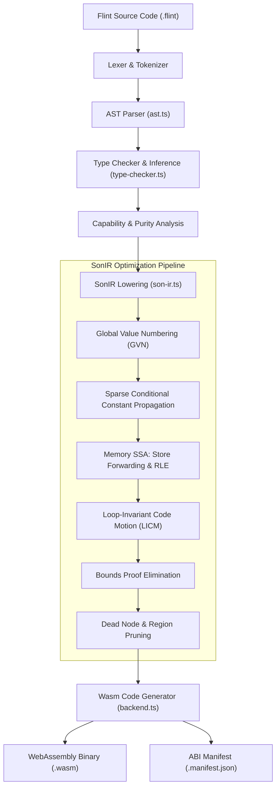
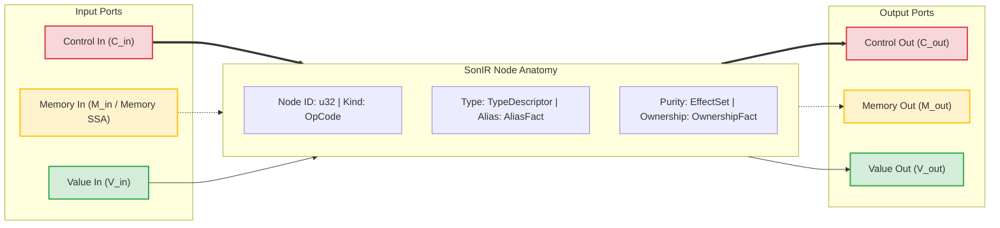
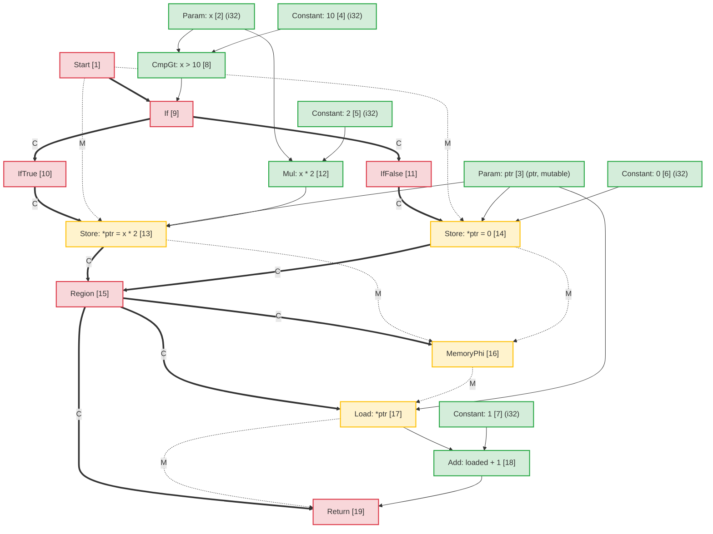
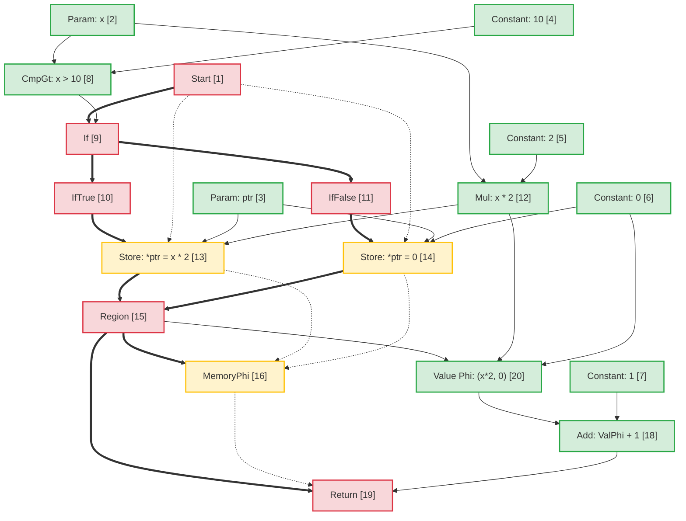
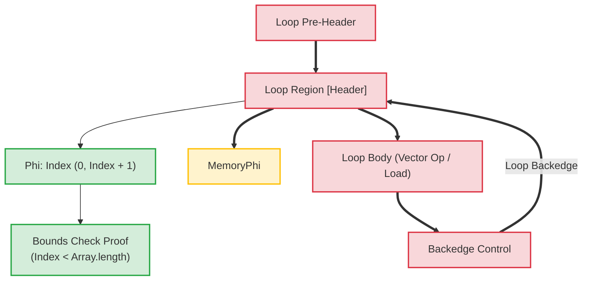

# Flint 컴파일러 아키텍처: Sea-of-Nodes 중간 표현(SonIR)

정식 영어 원문을 기계 지원으로 번역한 문서입니다. 필요 시 사람이 검수하세요. 패키지 이름, 명령, 경로, 기술 식별자는 그대로 둡니다.

> docs/architecture/compiler-pipelines.md: [docs/architecture/compiler-pipelines.md](../../../architecture/compiler-pipelines.md)
> 언어: 한국어 (ko)

이 문서는 핵심 중간 표현인 **SonIR**(Sea-of-Nodes IR)에 중점을 두고 **Flint** 컴파일러 파이프라인에 대한 아키텍처 사양을 제공합니다.

SonIR은 Cliff Click의 Sea-of-Nodes 미적분학을 고성능 WebAssembly 컴파일에 적용합니다. SonIR은 제어 흐름, 순수 데이터 흐름 및 메모리 부작용을 명시적 형식의 포트가 있는 단일 그래프로 통합함으로써 GVN(Global Value Numbering), SCCP(Sparse Conditional Constant Propagation), 메모리 SSA RLE(Redundant Load Elimination), LICM(Loop-Invariant Code Motion) 및 컴파일 시간 경계 증명 제거를 포함한 공격적인 최적화 패스를 지원합니다.

---

## 1. 상위 수준 컴파일 파이프라인

Flint 컴파일러 파이프라인은 높은 수준의 Flint 소스 코드를 검증되고 기능이 감소된 WebAssembly로 변환합니다.



---

## 2. SonIR 아키텍처 모델: 삼중 포트 Sea-of-Nodes

기존 컴파일러 아키텍처에서 제어 흐름은 기본 블록의 제어 흐름 그래프(CFG)로 표현되는 반면, 데이터 흐름은 SSA 레지스터를 통해 기본 블록 내에서 표현됩니다. 이러한 분리로 인해 코드 동작이나 중복 표현 제거와 같은 최적화 과정 중에 동기화 오버헤드가 발생합니다.

SonIR은 기본 블록 경계를 제거합니다. 함수는 노드가 값을 계산하거나 효과를 수행하는 통합 방향 그래프로 표시되며 간선은 종속성을 나타냅니다. 건전성을 유지하기 위해 모든 node은 **세 가지 개별 포트 범주**에서 입력 및 출력 에지를 명시적으로 분리합니다.



### 2.1 세 가지 에지/포트 카테고리

| 항만 카테고리 |   가장자리 표기법 | 의미론 및 주문 보장 | 대표노드 |
| :------------- | :----------------: | :-------------------------------------------------------------------------------------------------------------------------------------------------------------------------------------------------------------- | :------------------------------------------------------------- |
| **제어** | Solid 굵게 (`==>`) | 순차적 실행 순서, 조건부 분기 결정, 루프 헤더 및 함수 종료를 제어합니다. 순수 가치 노드에는 제어 입력이 없습니다.                                                           | `Start`, `Region`, `If`, `IfTrue`, `IfFalse`, `Loop`, `Return` |
| **메모리 SSA** |  대시(`-.->`) | 스레드는 효과 종속성을 나타내는 메모리 상태 토큰을 추상화합니다. 로드/저장 작업이 독립 메모리를 과도하게 제한하지 않고 쓰기 후 읽기 및 쓰기 후 쓰기 제약 조건을 준수하는지 확인합니다. | `MemoryPhi`, `Load`, `Store`, `HeapAlloc`, `Fence`, `Call` |
| **가치** | Solid 씬(`-->`) | 순수한 값과 산술 결과를 전달합니다. 제어 흐름 제약이 없습니다. 순수한 값 입력을 가진 노드는 데이터 종속성에 따라 노드의 바다에서 자유롭게 떠다닐 수 있습니다.                             | `Constant`, `Add`, `Sub`, `Mul`, `Cmp`, `Phi`, `VectorAdd` |

---

## 3. Node 구조 및 TypeScript 표현

`@mission-platform/flint` 내에서 노드는 `FlintSoNNode` 인터페이스로 표시되고 결정적 `.sonir.json` 모듈 아티팩트로 직렬화됩니다.

### 3.1 Node 인터페이스 구조

```typescript
export interface FlintSoNNode {
  /** Unique sequential identifier within the compilation unit */
  readonly id: number;
  /** Operation classification (e.g., 'start', 'constant', 'load', 'store', 'region', 'if', 'return') */
  readonly kind: string;
  /** Enclosing function name */
  readonly functionName: string;
  /** Input node dependencies (in SonIR 2.0 partitioned into control, memory, and value inputs) */
  readonly inputs: readonly number[];
  /** Effect classifications: 'pure' | 'read' | 'write' | 'call' | 'control' | 'allocation' | 'unknown' */
  readonly effects: readonly FlintSoNEffect[];
  /** Alias analysis classification: 'none' | 'local' | 'borrowed' | 'mutable' | 'unknown' */
  readonly alias: FlintSoNAliasFact;
  /** Affine ownership classification: 'value' | 'borrowed' | 'owned' | 'shared' | 'unknown' */
  readonly ownership: FlintSoNOwnershipFact;
  /** Value type representation (e.g., 'i32', 'f64', 'bool', 'ptr', 'v128') */
  readonly type?: string;
  /** Literal constant payload */
  readonly value?: boolean | number | string;
  /** Callee name for call nodes */
  readonly callee?: string;
  /** Source span provenance for diagnostics and debugging */
  readonly span?: FlintSourceSpan;
}
```

### 3.2 Node 분류 및 포트 라우팅

```
┌─────────────────┬─────────────────────┬─────────────────────┬──────────────────────┐
│ Node OpCode     │ Incoming Ports      │ Outgoing Ports      │ Description          │
├─────────────────┼─────────────────────┼─────────────────────┼──────────────────────┤
│ Start           │ None                │ Control, Memory     │ Function entry point │
│ Constant        │ None                │ Value               │ Literal constant     │
│ Add / Sub / Mul │ Value, Value        │ Value               │ Pure arithmetic      │
│ If              │ Control, Value      │ Control (T/F proj)  │ Branch predicate     │
│ IfTrue / False  │ Control (from If)   │ Control             │ Branch projection    │
│ Region          │ Control, Control    │ Control             │ Control merge point  │
│ Phi             │ Region, Value, Val  │ Value               │ Value merge point    │
│ MemoryPhi       │ Region, Mem, Mem    │ Memory              │ Memory SSA merge     │
│ Load            │ Control, Mem, Ptr   │ Memory, Value       │ Heap / stack read    │
│ Store           │ Control, Mem, Ptr, V│ Memory              │ Heap / stack write   │
│ Return          │ Control, Mem, Value │ None                │ Function exit        │
└─────────────────┴─────────────────────┴─────────────────────┴──────────────────────┘
```

---

## 4. 별칭 분석 및 메모리 SSA

메모리 SSA는 메모리를 명시적인 값 토큰으로 취급합니다. `Store` node는 메모리 토큰 $M_{in}$을 사용하고 새 토큰 $M_{out}$을 내보냅니다. `Load` node은 메모리 토큰 $M_{in}$ 및 주소 $V_{ptr}$를 사용하여 로드된 값 $V_{out}$을 내보내고 메모리 토큰을 전달합니다.

### 4.1 별칭분석 분류

메모리 주소를 전달하거나 조작하는 모든 node에는 별칭 사실이 태그로 지정됩니다.

- **`none`**: 메모리 간접 참조가 없는 순수 기본 값(스칼라) 또는 노드입니다.
- **`local`**: 현재 활성화 프레임 또는 영역에 할당된 메모리입니다. 로컬 범위를 벗어나지 않도록 보장됩니다. 발신자가 접근할 수 없습니다.
- **`borrowed`**: 다른 곳에서 소유한 메모리에 대한 불변 참조(`&T`)입니다. 이 핸들을 통해 수정할 수 없습니다. 동시 읽기는 안전합니다.
- **`mutable`**: 배타적 변경 가능 참조(`&mut T`). 수명 동안 이 메모리에 다른 참조 별칭을 지정하지 않도록 보장합니다.
- **`unknown`**: 출처가 확인되지 않은 이스케이프된 참조, 기능 가져오기 또는 동적 힙 포인터.

### 4.2 Store-to-Load 전달에서 분리된 별칭 명확화

두 개의 포인터 $P_1$ 및 $P_2$가 분리된 별칭 도메인을 갖는 경우:
$$\text{AliasClass}(P_1) \cap \text{AliasClass}(P_2) = \emptyset$$

최적화 프로그램은 $P_2$에 대한 `Store`이 $P_1$의 내용을 변경할 수 없음을 증명합니다. 이를 통해 다음이 허용됩니다.

1. 중간 저장소에서 앨리어싱되지 않은 메모리까지 **RLE(중복 로드 제거)**.
2. **저장-로드 전달**: 동일한 주소로 `Store`를 따르는 `Load`은 메모리를 기다리지 않고 저장된 값 피연산자를 직접 재사용합니다.
3. **데드 스토어 제거**: 두 개의 스토어가 중간 읽기 없이 동일한 `local` 또는 `mutable` 포인터에 쓰는 경우 첫 번째 스토어가 정리됩니다.

---

## 5. 엔드 투 엔드 변환 예: 조건부 메모리 돌연변이

상위 수준 코드가 어떻게 SonIR에 매핑되고, 최적화를 거쳐 Wasm으로 낮아지는지 설명하려면 다음 Flint 함수를 고려하세요.

```flint
fn compute(x: i32, ptr: &mut i32) -> i32 {
  if x > 10 {
    *ptr = x * 2;
  } else {
    *ptr = 0;
  }
  return *ptr + 1;
}
```

### 5.1 초기 감소된 SonIR 그래프

최적화되지 않은 그래프에서는 두 분기 모두 `ptr`에 독립적인 저장을 수행합니다. 병합 지점에서 `Region` node는 제어를 수렴하고 `MemoryPhi`는 메모리 상태를 수렴합니다. 후속 `Load`은 수렴된 메모리 토큰을 사용하여 `ptr`에서 읽습니다.



### 5.2 최적화 패스 및 중복 부하 제거(RLE)

최적화 파이프라인 중:

1. **메모리 SSA 분석**: 최적화 프로그램은 `Load [17]`을 검사합니다. 주소 입력은 `ptr [3]`이고 메모리 입력은 `MemoryPhi [16]`입니다.
2. **전임자 추적**:
   - `IfTrue` 수신 경로에서 `StoreThen [13]`는 `Mul [12]`(`x * 2`)를 `ptr [3]`에 썼습니다.
   - `IfFalse` 수신 경로에서 `StoreElse [14]`는 `Constant: 0 [6]`을 `ptr [3]`에 썼습니다.
3. **저장-로드 전달**: `ptr`는 `Region [15]`을 입력하는 모든 경로에 무조건 기록되었고 `ptr`에는 중간 쓰기 없이 독점적인 `mutable` 앨리어싱이 있기 때문에:
   - 순수 **값 `Phi`** node는 `Region [15]`에서 합성됩니다.
     $$\text{파이}[20] = \text{파이}(\text{지역}[15], \text{Mul}[12], \text{상수}[6])$$
   - `Load [17]`의 출력이 `Phi [20]`로 대체됩니다.
   - `Load [17]`에는 남은 가치가 없으며 해당 메모리 토큰은 단순히 `MemoryPhi [16]`을 통해 `Return [19]`로 전달됩니다. `Load [17]`은 데드 코드로 정리됩니다.

### 5.3 최적화된 SonIR 그래프



### 5.4 방출된 웹어셈블리 명령어

SonIR에서는 메모리 읽기가 완전히 제거되었기 때문에 방출된 WebAssembly는 비용이 많이 드는 `i32.load` 명령을 방지합니다.

```wat
(func $compute (param $x i32) (param $ptr i32) (result i32)
  (local $val i32)
  local.get $x
  i32.const 10
  i32.gt_s
  if
    local.get $x
    i32.const 1
    i32.shl           ;; x * 2 optimized to shift
    local.tee $val
    local.get $ptr
    i32.store         ;; *ptr = x * 2
  else
    i32.const 0
    local.tee $val
    local.get $ptr
    i32.store         ;; *ptr = 0
  end
  local.get $val      ;; Reuses register value directly from Phi
  i32.const 1
  i32.add             ;; val + 1 without reading memory
  return
)
```

---

## 6. 루프 변환 및 컴파일 시간 경계 증명

배열/벡터 루프에서 SonIR 모델은 `Loop` 제어 영역과 해당 `Phi` 및 `MemoryPhi` 노드를 사용하여 루프 헤더를 모델링합니다.



### 루프의 최적화 하이라이트:

1. **LICM(Loop-Invariant Code Motion)**: 값과 메모리 입력이 `Loop` 영역 외부에서 완전히 시작된 노드는 루프 본문에서 프리헤더로 이동됩니다.
2. **경계 증명 제거**: 컴파일러는 루프 인덱스($0 \le i < N$)에 대한 귀납적 범위 간격을 구성합니다. $N \le \text{length}$인 경우 경계 검사는 컴파일 타임에 안전한 것으로 입증되어 제거되어 내부 루프에서 런타임 분기 명령이 제거됩니다.
3. **SIMD 벡터화**: 패턴과 일치하는 선형 순차 배열 루프는 128비트 SIMD 노드(`v128.load`, `i32x4.add`)로 직접 낮아져 클록 사이클당 4개의 요소를 처리합니다.

---

## 7. 아티팩트 스키마 및 도구 통합

컴파일된 모든 Flint 모듈은 Wasm 바이너리와 함께 검증된 SonIR 그래프를 내보냅니다.

- 아티팩트 경로 규칙: `<target>.sonir.json`
- `mcp_mission-platform_flint_inspect_sonir` 및 `mcp_mission-platform_flint_verify_artifact`와 같은 도구는 이 아티팩트를 검사하여 샌드박스에 배포하기 전에 경계 검사, 그래프 해시 및 기능 준수를 확인합니다.
