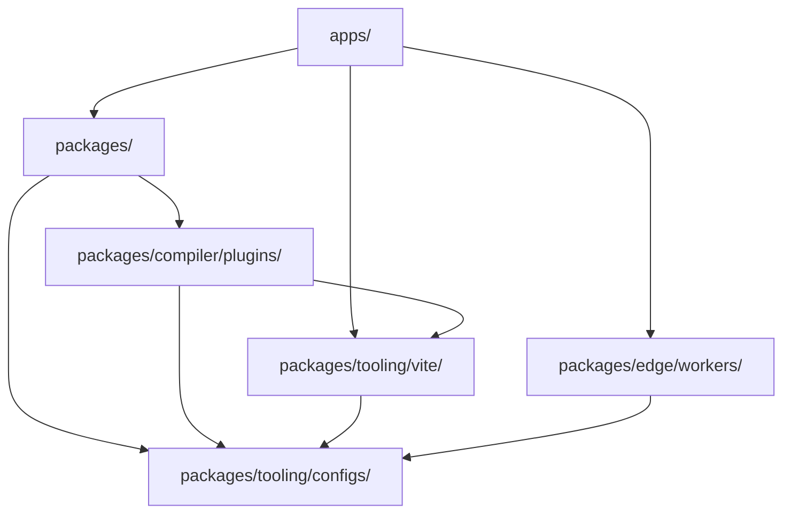

# Missieplatformarchitectuur

Machineondersteunde vertaling van de canonieke Engelse bron. Handmatig nalezen indien nodig. Pakketnamen, opdrachten, paden en technische identificatoren blijven ongewijzigd.

> docs/architecture.md: [docs/architecture.md](../../architecture.md)
> Taal: Nederlands (nl)

Mission Platform is ontworpen voor maximale herbruikbaarheid en cross-framework-flexibiliteit. In dit document wordt uitgelegd
architecturale principes, de raamwerkneutrale engine en de bouwsystemen die het platform aandrijven.

## Architecturale blauwdruk

Het platform volgt een **samenstelbare, pakketgestuurde architectuur**. Dit betekent dat toepassingen niet monolithisch zijn;
in plaats daarvan zijn ze "samengesteld" uit vele kleinere, onafhankelijke pakketten die elk een specifiek probleem behandelen (bijvoorbeeld routering,
internationalisering, UI-componenten).

### De gouden regel: richting van afhankelijkheid

Er wordt binnen de monorepo een strikte eenrichtingsafhankelijkheidsstroom afgedwongen om circulaire afhankelijkheden te voorkomen en overzichtelijk te houden
grenzen:

1. **Toepassingen (`apps/`)**: Gebruik pakketten, Vite-plug-ins en werkrollen. Ze exporteren nooit code naar andere delen van de
   monorepo.
2. **Pakketten (`packages/`)**: Bieden herbruikbare logica en componenten. Ze kunnen van elkaar afhankelijk zijn, maar nooit van elkaar
   toepassingen.
3. **Forge-plug-ins (`packages/compiler/plugins/`)**: uitvoerdoelen van de compiler: framework-plug-ins en CMS-doelen. Ze kunnen afhankelijk zijn van
   `packages/tooling/vite/` en `packages/tooling/configs/`, en nooit op `apps/` of op elkaars broers en zussen; een CMS-adapter is alleen afhankelijk van
   `forge-cms-plugin-api`.
4. **Configs (`packages/tooling/configs/`)**: Gedeelde tooling-instellingen (ESLint, TypeScript, enz.). Zij vormen de basis en zijn afhankelijk van
   niets binnen de monorepo.

## Framework-neutrale engine: Forge

Het hart van Mission Platform is `@mission-platform/forge-jsx`, een raamwerkneutraal auteursmodel voor componenten en
Composables. `@mission-platform/vite-plugin-forge` is het neutrale compilerstuurprogramma: het parseert en normaliseert de broncode
Oxc bouwt semantische IR, voert gedeelde analyses en optimalisaties uit en verzendt naar een expliciet opgegeven
`FrameworkOutputPlugin`.

Framework-pakketten zoals `@mission-platform/forge-plugin-react`, `@mission-platform/forge-plugin-vue`,
`@mission-platform/forge-plugin-solid`, `@mission-platform/forge-plugin-svelte` en
`@mission-platform/forge-plugin-web-components` eigen doelverlaging, doeloptimalisatie, native source-generatie,
diagnostiek, runtime-metagegevens en Vite/tsdown-adapters. Er is geen centrale raamwerkzender of string-naar-framework
register in het stuurprogramma. Aangepaste doelen worden geregistreerd door een `FrameworkOutputPlugin` te implementeren met een open
`FrameworkId` (`JsxFramework | (string & {})`), terwijl `JsxFramework` een gesloten unie blijft voor ingebouwde gemakken.
Configuraties voor het bouwen van pakketten selecteren de plug-in-instanties die ze publiceren, zodat de afhankelijkheden van de doelimplementatie behouden blijven
de kadergrens.

De resulterende stroom is **parseren/normaliseren (Oxc) → neutraal optimaliseren → semantische IR → doel lager → doel optimaliseren → genereren →
inheemse bouw**. Verlaging en doeloptimalisatie zijn strikt vereist vóór generatie; doelgeneratoren accepteren alleen
verlaagde intenties gevalideerd door `assertTargetIntentionsLowered`. De native build wordt uitgevoerd door de geselecteerde plug-ins
Vite of tsdown-adapter, die ook de declaraties, externe waarden en uitvoerconventies van het doel levert.

Een tweede, orthogonale as projecteert dezelfde neutrale componenten op **contentplatforms**.
`@mission-platform/forge-cms-plugin-api` bezit een platformneutraal inhoudsmodel, het `CmsOutputPlugin`-contract en een
generiek stuurprogramma; de adapterpakketten `forge-cms-storyblok`, `forge-cms-astro`, `forge-cms-ghost`, `forge-cms-jekyll`,
en `forge-cms-webflow` bezitten elk één platform. Een CMS-doel _componeert_ een framework-plug-in in plaats van er een te vervangen, dus
elk platform koppelt met elk raamwerk en de uitvoer komt terecht in `dist/cms/<cms>/<framework>/**`.

Zie voor de volledige pijplijn-, component- en hook-consumenten, CMS-projectie en uitbreidingsrichtlijnen
[Forge Compiler-pijplijn](../../../packages/tooling/vite/forge/docs/locales/nl/reference/compiler.md). Zie voor de build-orkestratieweergave
[Systeem bouwen](build-system.md).

## Ontwerptokensysteem

De visuele consistentie wordt gehandhaafd via een geavanceerd ontwerptokensysteem dat wordt beheerd door `@mission-platform/tokens`.

- **DTCG-standaard**: tokens zijn geschreven in het W3C Design Tokens Community Group-formaat (v2025.10).
- **OKLab-kleurruimte**: Primitieven gebruiken de OKLab-kleurruimte voor perceptueel uniforme verlopen en thema's.
- **Geautomatiseerde artefacten**: `@mission-platform/vite-plugin-tokens` genereert automatisch SCSS-variabelen, aangepaste CSS
  eigenschappen en TypeScript-constanten uit één enkele bron van waarheid.

## Framework-agnostische routering en I18n

Kernapplicatiediensten zoals routing en internationalisering zijn ontworpen om raamwerk-agnostisch te zijn.

- **`@mission-platform/router`**: biedt gestructureerde routedoelen, pure URL/locatie-helpers en compilermarkeringen zoals
  als `MpLink`, `useMpRoute`, `useMpRouter` en `MpRouterView`. Het heeft geen UI-framework of router-bibliotheek runtime
  afhankelijkheden en is nooit eigenaar van de routetabel van een applicatie.
- **Routerdoelen smeden**: `@mission-platform/forge-router-vue`, `-react`, `-solid`, `-svelte`, `-redwood` en
  `-web-components` verlaagt deze markeringen naar de native router die is geselecteerd door de verbruikende applicatie. Toepassingen behouden
  eigendom van eigen routedefinities, providers, bewakers, laders en routerinstanties; het doelwit levert alleen maar
  consumptiemogelijkheden.
- **`@mission-platform/i18n`**: een verpakking rond `i18next` die een universele `createForgeI18N`-fabriek biedt.
  Framework-specifieke adapters bieden `useI18n`-haken en componenten voor Vue en React.

## Bouw- en implementatiestrategie

### Taakorkestratie met Turborepo

Turborepo verzorgt het zware werk van het bouwen, testen en pluizen van de monorepo. Het maakt gebruik van een globale cache
ervoor zorgen dat taken alleen worden uitgevoerd als hun input is veranderd.

### Vite-aangedreven builds

Elk pakket en elke app gebruikt Vite voor ontwikkelings- en productiebuilds, waarbij gebruik wordt gemaakt van een gedeelde basisconfiguratie van
`@mission-platform/vite-config`.

### Cloudflare-implementatie

Applicaties worden voornamelijk geïmplementeerd op **Cloudflare Pages**, waarbij **Cloudflare Workers** (onder `packages/edge/workers/`)
gespecialiseerde logica voor API-proxying en SPA-activaservice.

## Samenvatting

De Mission Platform-architectuur geeft prioriteit aan isolatie, typeveiligheid en raamwerkflexibiliteit. Door de kern te ontkoppelen
Dankzij de logica van het UI-framework en het afdwingen van een strikte afhankelijkheidsrichting, garandeert het platform onderhoudbaarheid op de lange termijn
en schaalbaarheid voor complexe applicatie-ecosystemen.
