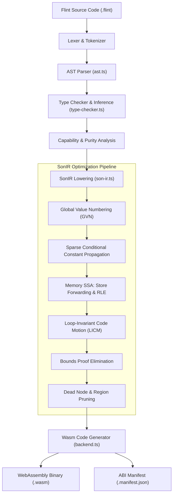
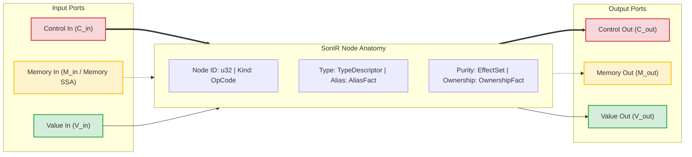
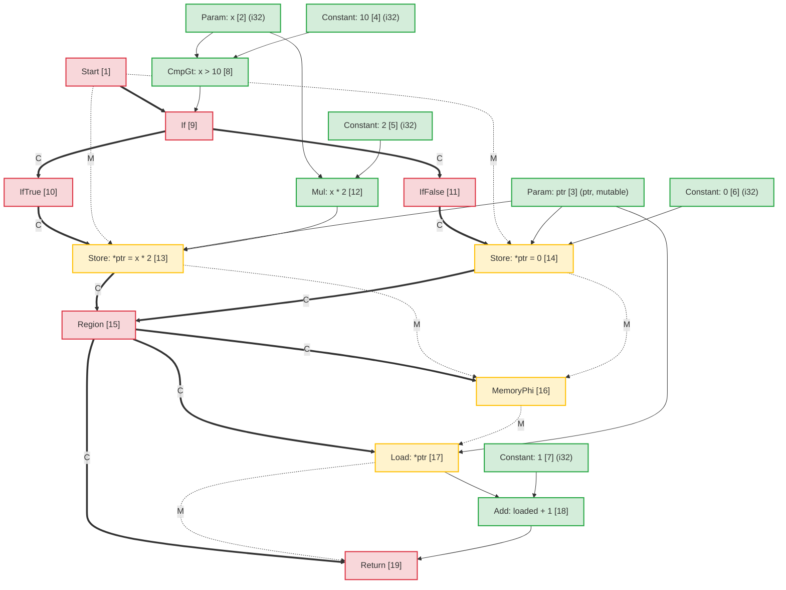
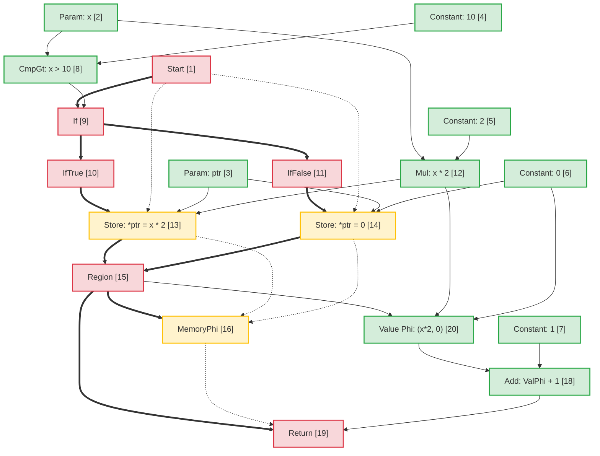
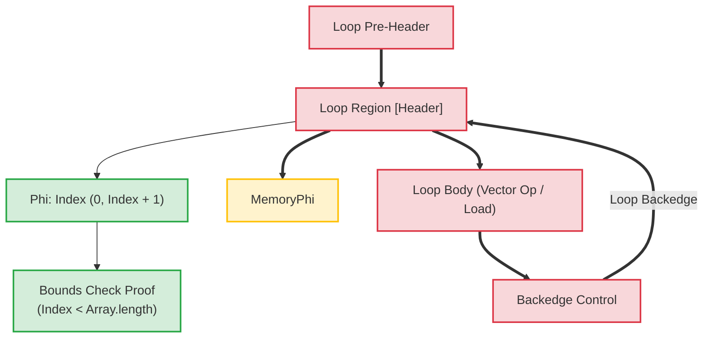

# Flint Compiler-architectuur: Sea-of-Nodes Intermediate Representation (SonIR)

Machineondersteunde vertaling van de canonieke Engelse bron. Handmatig nalezen indien nodig. Pakketnamen, opdrachten, paden en technische identificatoren blijven ongewijzigd.

> docs/architecture/compiler-pipelines.md: [docs/architecture/compiler-pipelines.md](../../../architecture/compiler-pipelines.md)
> Taal: Nederlands (nl)

Dit document biedt de architectonische specificatie voor de **Flint**-compilerpijplijn, waarbij de nadruk ligt op de tussenliggende kernrepresentatie: **SonIR** (Sea-of-Nodes IR).

SonIR past de Sea-of-Nodes-calculus van Cliff Click aan voor krachtige WebAssembly-compilatie. Door de controlestroom, pure datastroom en geheugenbijeffecten te verenigen in één enkele grafiek met expliciet getypte poorten, maakt SonIR agressieve optimalisatiepassages mogelijk, waaronder Global Value Numbering (GVN), Sparse Conditional Constant Propagation (SCCP), Memory SSA Redundant Load Elimination (RLE), Loop-Invariant Code Motion (LICM) en Compile-Time Bounds Proof Elimination.

---

## 1. Compilatiepijplijn op hoog niveau

De Flint-compilerpijplijn transformeert Flint-broncode op hoog niveau in geverifieerde, verzwakte WebAssembly:



---

## 2. SonIR-architectuurmodel: de drievoudige zee van knooppunten

In traditionele compilerarchitecturen wordt de besturingsstroom weergegeven als een besturingsstroomgrafiek (CFG) van basisblokken, terwijl de gegevensstroom binnen basisblokken wordt weergegeven via SSA-registers. Deze scheiding creëert synchronisatie-overhead tijdens optimalisatiepassages, zoals codebeweging of eliminatie van overtollige expressies.

SonIR elimineert fundamentele blokgrenzen. Functies worden weergegeven als een uniforme gerichte grafiek waarin knooppunten waarden berekenen of effecten uitvoeren, en randen afhankelijkheden vertegenwoordigen. Om de degelijkheid te behouden, scheidt elke node expliciet zijn invoer- en uitvoerranden over **drie verschillende poortcategorieën**:



### 2.1 De drie rand-/poortcategorieën

| Havencategorie |   Randnotatie | Semantiek en bestelgaranties | Representatieve knooppunten |
| :------------- | :----------------: | :-------------------------------------------------------------------------------------------------------------------------------------------------------------------------------------------------------------- | :------------------------------------------------------------- |
| **Controle** | Solid Vet (`==>`) | Regelt de sequentiële uitvoeringsvolgorde, voorwaardelijke vertakkingsbeslissingen, lusheaders en functiebeëindiging. Pure-waardeknooppunten hebben geen stuuringangen.                                                           | `Start`, `Region`, `If`, `IfTrue`, `IfFalse`, `Loop`, `Return` |
| **Geheugen-SSA** |  Gestreept (`-.->`) | Threads abstracte geheugenstatustokens die effectafhankelijkheden vertegenwoordigen. Zorgt ervoor dat laad-/opslagbewerkingen voldoen aan de beperkingen van lezen na schrijven en schrijven na schrijven, zonder het onafhankelijke geheugen te veel te beperken. | `MemoryPhi`, `Load`, `Store`, `HeapAlloc`, `Fence`, `Call` |
| **Waarde** | Solid Dun (`-->`) | Bevat pure waarden en rekenkundige resultaten. Vrij van beperkingen op het gebied van de controlestroom; knooppunten met pure waarde-invoer kunnen vrij rondzweven in de zee van knooppunten, alleen afhankelijk van gegevensafhankelijkheden.                             | `Constant`, `Add`, `Sub`, `Mul`, `Cmp`, `Phi`, `VectorAdd` |

---

## 3. Node Anatomie en TypeScript Weergave

Binnen `@mission-platform/flint` worden knooppunten weergegeven door de `FlintSoNNode`-interface en geserialiseerd in deterministische `.sonir.json`-moduleartefacten.

### 3.1 Node Interfacestructuur

```typescript
export interface FlintSoNNode {
  /** Unique sequential identifier within the compilation unit */
  readonly id: number;
  /** Operation classification (e.g., 'start', 'constant', 'load', 'store', 'region', 'if', 'return') */
  readonly kind: string;
  /** Enclosing function name */
  readonly functionName: string;
  /** Input node dependencies (in SonIR 2.0 partitioned into control, memory, and value inputs) */
  readonly inputs: readonly number[];
  /** Effect classifications: 'pure' | 'read' | 'write' | 'call' | 'control' | 'allocation' | 'unknown' */
  readonly effects: readonly FlintSoNEffect[];
  /** Alias analysis classification: 'none' | 'local' | 'borrowed' | 'mutable' | 'unknown' */
  readonly alias: FlintSoNAliasFact;
  /** Affine ownership classification: 'value' | 'borrowed' | 'owned' | 'shared' | 'unknown' */
  readonly ownership: FlintSoNOwnershipFact;
  /** Value type representation (e.g., 'i32', 'f64', 'bool', 'ptr', 'v128') */
  readonly type?: string;
  /** Literal constant payload */
  readonly value?: boolean | number | string;
  /** Callee name for call nodes */
  readonly callee?: string;
  /** Source span provenance for diagnostics and debugging */
  readonly span?: FlintSourceSpan;
}
```

### 3.2 Node-classificaties en poortroutering

```
┌─────────────────┬─────────────────────┬─────────────────────┬──────────────────────┐
│ Node OpCode     │ Incoming Ports      │ Outgoing Ports      │ Description          │
├─────────────────┼─────────────────────┼─────────────────────┼──────────────────────┤
│ Start           │ None                │ Control, Memory     │ Function entry point │
│ Constant        │ None                │ Value               │ Literal constant     │
│ Add / Sub / Mul │ Value, Value        │ Value               │ Pure arithmetic      │
│ If              │ Control, Value      │ Control (T/F proj)  │ Branch predicate     │
│ IfTrue / False  │ Control (from If)   │ Control             │ Branch projection    │
│ Region          │ Control, Control    │ Control             │ Control merge point  │
│ Phi             │ Region, Value, Val  │ Value               │ Value merge point    │
│ MemoryPhi       │ Region, Mem, Mem    │ Memory              │ Memory SSA merge     │
│ Load            │ Control, Mem, Ptr   │ Memory, Value       │ Heap / stack read    │
│ Store           │ Control, Mem, Ptr, V│ Memory              │ Heap / stack write   │
│ Return          │ Control, Mem, Value │ None                │ Function exit        │
└─────────────────┴─────────────────────┴─────────────────────┴──────────────────────┘
```

---

## 4. Aliasanalyse en geheugen-SSA

Geheugen SSA behandelt geheugen als een expliciet waardetoken. Een `Store` node verbruikt een geheugentoken $M_{in}$ en zendt een nieuw token $M_{out}$ uit. A `Load` node neemt een geheugentoken $M_{in}$ en adres $V_{ptr}$, zendt de geladen waarde $V_{out}$ uit en draagt ​​het geheugentoken mee naar voren.

### 4.1 Classificatie van aliasanalyse

Elke node die geheugenadressen draagt of manipuleert, wordt getagd met een aliasfeit:

- **`none`**: pure primitieve waarden (scalaren) of knooppunten zonder geheugenindirectie.
- **`local`**: geheugen toegewezen in het huidige activeringsframe of regio. Gegarandeerd niet te ontsnappen aan de lokale reikwijdte; onbereikbaar voor bellers.
- **`borrowed`**: een onveranderlijke verwijzing (`&T`) naar geheugen dat elders eigendom is. Kan niet worden gewijzigd via deze hendel; gelijktijdig lezen is veilig.
- **`mutable`**: een exclusieve veranderlijke referentie (`&mut T`). Garandeert dat dit geheugen tijdens zijn levensduur geen andere referentiealiassen krijgt.
- **`unknown`**: ontsnapte referenties, import van capaciteiten of dynamische heap-pointers met onbepaalde herkomst.

### 4.2 Disjuncte alias-ondubbelzinnigheid bij doorsturen van winkel naar lading

Wanneer twee pointers $P_1$ en $P_2$ aantoonbaar onsamenhangende aliasdomeinen hebben:
$$\text{AliasClass}(P_1) \cap \text{AliasClass}(P_2) = \emptyset$$

De optimalisatie bewijst dat een `Store` tot $P_2$ de inhoud van $P_1$ niet kan veranderen. Dit maakt het volgende mogelijk:

1. **Redundant Load Elimination (RLE)** tussen tussenliggende winkels en niet-aliased geheugen.
2. **Store-to-Load Forwarding**: Een `Load` die een `Store` volgt naar hetzelfde adres, hergebruikt direct de opgeslagen waarde-operand zonder op het geheugen te wachten.
3. **Eliminatie van dode winkels**: als twee winkels naar dezelfde `local`- of `mutable`-pointer schrijven zonder tussenliggende leesbewerkingen, wordt het eerste geheugen gesnoeid.

---

## 5. Voorbeeld van end-to-end-transformatie: voorwaardelijke geheugenmutatie

Om te illustreren hoe code op hoog niveau wordt toegewezen aan SonIR, wordt geoptimaliseerd en wordt verlaagd naar Wasm, kunt u deze Flint-functie overwegen:

```flint
fn compute(x: i32, ptr: &mut i32) -> i32 {
  if x > 10 {
    *ptr = x * 2;
  } else {
    *ptr = 0;
  }
  return *ptr + 1;
}
```

### 5.1 Initiële verlaagde SonIR-grafiek

In de niet-geoptimaliseerde grafiek voeren beide vestigingen onafhankelijke opslag uit naar `ptr`. Op het samenvoegpunt convergeert een `Region` node de besturing, en een `MemoryPhi` convergeert de geheugenstatus. De daaropvolgende `Load` leest uit `ptr` met behulp van het geconvergeerde geheugentoken:



### 5.2 Optimalisatiepassen en eliminatie van redundante belasting (RLE)

Tijdens de optimalisatiepijplijn:

1. **Geheugen-SSA-analyse**: de optimalisatie inspecteert `Load [17]`. De adresinvoer is `ptr [3]` en de geheugeninvoer is `MemoryPhi [16]`.
2. **Tracering van voorgangers**:
   - Op het binnenkomende pad `IfTrue` schreef `StoreThen [13]` `Mul [12]` (`x * 2`) naar `ptr [3]`.
   - Op het binnenkomende pad `IfFalse` schreef `StoreElse [14]` `Constant: 0 [6]` naar `ptr [3]`.
3. **Store-to-Load Forwarding**: Omdat `ptr` onvoorwaardelijk is geschreven op alle paden die `Region [15]` binnenkomen en `ptr` exclusieve `mutable`-aliasing heeft zonder tussenliggende schrijfbewerkingen:
   - Een pure **Waarde `Phi`** node wordt gesynthetiseerd op `Region [15]`:
     $$\text{Phi}[20] = \text{Phi}(\text{Regio}[15], \text{Mul}[12], \text{Constante}[6])$$
   - De uitvoer van `Load [17]` wordt vervangen door `Phi [20]`.
   - `Load [17]` heeft geen resterende gebruikerswaarde en het geheugentoken geeft `MemoryPhi [16]` eenvoudigweg door aan `Return [19]`. `Load [17]` wordt gesnoeid als dode code.

### 5.3 Geoptimaliseerde SonIR-grafiek



### 5.4 Uitgezonden WebAssembly-instructies

Omdat het lezen van het geheugen volledig werd geëlimineerd in SonIR, vermijdt de uitgezonden WebAssembly een dure `i32.load`-instructie:

```wat
(func $compute (param $x i32) (param $ptr i32) (result i32)
  (local $val i32)
  local.get $x
  i32.const 10
  i32.gt_s
  if
    local.get $x
    i32.const 1
    i32.shl           ;; x * 2 optimized to shift
    local.tee $val
    local.get $ptr
    i32.store         ;; *ptr = x * 2
  else
    i32.const 0
    local.tee $val
    local.get $ptr
    i32.store         ;; *ptr = 0
  end
  local.get $val      ;; Reuses register value directly from Phi
  i32.const 1
  i32.add             ;; val + 1 without reading memory
  return
)
```

---

## 6. Lustransformaties en bewijzen van compilatietijdgrenzen

In array/vectorlussen modelleert SonIR lusheaders met `Loop`-controlegebieden en bijbehorende `Phi`- en `MemoryPhi`-knooppunten.



### Optimalisatiehoogtepunten in loops:

1. **Loop-Invariant Code Motion (LICM)**: knooppunten waarvan de waarde- en geheugeninvoer volledig buiten de `Loop`-regio afkomstig is, worden uit de lusbody naar de pre-header geleid.
2. **Bounds Proof Elimination**: De compiler construeert inductieve bereikintervallen voor lusindices ($0 \le i < N$). Als $N \le \text{length}$, zijn grenscontroles veilig gebleken tijdens het compileren en geëlimineerd, waardoor runtime branch-instructies uit interne lussen worden geëlimineerd.
3. **SIMD-vectorisatie**: lineaire sequentiële array-lussen die overeenkomen met het patroon worden rechtstreeks verlaagd naar 128-bit SIMD-knooppunten (`v128.load`, `i32x4.add`), waarbij 4 elementen per klokcyclus worden verwerkt.

---

## 7. Artefactschema en tooling-integratie

Elke gecompileerde Flint-module zendt zijn geverifieerde SonIR-grafiek uit naast Wasm-binaire bestanden:

- Artefactpadconventie: `<target>.sonir.json`
- Tools zoals `mcp_mission-platform_flint_inspect_sonir` en `mcp_mission-platform_flint_verify_artifact` inspecteren dit artefact om grenscontroles, grafiekhashes en naleving van mogelijkheden te verifiëren voordat het in sandboxes wordt geïmplementeerd.
