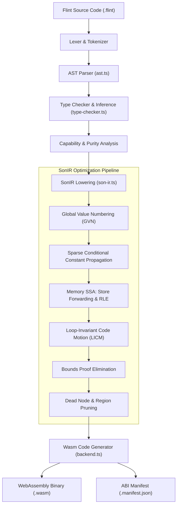
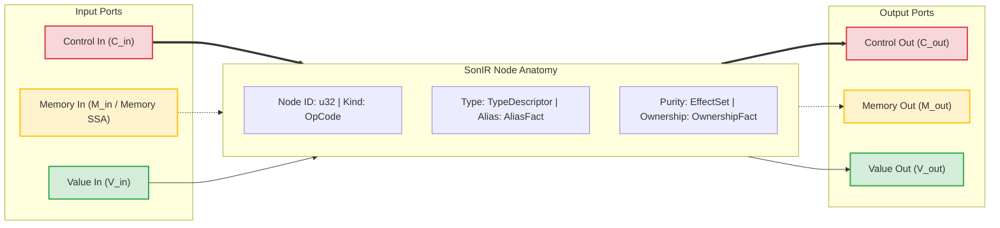
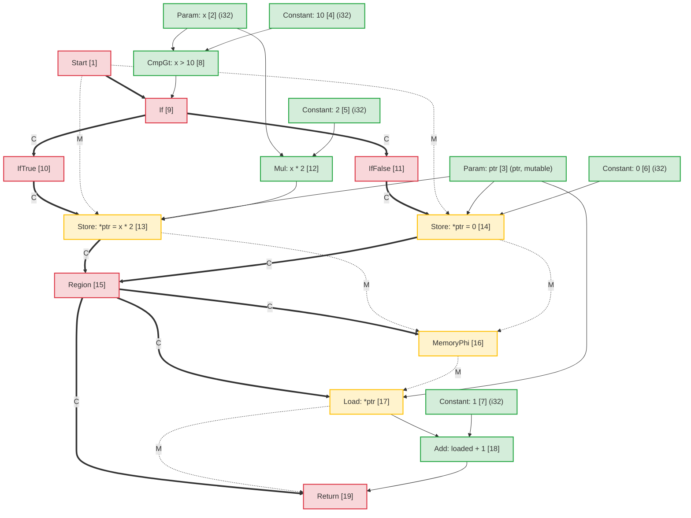
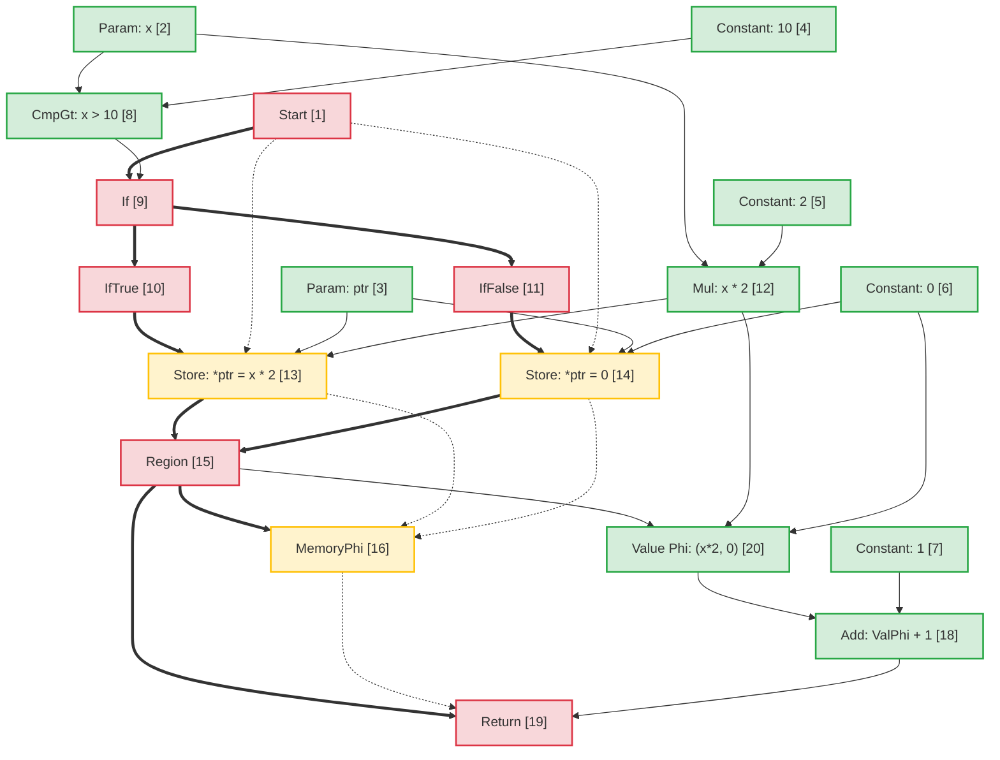
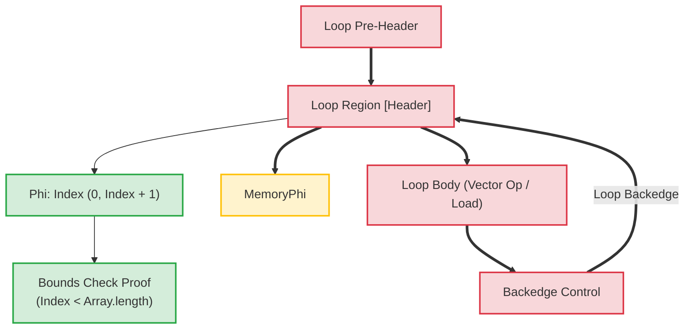

# Flint 编译器架构：节点海中间表示 (SonIR)

由规范英文源进行的机器辅助翻译。必要时请人工审校。包名、命令、路径与技术标识符保持不变。

> docs/architecture/compiler-pipelines.md: [docs/architecture/compiler-pipelines.md](../../../architecture/compiler-pipelines.md)
> 语言: 简体中文 (zh)

本文档提供 **Flint** 编译器管道的架构规范，重点关注其核心中间表示：**SonIR**（Sea-of-Nodes IR）。

SonIR 将 Cliff Click 的 Sea-of-Nodes 演算应用于高性能 WebAssembly 编译。通过将控制流、纯数据流和内存副作用统一到具有显式类型化端口的单个图形中，SonIR 实现了积极的优化过程，包括全局值编号 (GVN)、稀疏条件常量传播 (SCCP)、内存 SSA 冗余负载消除 (RLE)、循环不变代码运动 (LICM) 和编译时间界限证明消除。

---

## 1. 高级编译管道

Flint 编译器管道将高级 Flint 源代码转换为经过验证的、功能减弱的 WebAssembly：



---

## 2. SonIR 架构模型：三端口节点海

在传统的编译器架构中，控制流被表示为基本块的控制流图（CFG），而数据流通过SSA寄存器在基本块内表示。这种分离会在优化过程中产生同步开销，例如代码移动或冗余表达式消除。

SonIR 消除了基本的块边界。函数表示为统一的有向图，其中节点计算值或执行效果，边表示依赖关系。为了保持健全性，每个 node 都在**三个不同的端口类别**中明确隔离其输入和输出边缘：



### 2.1 三种边缘/端口类别

|港口类别 |   边缘符号|语义和订购保证|代表节点|
| :------------- | :----------------: | :-------------------------------------------------------------------------------------------------------------------------------------------------------------------------------------------------------------- | :------------------------------------------------------------- |
| **控制** | Solid 粗体 (`==>`) |控制顺序执行顺序、条件分支决策、循环头和函数终止。纯值节点没有控制输入。                                                           | `Start`、`Region`、`If`、`IfTrue`、`IfFalse`、`Loop`、`Return` |
| **内存SSA** |  虚线 (`-.->`) |线程抽象表示效果依赖性的内存状态标记。确保加载/存储操作遵守先写后读和先写后写约束，而不会过度限制独立内存。 | `MemoryPhi`、`Load`、`Store`、`HeapAlloc`、`Fence`、`Call` |
| **价值** | Solid 薄 (`-->`) |携带纯值和算术结果。不受控制流限制；具有纯值输入的节点可以在节点的海洋中自由漂浮，仅受数据依赖性的影响。                             | `Constant`、`Add`、`Sub`、`Mul`、`Cmp`、`Phi`、`VectorAdd` |

---

## 3. Node 剖析和 TypeScript 表示

在 `@mission-platform/flint` 内，节点由 `FlintSoNNode` 接口表示，并序列化为确定性 `.sonir.json` 模块工件。

### 3.1 Node 接口结构

```typescript
export interface FlintSoNNode {
  /** Unique sequential identifier within the compilation unit */
  readonly id: number;
  /** Operation classification (e.g., 'start', 'constant', 'load', 'store', 'region', 'if', 'return') */
  readonly kind: string;
  /** Enclosing function name */
  readonly functionName: string;
  /** Input node dependencies (in SonIR 2.0 partitioned into control, memory, and value inputs) */
  readonly inputs: readonly number[];
  /** Effect classifications: 'pure' | 'read' | 'write' | 'call' | 'control' | 'allocation' | 'unknown' */
  readonly effects: readonly FlintSoNEffect[];
  /** Alias analysis classification: 'none' | 'local' | 'borrowed' | 'mutable' | 'unknown' */
  readonly alias: FlintSoNAliasFact;
  /** Affine ownership classification: 'value' | 'borrowed' | 'owned' | 'shared' | 'unknown' */
  readonly ownership: FlintSoNOwnershipFact;
  /** Value type representation (e.g., 'i32', 'f64', 'bool', 'ptr', 'v128') */
  readonly type?: string;
  /** Literal constant payload */
  readonly value?: boolean | number | string;
  /** Callee name for call nodes */
  readonly callee?: string;
  /** Source span provenance for diagnostics and debugging */
  readonly span?: FlintSourceSpan;
}
```

### 3.2 Node 分类和端口路由

```
┌─────────────────┬─────────────────────┬─────────────────────┬──────────────────────┐
│ Node OpCode     │ Incoming Ports      │ Outgoing Ports      │ Description          │
├─────────────────┼─────────────────────┼─────────────────────┼──────────────────────┤
│ Start           │ None                │ Control, Memory     │ Function entry point │
│ Constant        │ None                │ Value               │ Literal constant     │
│ Add / Sub / Mul │ Value, Value        │ Value               │ Pure arithmetic      │
│ If              │ Control, Value      │ Control (T/F proj)  │ Branch predicate     │
│ IfTrue / False  │ Control (from If)   │ Control             │ Branch projection    │
│ Region          │ Control, Control    │ Control             │ Control merge point  │
│ Phi             │ Region, Value, Val  │ Value               │ Value merge point    │
│ MemoryPhi       │ Region, Mem, Mem    │ Memory              │ Memory SSA merge     │
│ Load            │ Control, Mem, Ptr   │ Memory, Value       │ Heap / stack read    │
│ Store           │ Control, Mem, Ptr, V│ Memory              │ Heap / stack write   │
│ Return          │ Control, Mem, Value │ None                │ Function exit        │
└─────────────────┴─────────────────────┴─────────────────────┴──────────────────────┘
```

---

## 4. 别名分析和内存 SSA

内存 SSA 将内存视为显式值令牌。 `Store` node 消耗内存令牌 $M_{in}$ 并发出新令牌 $M_{out}$。 `Load` node 采用内存令牌 $M_{in}$ 和地址 $V_{ptr}$，发出加载的值 $V_{out}$ 并向前传送内存令牌。

### 4.1 别名分析分类

每个携带或操作内存地址的 node 都标有别名事实：

- **`none`**：纯原始值（标量）或没有内存间接寻址的节点。
- **`local`**：在当前激活帧或区域中分配的内存。保证不脱离本地范围；呼叫者无法访问。
- **`borrowed`**：对其他地方拥有的内存的不可变引用 (`&T`)。无法通过该句柄修改；并发读取是安全的。
- **`mutable`**：独占可变引用 (`&mut T`)。保证在该内存的生命周期内没有其他引用别名。
- **`unknown`**：转义引用、功能导入或来源不确定的动态堆指针。

### 4.2 存储到加载转发中的不相交别名消歧

当两个指针 $P_1$ 和 $P_2$ 具有可证明不相交的别名域时：
$$\text{AliasClass}(P_1) \cap \text{AliasClass}(P_2) = \emptyset$$

优化器证明 `Store` 到 $P_2$ 不能更改 $P_1$ 的内容。这允许：

1. **冗余负载消除 (RLE)** 跨干预存储到非别名内存。
2. **存储到加载转发**：`Load` 跟随 `Store` 到同一地址，直接重用存储的值操作数，无需等待内存。
3. **死存储消除**：如果两个存储写入相同的 `local` 或 `mutable` 指针而没有干预读取，则第一个存储将被修剪。

---

## 5. 端到端转换示例：条件内存突变

为了说明高级代码如何映射到 SonIR、经过优化并降低到 Wasm，请考虑以下 Flint 函数：

```flint
fn compute(x: i32, ptr: &mut i32) -> i32 {
  if x > 10 {
    *ptr = x * 2;
  } else {
    *ptr = 0;
  }
  return *ptr + 1;
}
```

### 5.1 初始降低的 SonIR 图

在未优化的图中，两个分支都对 `ptr` 执行独立存储。在合并点，`Region` node 收敛控制，`MemoryPhi` 收敛存储器状态。随后的 `Load` 使用聚合内存令牌从 `ptr` 读取：



### 5.2 优化过程和冗余负载消除 (RLE)

在优化管道期间：

1. **内存 SSA 分析**：优化器检查 `Load [17]`。其地址输入为 `ptr [3]`，其存储器输入为 `MemoryPhi [16]`。
2. **前身追踪**：
   - 在 `IfTrue` 传入路径上，`StoreThen [13]` 将 `Mul [12]` (`x * 2`) 写入 `ptr [3]`。
   - 在 `IfFalse` 传入路径上，`StoreElse [14]` 将 `Constant: 0 [6]` 写入 `ptr [3]`。
3. **存储到加载转发**：因为 `ptr` 是在进入 `Region [15]` 的所有路径上无条件写入的，并且 `ptr` 具有独占的 `mutable` 别名，没有中间写入：
   - 纯 **值 `Phi`** node 在 `Region [15]` 处合成：
     $$\text{Phi}[20] = \text{Phi}(\text{区域}[15], \text{Mul}[12], \text{常数}[6])$$
   - `Load [17]` 的输出替换为 `Phi [20]`。
   - `Load [17]` 没有剩余价值用户，其内存令牌只是将 `MemoryPhi [16]` 传递到 `Return [19]`。 `Load [17]` 被修剪为死代码。

### 5.3 优化的 SonIR 图



### 5.4 发出的 WebAssembly 指令

由于 SonIR 中完全消除了内存读取，因此发出的 WebAssembly 避免了昂贵的 `i32.load` 指令：

```wat
(func $compute (param $x i32) (param $ptr i32) (result i32)
  (local $val i32)
  local.get $x
  i32.const 10
  i32.gt_s
  if
    local.get $x
    i32.const 1
    i32.shl           ;; x * 2 optimized to shift
    local.tee $val
    local.get $ptr
    i32.store         ;; *ptr = x * 2
  else
    i32.const 0
    local.tee $val
    local.get $ptr
    i32.store         ;; *ptr = 0
  end
  local.get $val      ;; Reuses register value directly from Phi
  i32.const 1
  i32.add             ;; val + 1 without reading memory
  return
)
```

---

## 6. 循环转换和编译时界限证明

在数组/矢量循环中，SonIR 使用 `Loop` 控制区域以及相应的 `Phi` 和 `MemoryPhi` 节点对循环头进行建模。



### 循环中的优化亮点：

1. **循环不变代码运动 (LICM)**：其值和内存输入完全源自 `Loop` 区域之外的节点将从循环体浮出到预标头中。
2. **边界证明消除**：编译器为循环索引构造归纳范围区间 ($0 \le i < N$)。如果 $N \le \text{length}$，则边界检查在编译时被证明是安全的并被消除，从而消除了内部循环中的运行时分支指令。
3. **SIMD 矢量化**：匹配模式的线性顺序数组循环直接降低到 128 位 SIMD 节点（`v128.load`、`i32x4.add`），每个时钟周期处理 4 个元素。

---

## 7. 工件架构和工具集成

每个编译的 Flint 模块都会发出经过验证的 SonIR 图以及 Wasm 二进制文件：

- 工件路径约定：`<target>.sonir.json`
- `mcp_mission-platform_flint_inspect_sonir` 和 `mcp_mission-platform_flint_verify_artifact` 等工具会检查此工件，以在部署到沙箱之前验证边界检查、图形哈希和功能合规性。
